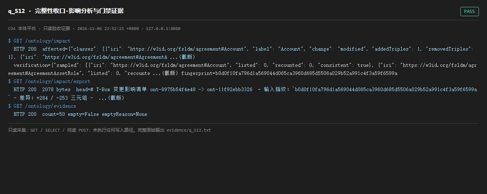

# q_S12 · 完整性收口·影响分析与门禁证据

| 项 | 内容 |
| --- | --- |
| 用例编号 | `q_S12` |
| 特性名称 | 完整性收口·影响分析与门禁证据 |
| 分组 | A 核心工作流 S0-S14 |
| 文档依据 | 10-实施路线图.md S12；52 §4.1 O-03/O-04 |
| 采集时间 | 2026-11-06 23:52:21 +0800 |
| 结论 | **PASS** |
| 证据截图 |  |
| 完整原始输出 | `evidence/q_S12.txt` |

## 1 测试目标

验证变更影响分析带输入指纹、可导出，且发布门禁证据包可枚举。

## 2 输入

- `GET /ontology/impact`
- `GET /ontology/impact/export`
- `GET /ontology/evidence`

> 零污染约束：以上输入均为 HTTP GET、只读 SQL `SELECT`、只读 SPARQL `SELECT`，以及一个已确认不写库的纯读 `POST /context/resolve`。未调用 `/answer`（会写 PROV 拒答事件）、未运行 smoke/acceptance、未触发任何 seed / refresh / import / materialize / approve / publish / reindex / rollback 写路径。

## 3 期待输出

impact 返回 affected/aggregations/verification/inputsFingerprint；export 为文本；evidence 返回 items 且每个含 verdict/hash。

## 4 真实输出

```
$ GET /ontology/impact
  HTTP 200  affected={"classes": [{"iri": "https://w3id.org/fsldm/agreement#Account", "label": "Account", "change": "modified", "addedTriples": 1, "removedTriples": 1}, {"iri": "https://w3id.org/fsldm/agreement#AgreementA ...(截断)
  verification={"sampled": [{"iri": "https://w3id.org/fsldm/agreement#Account", "listed": 0, "recounted": 0, "consistent": true}, {"iri": "https://w3id.org/fsldm/agreement#AgreementAssetRole", "listed": 0, "recounte ...(截断) fingerprint=b0d0f10fa796d1a569044d065ca3960d685d5506a029b52a991c4f3a59f6599a
$ GET /ontology/impact/export
  HTTP 200  2078 bytes  head=# T-Box 变更影响清单 ont-8975b54f4e48 -> ont-11f92ebb3326  - 输入指纹：`b0d0f10fa796d1a569044d065ca3960d685d5506a029b52a991c4f3a59f6599a` - 差异：+284 / -253 三元组 -  ...(截断)
$ GET /ontology/evidence
  HTTP 200  count=50 empty=False emptyReason=None
```

> 为控制篇幅，上面是结构化摘要；完整原始响应见 `evidence/q_S12.txt`，终端渲染截图见 `screenshots/q_S12.png`。

## 5 结论

**PASS** — 影响分析、导出、证据包三端点齐全且返回结构化字段。

O-04 的「每次发布生成证据包」需要写路径才能产生新记录，本轮只读验证只确认枚举与结构。

---
[返回总报告](README.md)
