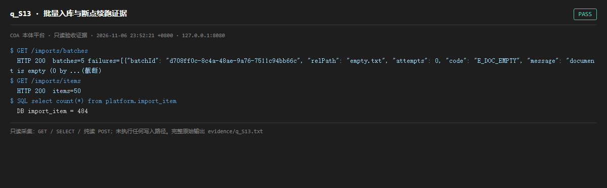

# q_S13 · 批量入库与断点续跑证据

| 项 | 内容 |
| --- | --- |
| 用例编号 | `q_S13` |
| 特性名称 | 批量入库与断点续跑证据 |
| 分组 | A 核心工作流 S0-S14 |
| 文档依据 | 10-实施路线图.md S13；_impl/WORKLOG |
| 采集时间 | 2026-11-06 23:52:21 +0800 |
| 结论 | **PASS** |
| 证据截图 |  |
| 完整原始输出 | `evidence/q_S13.txt` |

## 1 测试目标

验证批量导入的批次、条目、失败隔离与进度信息可在只读端点查到。

## 2 输入

- `GET /imports/batches`
- `GET /imports/items`
- `SQL: SELECT count(*) FROM platform.import_item`

> 零污染约束：以上输入均为 HTTP GET、只读 SQL `SELECT`、只读 SPARQL `SELECT`，以及一个已确认不写库的纯读 `POST /context/resolve`。未调用 `/answer`（会写 PROV 拒答事件）、未运行 smoke/acceptance、未触发任何 seed / refresh / import / materialize / approve / publish / reindex / rollback 写路径。

## 3 期待输出

batches 含批次与 failures；items 非空；与 import_item 表计数一致。

## 4 真实输出

```
$ GET /imports/batches
  HTTP 200  batches=5 failures=[{"batchId": "d708ff0c-8c4a-48ae-9a76-7511c94bb66c", "relPath": "empty.txt", "attempts": 0, "code": "E_DOC_EMPTY", "message": "document is empty (0 by ...(截断)
$ GET /imports/items
  HTTP 200  items=50
$ SQL select count(*) from platform.import_item
  DB import_item = 484
```

> 为控制篇幅，上面是结构化摘要；完整原始响应见 `evidence/q_S13.txt`，终端渲染截图见 `screenshots/q_S13.png`。

## 5 结论

**PASS** — 批次、条目、失败列表均可读，条目数与库一致。

S13 的吞吐/断点续跑属写路径行为，本轮不触发导入。

---
[返回总报告](README.md)
