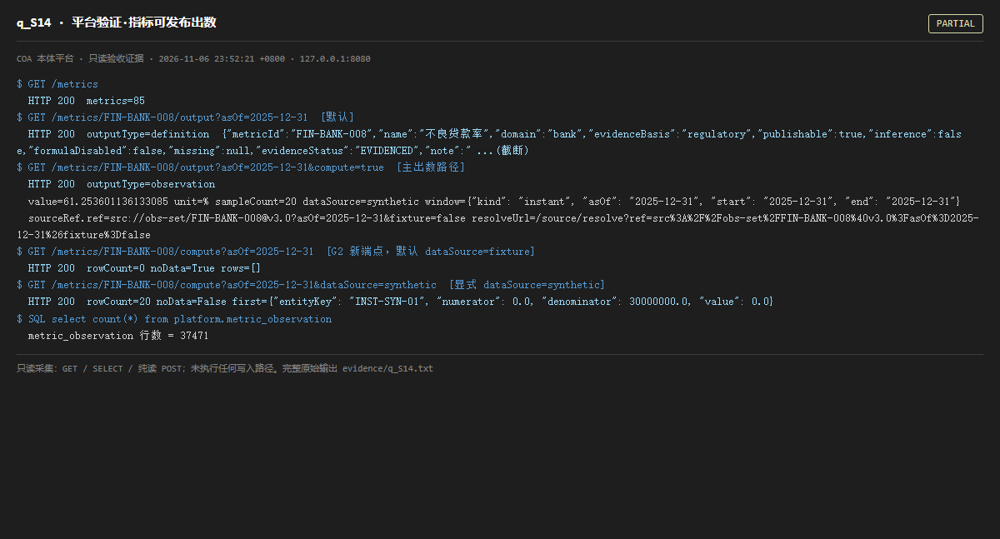

# q_S14 · 平台验证·指标可发布出数

| 项 | 内容 |
| --- | --- |
| 用例编号 | `q_S14` |
| 特性名称 | 平台验证·指标可发布出数 |
| 分组 | A 核心工作流 S0-S14 |
| 文档依据 | 10-实施路线图.md S14；52 §0；58 M-01 |
| 采集时间 | 2026-11-06 23:52:21 +0800 |
| 结论 | **PARTIAL** |
| 证据截图 |  |
| 完整原始输出 | `evidence/q_S14.txt` |

## 1 测试目标

验证「可发布出数」是否真的成立：分别检查老的 /output?compute=true 主出数路径与 G2 新增的 /compute 路径，以及观测表是否有数据。

## 2 输入

- `GET /metrics`
- `GET /metrics/FIN-BANK-008/output?asOf=2025-12-31（默认只回定义卡）`
- `GET /metrics/FIN-BANK-008/output?asOf=2025-12-31&compute=true（可发布出数主路径）`
- `GET /metrics/FIN-BANK-008/compute?asOf=2025-12-31（G2 新端点，默认 dataSource）`
- `GET /metrics/FIN-BANK-008/compute?asOf=2025-12-31&dataSource=synthetic`
- `SQL: SELECT count(*) FROM platform.metric_observation`

> 零污染约束：以上输入均为 HTTP GET、只读 SQL `SELECT`、只读 SPARQL `SELECT`，以及一个已确认不写库的纯读 `POST /context/resolve`。未调用 `/answer`（会写 PROV 拒答事件）、未运行 smoke/acceptance、未触发任何 seed / refresh / import / materialize / approve / publish / reindex / rollback 写路径。

## 3 期待输出

按 S14 判据，应能对外给出一个数值、口径版本、窗口、样本数与可解析的 sourceRef；且 /compute 默认调用不应全部 noData=true。

## 4 真实输出

```
$ GET /metrics
  HTTP 200  metrics=85
$ GET /metrics/FIN-BANK-008/output?asOf=2025-12-31  [默认]
  HTTP 200  outputType=definition  {"metricId":"FIN-BANK-008","name":"不良贷款率","domain":"bank","evidenceBasis":"regulatory","publishable":true,"inference":false,"formulaDisabled":false,"missing":null,"evidenceStatus":"EVIDENCED","note":" ...(截断)
$ GET /metrics/FIN-BANK-008/output?asOf=2025-12-31&compute=true  [主出数路径]
  HTTP 200  outputType=observation
  value=61.253601136133085 unit=% sampleCount=20 dataSource=synthetic window={"kind": "instant", "asOf": "2025-12-31", "start": "2025-12-31", "end": "2025-12-31"}
  sourceRef.ref=src://obs-set/FIN-BANK-008@v3.0?asOf=2025-12-31&fixture=false resolveUrl=/source/resolve?ref=src%3A%2F%2Fobs-set%2FFIN-BANK-008%40v3.0%3FasOf%3D2025-12-31%26fixture%3Dfalse
$ GET /metrics/FIN-BANK-008/compute?asOf=2025-12-31  [G2 新端点，默认 dataSource=fixture]
  HTTP 200  rowCount=0 noData=True rows=[]
$ GET /metrics/FIN-BANK-008/compute?asOf=2025-12-31&dataSource=synthetic  [显式 dataSource=synthetic]
  HTTP 200  rowCount=20 noData=False first={"entityKey": "INST-SYN-01", "numerator": 0.0, "denominator": 30000000.0, "value": 0.0}
$ SQL select count(*) from platform.metric_observation
  metric_observation 行数 = 37471
```

> 为控制篇幅，上面是结构化摘要；完整原始响应见 `evidence/q_S14.txt`，终端渲染截图见 `screenshots/q_S14.png`。

## 5 结论

**PARTIAL** — 老的 /output?compute=true 主路径确实能出数：返回 value、unit、口径版本、窗口、sampleCount、dataSource=synthetic 与可解析的 sourceRef；观测表在审计期间被并行开发线回填，不再是空表。但 G2 新增的 /compute 端点默认 dataSource=fixture，默认调用仍 rows=[] / noData=true，必须显式传 dataSource=synthetic 才出数。同一指标存在两条出数路径且默认参数互不兼容。

审计过程本身提供了关键证据：首次基线时 metric_observation 为 0 行、/output 只能回定义卡；并行开发线回填观测后，同一端点即返回完整数值与 sourceRef。也就是说「能否出数」高度依赖 seed/回填是否跑过，而不是定义或公式是否完备。根因在 metric_compiler.py 的 CTE 固定追加 where data_source = %s、默认 'fixture'，而事实表与观测表都是 'synthetic'；单测自插 fixture 固定行自算自验，故单测全绿、运行态默认不可用。对外叙述「可发布出数」时必须同时说明数据回填前置条件与两条路径的参数差异。

---
[返回总报告](README.md)
