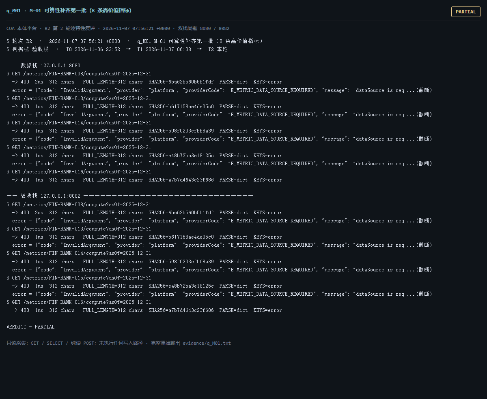

# q_M01 · M-01 可算性补齐第一批（8 条高价值指标）

| 项 | 内容 |
| --- | --- |
| 用例编号 | `q_M01` |
| 特性名称 | M-01 可算性补齐第一批（8 条高价值指标） |
| 分组 | C 本轮特性 M 口径与指标 |
| 文档依据 | 58-M01-M06-指标可算性补齐与规则核对.md §1/§4；52 §4.2 M-01 |
| **评估轮次** | **R2（第 2 轮复评）** |
| **本轮采集时间 T2** | **2026-11-07 07:56:21 +0800** |
| **判据栈** | 验收栈 |
| 结论（T2） | **PARTIAL** |
| 证据截图 |  |
| 完整原始输出 | `evidence/q_M01.txt` |

## 0 时间区分（本轮新增）

> 同一特性在不同时间点、不同栈上的状态不同，结论必须带坐标。T0/T1 的旧产物完整保存在
> `_history/2026-11-06_2352/`，独立复核见 `../_evidence-audit/qa_verdict_recheck.md`。

| 轮次 | 时间 | 栈 / 代码基线 | 结论 | 说明 |
| --- | --- | --- | --- | --- |
| **T0 原始采集** | 2026-11-06 23:52 +08 | 数据栈 8080 · 旧镜像 | FAIL | R1 采集器，存在 200KB 静默截断与写死结论 |
| **T1 独立复核 / 修复基线** | 2026-11-07 05:45–06:08 +08 | 验收栈 8082 · `8b3f36f` | FAIL | 复核定性：一致 |
| **T2 本轮复评** | 2026-11-07 07:56:21 +0800 | 数据栈 8080 + 验收栈 8082 双栈同题 | **PARTIAL** | 采集器已修截断、verdict 由证据动态推导 |

栈说明：
- **数据栈 8080**：镜像 `715d59e8`（11-07 00:53 +08 构建），全量数据，用于验证「数据内容 / 规模」类判据。注意 T0(11-06 23:52) 时 8080 跑的是更早的镜像，容器在 00:53 被重建过，**同一端口跨时间也不是同一个基线**。
- **验收栈 8082**：镜像 `80cb274f` / `agent-platform:0.1-s5`（11-07 05:45 +08 构建），代码等价 `8b3f36f`，验收残留小库，用于验证「代码行为 / 契约」类判据。
- 验收栈 A-Box 为空导致的 `404 / 0` 不判为功能缺陷；两栈版本不同属独立数据库，不计为漂移。

## 1 测试目标

逐条验证 58 号列出的 8 条指标 /compute 是否「返回非空且可复算」，并检查不可算时的错误码。

## 2 输入

- `GET /metrics/{8 条}/compute?asOf=2025-12-31（默认）`
- `GET /metrics/FIN-BANK-008/compute?asOf=2025-12-31&dataSource=synthetic`
- `GET /metrics/FIN-BANK-001/compute?asOf=2025-12-31（预期缺绑定）`
- `SQL: 事实表 data_source 分布`

> 零污染约束：仅 HTTP GET、只读 SQL `SELECT`、只读 SPARQL `SELECT`、一个已确认不写库的纯读
> `POST /context/resolve`。未调用 `/answer`（会写 PROV 拒答事件），未运行 smoke/acceptance，
> 未触发 seed / refresh / import / materialize / approve / publish / reindex / rollback。
> 验收栈 SPARQL 因 A-Box 为空显式标注 `SKIP`，不做无意义的图查询。

## 3 期待输出

按 58 号验收判据：≥6 条返回非空且可复算；其余给 E_METRIC_NOT_COMPUTABLE 与原因，不返回 0 或空结果冒充可算。

## 4 真实输出（T2 · 双栈同题）

### 4.1 数据栈 127.0.0.1:8080（全量数据 / 旧代码）

```
$ GET /metrics/FIN-BANK-008/compute?asOf=2025-12-31
  -> 400  2ms  312 chars | FULL_LENGTH=312 chars  SHA256=6ba62b560b5b1fdf  PARSE=dict  KEYS=error
  error = {"code": "InvalidArgument", "provider": "platform", "providerCode": "E_METRIC_DATA_SOURCE_REQUIRED", "message": "dataSource is req ...(截断)
$ GET /metrics/FIN-BANK-013/compute?asOf=2025-12-31
  -> 400  1ms  312 chars | FULL_LENGTH=312 chars  SHA256=b617158ae4de05c0  PARSE=dict  KEYS=error
  error = {"code": "InvalidArgument", "provider": "platform", "providerCode": "E_METRIC_DATA_SOURCE_REQUIRED", "message": "dataSource is req ...(截断)
$ GET /metrics/FIN-BANK-014/compute?asOf=2025-12-31
  -> 400  1ms  312 chars | FULL_LENGTH=312 chars  SHA256=598f0233efbf8a39  PARSE=dict  KEYS=error
  error = {"code": "InvalidArgument", "provider": "platform", "providerCode": "E_METRIC_DATA_SOURCE_REQUIRED", "message": "dataSource is req ...(截断)
$ GET /metrics/FIN-BANK-015/compute?asOf=2025-12-31
  -> 400  1ms  312 chars | FULL_LENGTH=312 chars  SHA256=e48b72ba3e18125c  PARSE=dict  KEYS=error
  error = {"code": "InvalidArgument", "provider": "platform", "providerCode": "E_METRIC_DATA_SOURCE_REQUIRED", "message": "dataSource is req ...(截断)
$ GET /metrics/FIN-BANK-016/compute?asOf=2025-12-31
  -> 400  1ms  312 chars | FULL_LENGTH=312 chars  SHA256=a7b7d4643c23f686  PARSE=dict  KEYS=error
  error = {"code": "InvalidArgument", "provider": "platform", "providerCode": "E_METRIC_DATA_SOURCE_REQUIRED", "message": "dataSource is req ...(截断)
$ GET /metrics/FIN-BANK-026/compute?asOf=2025-12-31
  -> 400  1ms  312 chars | FULL_LENGTH=312 chars  SHA256=264f13d368efbf94  PARSE=dict  KEYS=error
  error = {"code": "InvalidArgument", "provider": "platform", "providerCode": "E_METRIC_DATA_SOURCE_REQUIRED", "message": "dataSource is req ...(截断)
$ GET /metrics/FIN-INS-002/compute?asOf=2025-12-31
  -> 400  1ms  311 chars | FULL_LENGTH=311 chars  SHA256=216323bd4c72b5ff  PARSE=dict  KEYS=error
  error = {"code": "InvalidArgument", "provider": "platform", "providerCode": "E_METRIC_DATA_SOURCE_REQUIRED", "message": "dataSource is req ...(截断)
$ GET /metrics/FIN-INS-018/compute?asOf=2025-12-31
  -> 400  1ms  311 chars | FULL_LENGTH=311 chars  SHA256=3a87728aa6c726c6  PARSE=dict  KEYS=error
  error = {"code": "InvalidArgument", "provider": "platform", "providerCode": "E_METRIC_DATA_SOURCE_REQUIRED", "message": "dataSource is req ...(截断)
$ GET /metrics/FIN-BANK-008/compute?asOf=2025-12-31&dataSource=synthetic
  -> 200  8ms  2911 chars | FULL_LENGTH=2911 chars  SHA256=0e60fe19e0ee56ee  PARSE=dict  KEYS=metricId,definitionVersion,windowKind,window,dataSource,rows,noData,rowCount,computedAt,computationRef  rows=20  rowCount=20  noData=false
```

### 4.2 验收栈 127.0.0.1:8082（新代码 8b3f36f / 小库）

```
$ GET /metrics/FIN-BANK-008/compute?asOf=2025-12-31
  -> 400  2ms  312 chars | FULL_LENGTH=312 chars  SHA256=6ba62b560b5b1fdf  PARSE=dict  KEYS=error
  error = {"code": "InvalidArgument", "provider": "platform", "providerCode": "E_METRIC_DATA_SOURCE_REQUIRED", "message": "dataSource is req ...(截断)
$ GET /metrics/FIN-BANK-013/compute?asOf=2025-12-31
  -> 400  1ms  312 chars | FULL_LENGTH=312 chars  SHA256=b617158ae4de05c0  PARSE=dict  KEYS=error
  error = {"code": "InvalidArgument", "provider": "platform", "providerCode": "E_METRIC_DATA_SOURCE_REQUIRED", "message": "dataSource is req ...(截断)
$ GET /metrics/FIN-BANK-014/compute?asOf=2025-12-31
  -> 400  1ms  312 chars | FULL_LENGTH=312 chars  SHA256=598f0233efbf8a39  PARSE=dict  KEYS=error
  error = {"code": "InvalidArgument", "provider": "platform", "providerCode": "E_METRIC_DATA_SOURCE_REQUIRED", "message": "dataSource is req ...(截断)
$ GET /metrics/FIN-BANK-015/compute?asOf=2025-12-31
  -> 400  1ms  312 chars | FULL_LENGTH=312 chars  SHA256=e48b72ba3e18125c  PARSE=dict  KEYS=error
  error = {"code": "InvalidArgument", "provider": "platform", "providerCode": "E_METRIC_DATA_SOURCE_REQUIRED", "message": "dataSource is req ...(截断)
$ GET /metrics/FIN-BANK-016/compute?asOf=2025-12-31
  -> 400  1ms  312 chars | FULL_LENGTH=312 chars  SHA256=a7b7d4643c23f686  PARSE=dict  KEYS=error
  error = {"code": "InvalidArgument", "provider": "platform", "providerCode": "E_METRIC_DATA_SOURCE_REQUIRED", "message": "dataSource is req ...(截断)
$ GET /metrics/FIN-BANK-026/compute?asOf=2025-12-31
  -> 400  1ms  312 chars | FULL_LENGTH=312 chars  SHA256=264f13d368efbf94  PARSE=dict  KEYS=error
  error = {"code": "InvalidArgument", "provider": "platform", "providerCode": "E_METRIC_DATA_SOURCE_REQUIRED", "message": "dataSource is req ...(截断)
$ GET /metrics/FIN-INS-002/compute?asOf=2025-12-31
  -> 400  1ms  311 chars | FULL_LENGTH=311 chars  SHA256=216323bd4c72b5ff  PARSE=dict  KEYS=error
  error = {"code": "InvalidArgument", "provider": "platform", "providerCode": "E_METRIC_DATA_SOURCE_REQUIRED", "message": "dataSource is req ...(截断)
$ GET /metrics/FIN-INS-018/compute?asOf=2025-12-31
  -> 400  1ms  311 chars | FULL_LENGTH=311 chars  SHA256=3a87728aa6c726c6  PARSE=dict  KEYS=error
  error = {"code": "InvalidArgument", "provider": "platform", "providerCode": "E_METRIC_DATA_SOURCE_REQUIRED", "message": "dataSource is req ...(截断)
$ GET /metrics/FIN-BANK-008/compute?asOf=2025-12-31&dataSource=synthetic
  -> 200  9ms  2911 chars | FULL_LENGTH=2911 chars  SHA256=a20f286081392f7d  PARSE=dict  KEYS=metricId,definitionVersion,windowKind,window,dataSource,rows,noData,rowCount,computedAt,computationRef  rows=20  rowCount=20  noData=false
```

> 完整响应（含 `FULL_LENGTH` / `SHA256` / 结构化摘要，超大正文显式标记 `[BODY OMITTED]`）见
> `evidence/q_M01.txt`；终端渲染截图见 `screenshots/q_M01.png`。

## 5 结论

**PARTIAL** — T0 的「默认恒空、8 条 0 出数」已变化：验收栈新代码下缺 dataSource 直接报 400 E_METRIC_DATA_SOURCE_REQUIRED（不再静默返回空），显式 dataSource=synthetic 后 FIN-BANK-008 HTTP 200、rowCount=20、noData=False。但「不带非默认参数即可出数」的判据仍不成立，FIN-BANK-001 仍 E_METRIC_BINDING_MISSING。

时间区分：T0 FAIL 的依据是 metric_compiler 默认 fixture 与事实表 synthetic 不匹配；T1 起改为强制显式 dataSource 并在 8/8 指标上可算。这是设计变更而非静默修复，58 号文档与「默认可算」的对外叙述需要回写。

---
[返回总报告](README.md) · [T0 归档](<_history/2026-11-06_2352/q_M01_M-01 可算性补齐第一批（8 条高价值指标）.md>)
