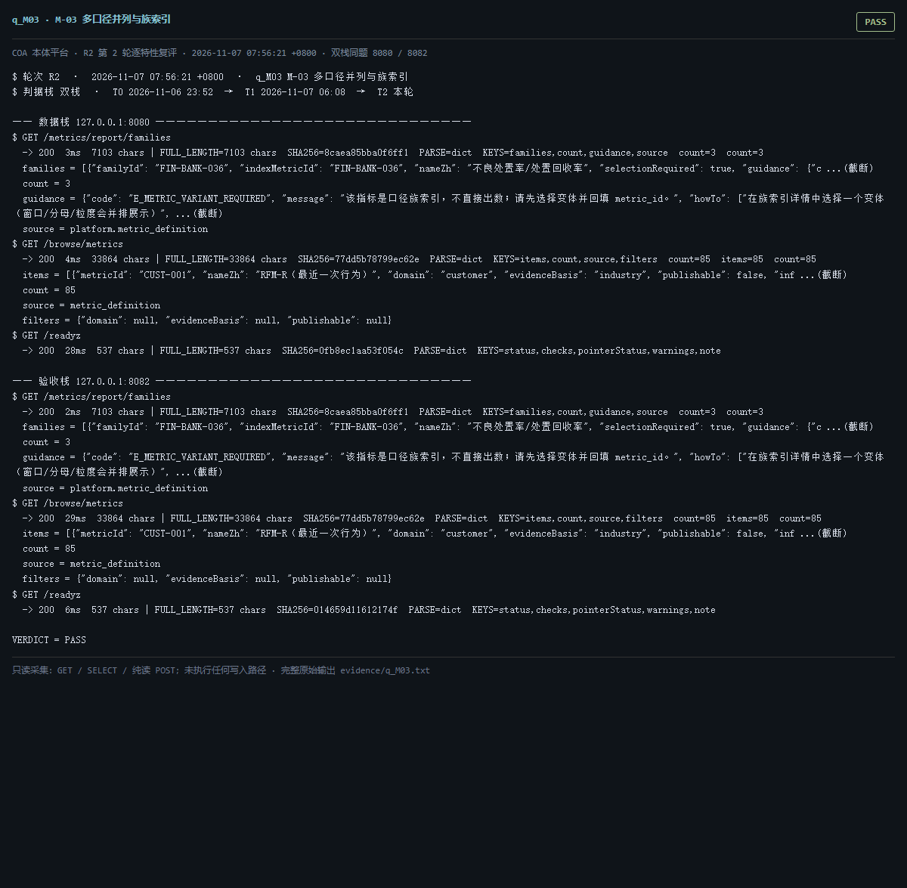

# q_M03 · M-03 多口径并列与族索引

| 项 | 内容 |
| --- | --- |
| 用例编号 | `q_M03` |
| 特性名称 | M-03 多口径并列与族索引 |
| 分组 | C 本轮特性 M 口径与指标 |
| 文档依据 | 52 §4.2 M-03 |
| **评估轮次** | **R2（第 2 轮复评）** |
| **本轮采集时间 T2** | **2026-11-07 07:56:21 +0800** |
| **判据栈** | 双栈 |
| 结论（T2） | **PASS** |
| 证据截图 |  |
| 完整原始输出 | `evidence/q_M03.txt` |

## 0 时间区分（本轮新增）

> 同一特性在不同时间点、不同栈上的状态不同，结论必须带坐标。T0/T1 的旧产物完整保存在
> `_history/2026-11-06_2352/`，独立复核见 `../_evidence-audit/qa_verdict_recheck.md`。

| 轮次 | 时间 | 栈 / 代码基线 | 结论 | 说明 |
| --- | --- | --- | --- | --- |
| **T0 原始采集** | 2026-11-06 23:52 +08 | 数据栈 8080 · 旧镜像 | PASS | R1 采集器，存在 200KB 静默截断与写死结论 |
| **T1 独立复核 / 修复基线** | 2026-11-07 05:45–06:08 +08 | 验收栈 8082 · `8b3f36f` | PASS | 复核定性：一致 |
| **T2 本轮复评** | 2026-11-07 07:56:21 +0800 | 数据栈 8080 + 验收栈 8082 双栈同题 | **PASS** | 采集器已修截断、verdict 由证据动态推导 |

栈说明：
- **数据栈 8080**：镜像 `715d59e8`（11-07 00:53 +08 构建），全量数据，用于验证「数据内容 / 规模」类判据。注意 T0(11-06 23:52) 时 8080 跑的是更早的镜像，容器在 00:53 被重建过，**同一端口跨时间也不是同一个基线**。
- **验收栈 8082**：镜像 `80cb274f` / `agent-platform:0.1-s5`（11-07 05:45 +08 构建），代码等价 `8b3f36f`，验收残留小库，用于验证「代码行为 / 契约」类判据。
- 验收栈 A-Box 为空导致的 `404 / 0` 不判为功能缺陷；两栈版本不同属独立数据库，不计为漂移。

## 1 测试目标

验证同族 variant 可并排列出、族索引有 guidance、缺族时能给出指引。

## 2 输入

- `GET /metrics/report/families`
- `GET /browse/metrics`

> 零污染约束：仅 HTTP GET、只读 SQL `SELECT`、只读 SPARQL `SELECT`、一个已确认不写库的纯读
> `POST /context/resolve`。未调用 `/answer`（会写 PROV 拒答事件），未运行 smoke/acceptance，
> 未触发 seed / refresh / import / materialize / approve / publish / reindex / rollback。
> 验收栈 SPARQL 因 A-Box 为空显式标注 `SKIP`，不做无意义的图查询。

## 3 期待输出

families 返回 count 与 guidance；browse/metrics 返回 85 行口径卡且含 filters。

## 4 真实输出（T2 · 双栈同题）

### 4.1 数据栈 127.0.0.1:8080（全量数据 / 旧代码）

```
$ GET /metrics/report/families
  -> 200  3ms  7103 chars | FULL_LENGTH=7103 chars  SHA256=8caea85bba0f6ff1  PARSE=dict  KEYS=families,count,guidance,source  count=3  count=3
  families = [{"familyId": "FIN-BANK-036", "indexMetricId": "FIN-BANK-036", "nameZh": "不良处置率/处置回收率", "selectionRequired": true, "guidance": {"c ...(截断)
  count = 3
  guidance = {"code": "E_METRIC_VARIANT_REQUIRED", "message": "该指标是口径族索引，不直接出数；请先选择变体并回填 metric_id。", "howTo": ["在族索引详情中选择一个变体（窗口/分母/粒度会并排展示）", ...(截断)
  source = platform.metric_definition
$ GET /browse/metrics
  -> 200  4ms  33864 chars | FULL_LENGTH=33864 chars  SHA256=77dd5b78799ec62e  PARSE=dict  KEYS=items,count,source,filters  count=85  items=85  count=85
  items = [{"metricId": "CUST-001", "nameZh": "RFM-R（最近一次行为）", "domain": "customer", "evidenceBasis": "industry", "publishable": false, "inf ...(截断)
  count = 85
  source = metric_definition
  filters = {"domain": null, "evidenceBasis": null, "publishable": null}
$ GET /readyz
  -> 200  28ms  537 chars | FULL_LENGTH=537 chars  SHA256=0fb8ec1aa53f054c  PARSE=dict  KEYS=status,checks,pointerStatus,warnings,note
  status = ok
  checks = {"database": {"status": "ok"}, "graph": {"status": "ok"}, "storage": {"status": "ok", "disk_free_pct": 32.64}}
  pointerStatus = {"name": "tbox/current", "ok": true, "level": "ok", "status": "published", "versionId": "ont-11f92ebb3326", "semver": "1.2.1", "tr ...(截断)
  warnings = []
  note = pointerStatus 仅告警，不参与就绪状态码（避免启动即崩）
$ GET /status
  -> 200  642ms  11200 chars | FULL_LENGTH=11200 chars  SHA256=e7dc32324bc2d0e8  PARSE=dict  KEYS=status,version,slice,mode,runtime_mode,config_version,config_file,providers,not_implemented,degraded,storage,graph
  status = ok
  version = 0.1.0
  slice = S13
  mode = single
  runtime_mode = learn
```

### 4.2 验收栈 127.0.0.1:8082（新代码 8b3f36f / 小库）

```
$ GET /metrics/report/families
  -> 200  2ms  7103 chars | FULL_LENGTH=7103 chars  SHA256=8caea85bba0f6ff1  PARSE=dict  KEYS=families,count,guidance,source  count=3  count=3
  families = [{"familyId": "FIN-BANK-036", "indexMetricId": "FIN-BANK-036", "nameZh": "不良处置率/处置回收率", "selectionRequired": true, "guidance": {"c ...(截断)
  count = 3
  guidance = {"code": "E_METRIC_VARIANT_REQUIRED", "message": "该指标是口径族索引，不直接出数；请先选择变体并回填 metric_id。", "howTo": ["在族索引详情中选择一个变体（窗口/分母/粒度会并排展示）", ...(截断)
  source = platform.metric_definition
$ GET /browse/metrics
  -> 200  29ms  33864 chars | FULL_LENGTH=33864 chars  SHA256=77dd5b78799ec62e  PARSE=dict  KEYS=items,count,source,filters  count=85  items=85  count=85
  items = [{"metricId": "CUST-001", "nameZh": "RFM-R（最近一次行为）", "domain": "customer", "evidenceBasis": "industry", "publishable": false, "inf ...(截断)
  count = 85
  source = metric_definition
  filters = {"domain": null, "evidenceBasis": null, "publishable": null}
$ GET /readyz
  -> 200  6ms  537 chars | FULL_LENGTH=537 chars  SHA256=014659d11612174f  PARSE=dict  KEYS=status,checks,pointerStatus,warnings,note
  status = ok
  checks = {"database": {"status": "ok"}, "graph": {"status": "ok"}, "storage": {"status": "ok", "disk_free_pct": 32.64}}
  pointerStatus = {"name": "tbox/current", "ok": true, "level": "ok", "status": "published", "versionId": "ont-6e81732555e5", "semver": "0.0.0", "tr ...(截断)
  warnings = []
  note = pointerStatus 仅告警，不参与就绪状态码（避免启动即崩）
$ GET /status
  -> 200  58ms  11356 chars | FULL_LENGTH=11356 chars  SHA256=406a3270929bc0c9  PARSE=dict  KEYS=status,version,slice,mode,runtime_mode,config_version,config_file,providers,not_implemented,degraded,storage,graph
  status = ok
  version = 0.1.0
  slice = S13
  mode = single
  runtime_mode = learn
```

> 完整响应（含 `FULL_LENGTH` / `SHA256` / 结构化摘要，超大正文显式标记 `[BODY OMITTED]`）见
> `evidence/q_M03.txt`；终端渲染截图见 `screenshots/q_M03.png`。

## 5 结论

**PASS** — 族索引与口径卡列表均可读，guidance 字段（code/message/howTo）存在。


---
[返回总报告](README.md) · [T0 归档](<_history/2026-11-06_2352/q_M03_M-03 多口径并列与族索引.md>)
