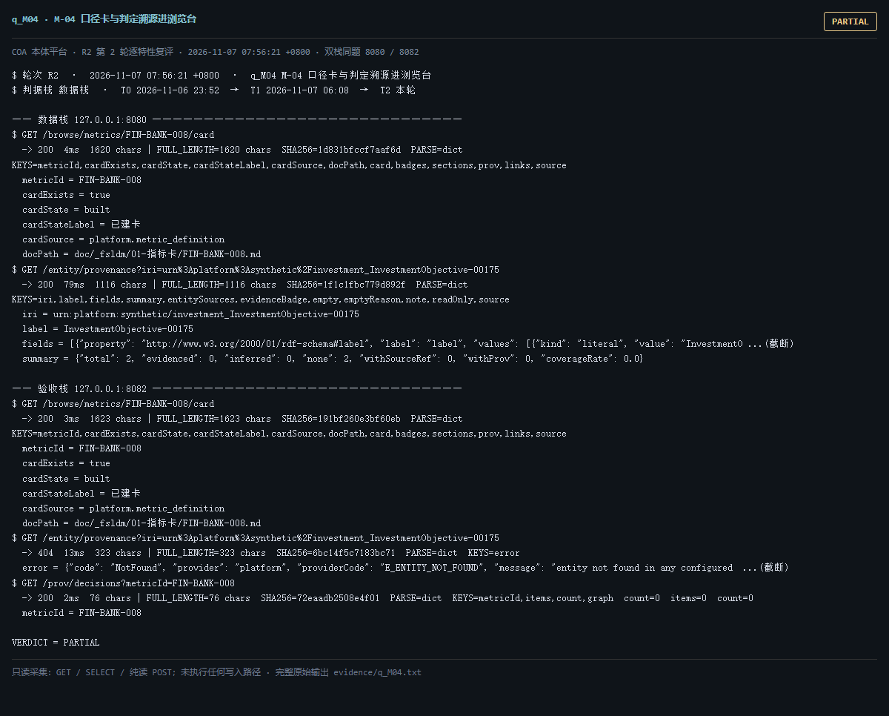

# q_M04 · M-04 口径卡与判定溯源进浏览台

| 项 | 内容 |
| --- | --- |
| 用例编号 | `q_M04` |
| 特性名称 | M-04 口径卡与判定溯源进浏览台 |
| 分组 | C 本轮特性 M 口径与指标 |
| 文档依据 | 52 §4.2 M-04 |
| **评估轮次** | **R2（第 2 轮复评）** |
| **本轮采集时间 T2** | **2026-11-07 07:56:21 +0800** |
| **判据栈** | 数据栈 |
| 结论（T2） | **PARTIAL** |
| 证据截图 |  |
| 完整原始输出 | `evidence/q_M04.txt` |

## 0 时间区分（本轮新增）

> 同一特性在不同时间点、不同栈上的状态不同，结论必须带坐标。T0/T1 的旧产物完整保存在
> `_history/2026-11-06_2352/`，独立复核见 `../_evidence-audit/qa_verdict_recheck.md`。

| 轮次 | 时间 | 栈 / 代码基线 | 结论 | 说明 |
| --- | --- | --- | --- | --- |
| **T0 原始采集** | 2026-11-06 23:52 +08 | 数据栈 8080 · 旧镜像 | PARTIAL | R1 采集器，存在 200KB 静默截断与写死结论 |
| **T1 独立复核 / 修复基线** | 2026-11-07 05:45–06:08 +08 | 验收栈 8082 · `8b3f36f` | PARTIAL | 复核定性：文案错 |
| **T2 本轮复评** | 2026-11-07 07:56:21 +0800 | 数据栈 8080 + 验收栈 8082 双栈同题 | **PARTIAL** | 采集器已修截断、verdict 由证据动态推导 |

栈说明：
- **数据栈 8080**：镜像 `715d59e8`（11-07 00:53 +08 构建），全量数据，用于验证「数据内容 / 规模」类判据。注意 T0(11-06 23:52) 时 8080 跑的是更早的镜像，容器在 00:53 被重建过，**同一端口跨时间也不是同一个基线**。
- **验收栈 8082**：镜像 `80cb274f` / `agent-platform:0.1-s5`（11-07 05:45 +08 构建），代码等价 `8b3f36f`，验收残留小库，用于验证「代码行为 / 契约」类判据。
- 验收栈 A-Box 为空导致的 `404 / 0` 不判为功能缺陷；两栈版本不同属独立数据库，不计为漂移。

## 1 测试目标

验证单张口径卡可取、实体溯源可查，PROV 节点可点。

## 2 输入

- `GET /browse/metrics/FIN-BANK-008/card`
- `GET /entity/provenance?iri=<真实 A-Box IRI>`
- `GET /prov/decisions?metricId=FIN-BANK-008`

> 零污染约束：仅 HTTP GET、只读 SQL `SELECT`、只读 SPARQL `SELECT`、一个已确认不写库的纯读
> `POST /context/resolve`。未调用 `/answer`（会写 PROV 拒答事件），未运行 smoke/acceptance，
> 未触发 seed / refresh / import / materialize / approve / publish / reindex / rollback。
> 验收栈 SPARQL 因 A-Box 为空显式标注 `SKIP`，不做无意义的图查询。

## 3 期待输出

card 返回公式/证据；provenance 返回 fields 且含 source_ref；decisions 返回 items/count。

## 4 真实输出（T2 · 双栈同题）

### 4.1 数据栈 127.0.0.1:8080（全量数据 / 旧代码）

```
$ GET /browse/metrics/FIN-BANK-008/card
  -> 200  4ms  1620 chars | FULL_LENGTH=1620 chars  SHA256=1d831bfccf7aaf6d  PARSE=dict  KEYS=metricId,cardExists,cardState,cardStateLabel,cardSource,docPath,card,badges,sections,prov,links,source
  metricId = FIN-BANK-008
  cardExists = true
  cardState = built
  cardStateLabel = 已建卡
  cardSource = platform.metric_definition
  docPath = doc/_fsldm/01-指标卡/FIN-BANK-008.md
$ GET /entity/provenance?iri=urn%3Aplatform%3Asynthetic%2Finvestment_InvestmentObjective-00175
  -> 200  79ms  1116 chars | FULL_LENGTH=1116 chars  SHA256=1f1c1fbc779d892f  PARSE=dict  KEYS=iri,label,fields,summary,entitySources,evidenceBadge,empty,emptyReason,note,readOnly,source
  iri = urn:platform:synthetic/investment_InvestmentObjective-00175
  label = InvestmentObjective-00175
  fields = [{"property": "http://www.w3.org/2000/01/rdf-schema#label", "label": "label", "values": [{"kind": "literal", "value": "InvestmentO ...(截断)
  summary = {"total": 2, "evidenced": 0, "inferred": 0, "none": 2, "withSourceRef": 0, "withProv": 0, "coverageRate": 0.0}
  entitySources = []
  evidenceBadge = {"state": "no-source", "label": "无依据", "basis": "存在断言三元组，但未找到 sourceRef / PROV 溯源链接", "judge": null}
$ GET /prov/decisions?metricId=FIN-BANK-008
  -> 200  18ms  8033 chars | FULL_LENGTH=8033 chars  SHA256=455a5c7e89ed9c53  PARSE=dict  KEYS=metricId,items,count,graph  count=6  items=6  count=6
  metricId = FIN-BANK-008
  items = [{"eventId": 531, "activityId": "act-36b55c83374240ff", "activityIri": "urn:platform:prov:activity/act-36b55c83374240ff", "conclus ...(截断)
  count = 6
  graph = urn:platform:prov
$ GET /readyz
  -> 200  28ms  537 chars | FULL_LENGTH=537 chars  SHA256=0fb8ec1aa53f054c  PARSE=dict  KEYS=status,checks,pointerStatus,warnings,note
  status = ok
  checks = {"database": {"status": "ok"}, "graph": {"status": "ok"}, "storage": {"status": "ok", "disk_free_pct": 32.64}}
```

### 4.2 验收栈 127.0.0.1:8082（新代码 8b3f36f / 小库）

```
$ GET /browse/metrics/FIN-BANK-008/card
  -> 200  3ms  1623 chars | FULL_LENGTH=1623 chars  SHA256=191bf260e3bf60eb  PARSE=dict  KEYS=metricId,cardExists,cardState,cardStateLabel,cardSource,docPath,card,badges,sections,prov,links,source
  metricId = FIN-BANK-008
  cardExists = true
  cardState = built
  cardStateLabel = 已建卡
  cardSource = platform.metric_definition
  docPath = doc/_fsldm/01-指标卡/FIN-BANK-008.md
$ GET /entity/provenance?iri=urn%3Aplatform%3Asynthetic%2Finvestment_InvestmentObjective-00175
  -> 404  13ms  323 chars | FULL_LENGTH=323 chars  SHA256=6bc14f5c7183bc71  PARSE=dict  KEYS=error
  error = {"code": "NotFound", "provider": "platform", "providerCode": "E_ENTITY_NOT_FOUND", "message": "entity not found in any configured  ...(截断)
$ GET /prov/decisions?metricId=FIN-BANK-008
  -> 200  2ms  76 chars | FULL_LENGTH=76 chars  SHA256=72eaadb2508e4f01  PARSE=dict  KEYS=metricId,items,count,graph  count=0  items=0  count=0
  metricId = FIN-BANK-008
  items = []
  count = 0
  graph = urn:platform:prov
$ GET /readyz
  -> 200  6ms  537 chars | FULL_LENGTH=537 chars  SHA256=014659d11612174f  PARSE=dict  KEYS=status,checks,pointerStatus,warnings,note
  status = ok
  checks = {"database": {"status": "ok"}, "graph": {"status": "ok"}, "storage": {"status": "ok", "disk_free_pct": 32.64}}
  pointerStatus = {"name": "tbox/current", "ok": true, "level": "ok", "status": "published", "versionId": "ont-6e81732555e5", "semver": "0.0.0", "tr ...(截断)
  warnings = []
  note = pointerStatus 仅告警，不参与就绪状态码（避免启动即崩）
$ GET /status
  -> 200  58ms  11356 chars | FULL_LENGTH=11356 chars  SHA256=406a3270929bc0c9  PARSE=dict  KEYS=status,version,slice,mode,runtime_mode,config_version,config_file,providers,not_implemented,degraded,storage,graph
```

> 完整响应（含 `FULL_LENGTH` / `SHA256` / 结构化摘要，超大正文显式标记 `[BODY OMITTED]`）见
> `evidence/q_M04.txt`；终端渲染截图见 `screenshots/q_M04.png`。

## 5 结论

**PARTIAL** — 口径卡与实体溯源字段可读：summary.total=2、withSourceRef=0、coverageRate=0.0、links=0；/prov/decisions 无判定记录。验收栈同一 IRI 返回 404（小库无此实体，属数据缺失）。

R1 文案「字段带来源」被证据反证；本轮按 withSourceRef 实测值表述，verdict 仍 PARTIAL。

---
[返回总报告](README.md) · [T0 归档](<_history/2026-11-06_2352/q_M04_M-04 口径卡与判定溯源进浏览台.md>)
