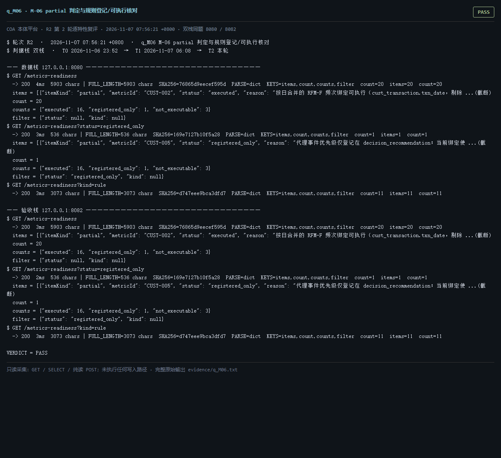

# q_M06 · M-06 partial 判定与规则登记/可执行核对

| 项 | 内容 |
| --- | --- |
| 用例编号 | `q_M06` |
| 特性名称 | M-06 partial 判定与规则登记/可执行核对 |
| 分组 | C 本轮特性 M 口径与指标 |
| 文档依据 | 58-M01-M06-指标可算性补齐与规则核对.md §2/§4；52 §4.2 M-06 |
| **评估轮次** | **R2（第 2 轮复评）** |
| **本轮采集时间 T2** | **2026-11-07 07:56:21 +0800** |
| **判据栈** | 双栈 |
| 结论（T2） | **PASS** |
| 证据截图 |  |
| 完整原始输出 | `evidence/q_M06.txt` |

## 0 时间区分（本轮新增）

> 同一特性在不同时间点、不同栈上的状态不同，结论必须带坐标。T0/T1 的旧产物完整保存在
> `_history/2026-11-06_2352/`，独立复核见 `../_evidence-audit/qa_verdict_recheck.md`。

| 轮次 | 时间 | 栈 / 代码基线 | 结论 | 说明 |
| --- | --- | --- | --- | --- |
| **T0 原始采集** | 2026-11-06 23:52 +08 | 数据栈 8080 · 旧镜像 | PASS | R1 采集器，存在 200KB 静默截断与写死结论 |
| **T1 独立复核 / 修复基线** | 2026-11-07 05:45–06:08 +08 | 验收栈 8082 · `8b3f36f` | PASS | 复核定性：一致 |
| **T2 本轮复评** | 2026-11-07 07:56:21 +0800 | 数据栈 8080 + 验收栈 8082 双栈同题 | **PASS** | 采集器已修截断、verdict 由证据动态推导 |

栈说明：
- **数据栈 8080**：镜像 `715d59e8`（11-07 00:53 +08 构建），全量数据，用于验证「数据内容 / 规模」类判据。注意 T0(11-06 23:52) 时 8080 跑的是更早的镜像，容器在 00:53 被重建过，**同一端口跨时间也不是同一个基线**。
- **验收栈 8082**：镜像 `80cb274f` / `agent-platform:0.1-s5`（11-07 05:45 +08 构建），代码等价 `8b3f36f`，验收残留小库，用于验证「代码行为 / 契约」类判据。
- 验收栈 A-Box 为空导致的 `404 / 0` 不判为功能缺陷；两栈版本不同属独立数据库，不计为漂移。

## 1 测试目标

验证 20 条台账（9 partial + 11 规则）逐条有状态，且「仅登记」可导出、不与可执行混淆。

## 2 输入

- `GET /metrics-readiness`
- `GET /metrics-readiness?status=registered_only`
- `GET /metrics-readiness?kind=rule`
- `GET /metrics-readiness?status=registered_only&format=csv`

> 零污染约束：仅 HTTP GET、只读 SQL `SELECT`、只读 SPARQL `SELECT`、一个已确认不写库的纯读
> `POST /context/resolve`。未调用 `/answer`（会写 PROV 拒答事件），未运行 smoke/acceptance，
> 未触发 seed / refresh / import / materialize / approve / publish / reindex / rollback。
> 验收栈 SPARQL 因 A-Box 为空显式标注 `SKIP`，不做无意义的图查询。

## 3 期待输出

按 58 号：executed=16 / registered_only=1 / not_executable=3，总 20；registered_only 可单独筛出并导出 CSV。

## 4 真实输出（T2 · 双栈同题）

### 4.1 数据栈 127.0.0.1:8080（全量数据 / 旧代码）

```
$ GET /metrics-readiness
  -> 200  4ms  5903 chars | FULL_LENGTH=5903 chars  SHA256=76865d9eecef595d  PARSE=dict  KEYS=items,count,counts,filter  count=20  items=20  count=20
  items = [{"itemKind": "partial", "metricId": "CUST-002", "status": "executed", "reason": "按日合并的 RFM-F 频次绑定可执行（cust_transaction.txn_date，剔除 ...(截断)
  count = 20
  counts = {"executed": 16, "registered_only": 1, "not_executable": 3}
  filter = {"status": null, "kind": null}
$ GET /metrics-readiness?status=registered_only
  -> 200  3ms  536 chars | FULL_LENGTH=536 chars  SHA256=169e7127b10f5a28  PARSE=dict  KEYS=items,count,counts,filter  count=1  items=1  count=1
  items = [{"itemKind": "partial", "metricId": "CUST-005", "status": "registered_only", "reason": "代理事件优先级仅登记在 decision_recommendation；当前绑定使 ...(截断)
  count = 1
  counts = {"executed": 16, "registered_only": 1, "not_executable": 3}
  filter = {"status": "registered_only", "kind": null}
$ GET /metrics-readiness?kind=rule
  -> 200  3ms  3073 chars | FULL_LENGTH=3073 chars  SHA256=d747eee9bca3dfd7  PARSE=dict  KEYS=items,count,counts,filter  count=11  items=11  count=11
  items = [{"itemKind": "rule", "metricId": "FIN-BANK-002", "status": "executed", "reason": "6 条规则 spec 完整，/metrics/FIN-BANK-002/rules 可执行", ...(截断)
  count = 11
  counts = {"executed": 16, "registered_only": 1, "not_executable": 3}
  filter = {"status": null, "kind": "rule"}
$ GET /metrics-readiness?status=registered_only&format=csv
  -> 200  2ms  244 chars | FULL_LENGTH=244 chars  SHA256=8cdc086aca0b483f  PARSE=non-json  head=item_kind,metric_id,status,reason,evidence_ref,checked_at
 partial,CUST-005,registered_only,代理事件优先级仅登记在 decision_recomme ...(截断)
  item_kind,metric_id,status,reason,evidence_ref,checked_at
 partial,CUST-005,registered_only,代理事件优先级仅登记在 decision_recommendation；当前绑定使用预计算 days_since_p ...(截断)
$ GET /readyz
  -> 200  28ms  537 chars | FULL_LENGTH=537 chars  SHA256=0fb8ec1aa53f054c  PARSE=dict  KEYS=status,checks,pointerStatus,warnings,note
  status = ok
  checks = {"database": {"status": "ok"}, "graph": {"status": "ok"}, "storage": {"status": "ok", "disk_free_pct": 32.64}}
  pointerStatus = {"name": "tbox/current", "ok": true, "level": "ok", "status": "published", "versionId": "ont-11f92ebb3326", "semver": "1.2.1", "tr ...(截断)
```

### 4.2 验收栈 127.0.0.1:8082（新代码 8b3f36f / 小库）

```
$ GET /metrics-readiness
  -> 200  3ms  5903 chars | FULL_LENGTH=5903 chars  SHA256=76865d9eecef595d  PARSE=dict  KEYS=items,count,counts,filter  count=20  items=20  count=20
  items = [{"itemKind": "partial", "metricId": "CUST-002", "status": "executed", "reason": "按日合并的 RFM-F 频次绑定可执行（cust_transaction.txn_date，剔除 ...(截断)
  count = 20
  counts = {"executed": 16, "registered_only": 1, "not_executable": 3}
  filter = {"status": null, "kind": null}
$ GET /metrics-readiness?status=registered_only
  -> 200  2ms  536 chars | FULL_LENGTH=536 chars  SHA256=169e7127b10f5a28  PARSE=dict  KEYS=items,count,counts,filter  count=1  items=1  count=1
  items = [{"itemKind": "partial", "metricId": "CUST-005", "status": "registered_only", "reason": "代理事件优先级仅登记在 decision_recommendation；当前绑定使 ...(截断)
  count = 1
  counts = {"executed": 16, "registered_only": 1, "not_executable": 3}
  filter = {"status": "registered_only", "kind": null}
$ GET /metrics-readiness?kind=rule
  -> 200  3ms  3073 chars | FULL_LENGTH=3073 chars  SHA256=d747eee9bca3dfd7  PARSE=dict  KEYS=items,count,counts,filter  count=11  items=11  count=11
  items = [{"itemKind": "rule", "metricId": "FIN-BANK-002", "status": "executed", "reason": "6 条规则 spec 完整，/metrics/FIN-BANK-002/rules 可执行", ...(截断)
  count = 11
  counts = {"executed": 16, "registered_only": 1, "not_executable": 3}
  filter = {"status": null, "kind": "rule"}
$ GET /metrics-readiness?status=registered_only&format=csv
  -> 200  2ms  244 chars | FULL_LENGTH=244 chars  SHA256=8cdc086aca0b483f  PARSE=non-json  head=item_kind,metric_id,status,reason,evidence_ref,checked_at
 partial,CUST-005,registered_only,代理事件优先级仅登记在 decision_recomme ...(截断)
  item_kind,metric_id,status,reason,evidence_ref,checked_at
 partial,CUST-005,registered_only,代理事件优先级仅登记在 decision_recommendation；当前绑定使用预计算 days_since_p ...(截断)
$ GET /readyz
  -> 200  6ms  537 chars | FULL_LENGTH=537 chars  SHA256=014659d11612174f  PARSE=dict  KEYS=status,checks,pointerStatus,warnings,note
  status = ok
  checks = {"database": {"status": "ok"}, "graph": {"status": "ok"}, "storage": {"status": "ok", "disk_free_pct": 32.64}}
  pointerStatus = {"name": "tbox/current", "ok": true, "level": "ok", "status": "published", "versionId": "ont-6e81732555e5", "semver": "0.0.0", "tr ...(截断)
```

> 完整响应（含 `FULL_LENGTH` / `SHA256` / 结构化摘要，超大正文显式标记 `[BODY OMITTED]`）见
> `evidence/q_M06.txt`；终端渲染截图见 `screenshots/q_M06.png`。

## 5 结论

**PASS** — counts={'executed': 16, 'registered_only': 1, 'not_executable': 3}（16/1/3 共 20），筛选与 CSV 导出可用，registered_only 条目带具体原因；两栈一致。


---
[返回总报告](README.md) · [T0 归档](<_history/2026-11-06_2352/q_M06_M-06 partial 判定与规则登记-可执行核对.md>)
