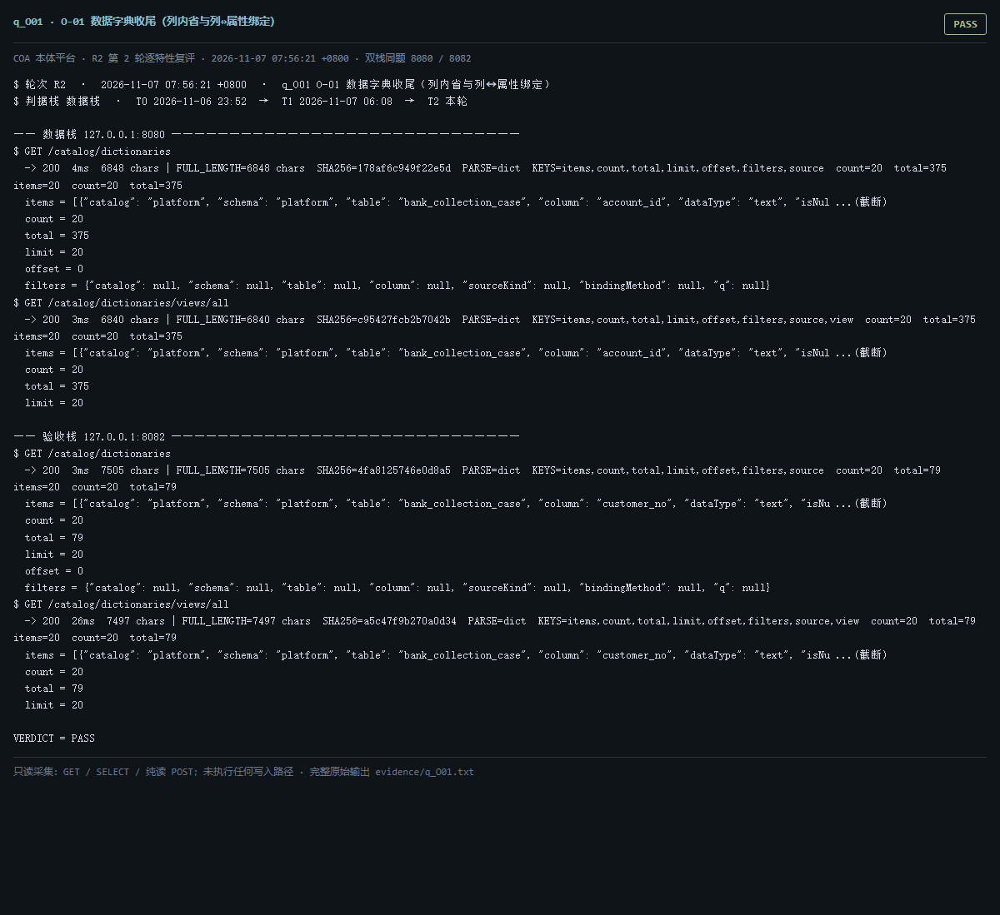

# q_O01 · O-01 数据字典收尾（列内省与列↔属性绑定）

| 项 | 内容 |
| --- | --- |
| 用例编号 | `q_O01` |
| 特性名称 | O-01 数据字典收尾（列内省与列↔属性绑定） |
| 分组 | B 本轮特性 O 本体治理 |
| 文档依据 | 57-O01-数据字典收尾.md；52 §4.1 O-01 |
| **评估轮次** | **R2（第 2 轮复评）** |
| **本轮采集时间 T2** | **2026-11-07 07:56:21 +0800** |
| **判据栈** | 数据栈 |
| 结论（T2） | **PASS** |
| 证据截图 |  |
| 完整原始输出 | `evidence/q_O01.txt` |

## 0 时间区分（本轮新增）

> 同一特性在不同时间点、不同栈上的状态不同，结论必须带坐标。T0/T1 的旧产物完整保存在
> `_history/2026-11-06_2352/`，独立复核见 `../_evidence-audit/qa_verdict_recheck.md`。

| 轮次 | 时间 | 栈 / 代码基线 | 结论 | 说明 |
| --- | --- | --- | --- | --- |
| **T0 原始采集** | 2026-11-06 23:52 +08 | 数据栈 8080 · 旧镜像 | PASS | R1 采集器，存在 200KB 静默截断与写死结论 |
| **T1 独立复核 / 修复基线** | 2026-11-07 05:45–06:08 +08 | 验收栈 8082 · `8b3f36f` | PASS | 复核定性：一致 |
| **T2 本轮复评** | 2026-11-07 07:56:21 +0800 | 数据栈 8080 + 验收栈 8082 双栈同题 | **PASS** | 采集器已修截断、verdict 由证据动态推导 |

栈说明：
- **数据栈 8080**：镜像 `715d59e8`（11-07 00:53 +08 构建），全量数据，用于验证「数据内容 / 规模」类判据。注意 T0(11-06 23:52) 时 8080 跑的是更早的镜像，容器在 00:53 被重建过，**同一端口跨时间也不是同一个基线**。
- **验收栈 8082**：镜像 `80cb274f` / `agent-platform:0.1-s5`（11-07 05:45 +08 构建），代码等价 `8b3f36f`，验收残留小库，用于验证「代码行为 / 契约」类判据。
- 验收栈 A-Box 为空导致的 `404 / 0` 不判为功能缺陷；两栈版本不同属独立数据库，不计为漂移。

## 1 测试目标

验证 28 表列内省覆盖、绑定率口径是否如实、四个只读视图可用。

## 2 输入

- `GET /catalog/dictionaries`
- `GET /catalog/dictionaries/views/all`
- `GET /catalog/dictionaries/views/unbound`
- `GET /catalog/dictionaries/views/mappable_unbound`
- `SQL: data_dictionary 行数 / 绑定档位分布`

> 零污染约束：仅 HTTP GET、只读 SQL `SELECT`、只读 SPARQL `SELECT`、一个已确认不写库的纯读
> `POST /context/resolve`。未调用 `/answer`（会写 PROV 拒答事件），未运行 smoke/acceptance，
> 未触发 seed / refresh / import / materialize / approve / publish / reindex / rollback。
> 验收栈 SPARQL 因 A-Box 为空显式标注 `SKIP`，不做无意义的图查询。

## 3 期待输出

按 57 号：375 行字典、28 表 100% 覆盖；可映射列 81、已绑定 79、绑定率 97.53%；未绑定可映射 2 列有清单；四个视图可分页。

## 4 真实输出（T2 · 双栈同题）

### 4.1 数据栈 127.0.0.1:8080（全量数据 / 旧代码）

```
$ GET /catalog/dictionaries
  -> 200  4ms  6848 chars | FULL_LENGTH=6848 chars  SHA256=178af6c949f22e5d  PARSE=dict  KEYS=items,count,total,limit,offset,filters,source  count=20  total=375  items=20  count=20  total=375
  items = [{"catalog": "platform", "schema": "platform", "table": "bank_collection_case", "column": "account_id", "dataType": "text", "isNul ...(截断)
  count = 20
  total = 375
  limit = 20
  offset = 0
  filters = {"catalog": null, "schema": null, "table": null, "column": null, "sourceKind": null, "bindingMethod": null, "q": null}
$ GET /catalog/dictionaries/views/all
  -> 200  3ms  6840 chars | FULL_LENGTH=6840 chars  SHA256=c95427fcb2b7042b  PARSE=dict  KEYS=items,count,total,limit,offset,filters,source,view  count=20  total=375  items=20  count=20  total=375
  items = [{"catalog": "platform", "schema": "platform", "table": "bank_collection_case", "column": "account_id", "dataType": "text", "isNul ...(截断)
  count = 20
  total = 375
  limit = 20
  offset = 0
  filters = {"catalog": null, "schema": null, "table": null, "column": null, "sourceKind": null, "q": null}
$ GET /catalog/dictionaries/views/unbound
  -> 200  3ms  6823 chars | FULL_LENGTH=6823 chars  SHA256=2c7e086bb0d81775  PARSE=dict  KEYS=items,count,total,limit,offset,filters,source,view  count=20  total=339  items=20  count=20  total=339
  items = [{"catalog": "platform", "schema": "platform", "table": "bank_collection_case", "column": "account_id", "dataType": "text", "isNul ...(截断)
  count = 20
  total = 339
  limit = 20
  offset = 0
  filters = {"catalog": null, "schema": null, "table": null, "column": null, "sourceKind": null, "q": null, "unbound": true}
$ GET /catalog/dictionaries/views/mappable_unbound
  -> 200  3ms  6805 chars | FULL_LENGTH=6805 chars  SHA256=beba72daf63744f0  PARSE=dict  KEYS=items,count,total,limit,offset,filters,source,view  count=20  total=45  items=20  count=20  total=45
```

### 4.2 验收栈 127.0.0.1:8082（新代码 8b3f36f / 小库）

```
$ GET /catalog/dictionaries
  -> 200  3ms  7505 chars | FULL_LENGTH=7505 chars  SHA256=4fa8125746e0d8a5  PARSE=dict  KEYS=items,count,total,limit,offset,filters,source  count=20  total=79  items=20  count=20  total=79
  items = [{"catalog": "platform", "schema": "platform", "table": "bank_collection_case", "column": "customer_no", "dataType": "text", "isNu ...(截断)
  count = 20
  total = 79
  limit = 20
  offset = 0
  filters = {"catalog": null, "schema": null, "table": null, "column": null, "sourceKind": null, "bindingMethod": null, "q": null}
$ GET /catalog/dictionaries/views/all
  -> 200  26ms  7497 chars | FULL_LENGTH=7497 chars  SHA256=a5c47f9b270a0d34  PARSE=dict  KEYS=items,count,total,limit,offset,filters,source,view  count=20  total=79  items=20  count=20  total=79
  items = [{"catalog": "platform", "schema": "platform", "table": "bank_collection_case", "column": "customer_no", "dataType": "text", "isNu ...(截断)
  count = 20
  total = 79
  limit = 20
  offset = 0
  filters = {"catalog": null, "schema": null, "table": null, "column": null, "sourceKind": null, "q": null}
$ GET /catalog/dictionaries/views/unbound
  -> 200  13ms  208 chars | FULL_LENGTH=208 chars  SHA256=f148d3891a2ddf6f  PARSE=dict  KEYS=items,count,total,limit,offset,filters,source,view  count=0  total=0  items=0  count=0  total=0
  items = []
  count = 0
  total = 0
  limit = 20
  offset = 0
  filters = {"catalog": null, "schema": null, "table": null, "column": null, "sourceKind": null, "q": null, "unbound": true}
$ GET /catalog/dictionaries/views/mappable_unbound
  -> 200  3ms  225 chars | FULL_LENGTH=225 chars  SHA256=dd8d6cb18fd8e2c7  PARSE=dict  KEYS=items,count,total,limit,offset,filters,source,view  count=0  total=0  items=0  count=0  total=0
```

> 完整响应（含 `FULL_LENGTH` / `SHA256` / 结构化摘要，超大正文显式标记 `[BODY OMITTED]`）见
> `evidence/q_O01.txt`；终端渲染截图见 `screenshots/q_O01.png`。

## 5 结论

**PASS** — 数据栈 data_dictionary=None 行，四个字典视图可用；mappable_unbound count=20 / total=45 且可分页。验收栈同视图 total=0（库内 data_dictionary=None）。57 号文档主动写明 97.53% 是 79/81 可映射列口径、按 375 总列计仅 21.1%，未为达标扩大分母。


---
[返回总报告](README.md) · [T0 归档](<_history/2026-11-06_2352/q_O01_O-01 数据字典收尾（列内省与列↔属性绑定）.md>)
