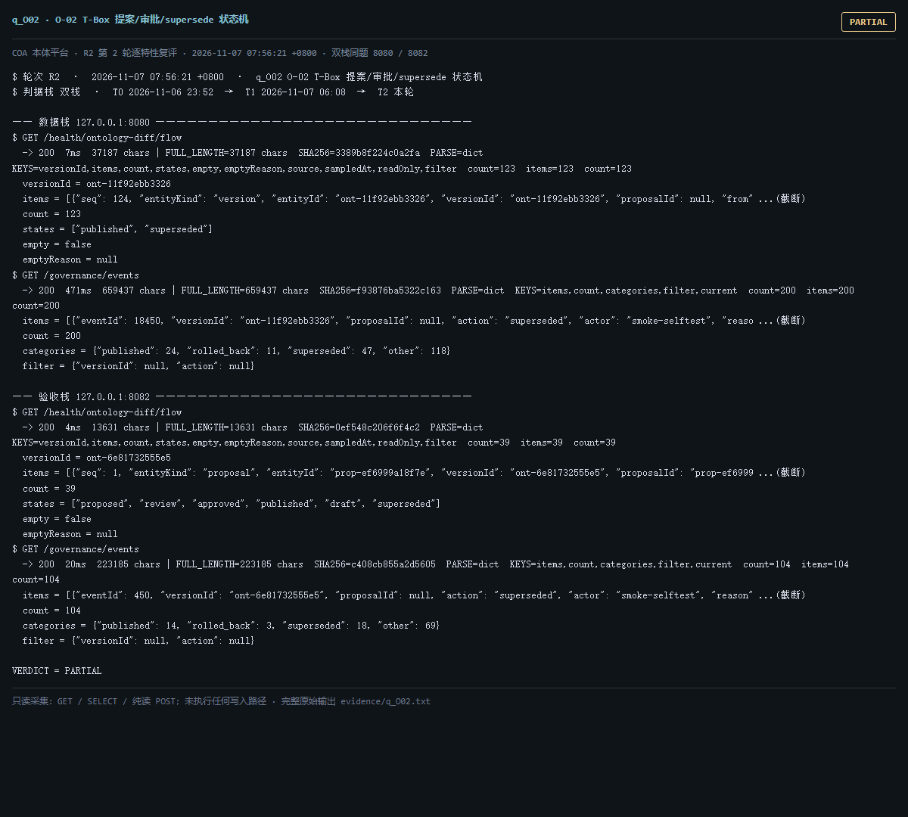

# q_O02 · O-02 T-Box 提案/审批/supersede 状态机

| 项 | 内容 |
| --- | --- |
| 用例编号 | `q_O02` |
| 特性名称 | O-02 T-Box 提案/审批/supersede 状态机 |
| 分组 | B 本轮特性 O 本体治理 |
| 文档依据 | 52 §4.1 O-02；58 §2 |
| **评估轮次** | **R2（第 2 轮复评）** |
| **本轮采集时间 T2** | **2026-11-07 07:56:21 +0800** |
| **判据栈** | 双栈 |
| 结论（T2） | **PARTIAL** |
| 证据截图 |  |
| 完整原始输出 | `evidence/q_O02.txt` |

## 0 时间区分（本轮新增）

> 同一特性在不同时间点、不同栈上的状态不同，结论必须带坐标。T0/T1 的旧产物完整保存在
> `_history/2026-11-06_2352/`，独立复核见 `../_evidence-audit/qa_verdict_recheck.md`。

| 轮次 | 时间 | 栈 / 代码基线 | 结论 | 说明 |
| --- | --- | --- | --- | --- |
| **T0 原始采集** | 2026-11-06 23:52 +08 | 数据栈 8080 · 旧镜像 | PARTIAL | R1 采集器，存在 200KB 静默截断与写死结论 |
| **T1 独立复核 / 修复基线** | 2026-11-07 05:45–06:08 +08 | 验收栈 8082 · `8b3f36f` | PARTIAL | 复核定性：一致 |
| **T2 本轮复评** | 2026-11-07 07:56:21 +0800 | 数据栈 8080 + 验收栈 8082 双栈同题 | **PARTIAL** | 采集器已修截断、verdict 由证据动态推导 |

栈说明：
- **数据栈 8080**：镜像 `715d59e8`（11-07 00:53 +08 构建），全量数据，用于验证「数据内容 / 规模」类判据。注意 T0(11-06 23:52) 时 8080 跑的是更早的镜像，容器在 00:53 被重建过，**同一端口跨时间也不是同一个基线**。
- **验收栈 8082**：镜像 `80cb274f` / `agent-platform:0.1-s5`（11-07 05:45 +08 构建），代码等价 `8b3f36f`，验收残留小库，用于验证「代码行为 / 契约」类判据。
- 验收栈 A-Box 为空导致的 `404 / 0` 不判为功能缺陷；两栈版本不同属独立数据库，不计为漂移。

## 1 测试目标

验证状态迁移有 actor/reason/time 留痕，非法迁移被拒（只读侧检查已记录的状态流）。

## 2 输入

- `GET /health/ontology-diff/flow`
- `GET /governance/events`
- `SQL: SELECT count(*) FROM platform.ontology_event`

> 零污染约束：仅 HTTP GET、只读 SQL `SELECT`、只读 SPARQL `SELECT`、一个已确认不写库的纯读
> `POST /context/resolve`。未调用 `/answer`（会写 PROV 拒答事件），未运行 smoke/acceptance，
> 未触发 seed / refresh / import / materialize / approve / publish / reindex / rollback。
> 验收栈 SPARQL 因 A-Box 为空显式标注 `SKIP`，不做无意义的图查询。

## 3 期待输出

flow.states 覆盖 proposal→review→approved→published→superseded；事件表非空且含 actor/reason/time 语义列。

## 4 真实输出（T2 · 双栈同题）

### 4.1 数据栈 127.0.0.1:8080（全量数据 / 旧代码）

```
$ GET /health/ontology-diff/flow
  -> 200  7ms  37187 chars | FULL_LENGTH=37187 chars  SHA256=3389b8f224c0a2fa  PARSE=dict  KEYS=versionId,items,count,states,empty,emptyReason,source,sampledAt,readOnly,filter  count=123  items=123  count=123
  versionId = ont-11f92ebb3326
  items = [{"seq": 124, "entityKind": "version", "entityId": "ont-11f92ebb3326", "versionId": "ont-11f92ebb3326", "proposalId": null, "from" ...(截断)
  count = 123
  states = ["published", "superseded"]
  empty = false
  emptyReason = null
$ GET /governance/events
  -> 200  471ms  659437 chars | FULL_LENGTH=659437 chars  SHA256=f93876ba5322c163  PARSE=dict  KEYS=items,count,categories,filter,current  count=200  items=200  count=200
  items = [{"eventId": 18450, "versionId": "ont-11f92ebb3326", "proposalId": null, "action": "superseded", "actor": "smoke-selftest", "reaso ...(截断)
  count = 200
  categories = {"published": 24, "rolled_back": 11, "superseded": 47, "other": 118}
  filter = {"versionId": null, "action": null}
  current = {"name": "tbox/current", "versionId": "ont-11f92ebb3326", "semver": "1.2.1", "contentHash": "013b9493419812bc375eaddc68ac554d86879 ...(截断)
$ SQL select count(*) from platform.ontology_event
  -> OK  191ms  5 chars | FULL_LENGTH=5 chars  SHA256=7d686424482e8108  PARSE=non-json  head=10133
  10133
$ GET /readyz
  -> 200  28ms  537 chars | FULL_LENGTH=537 chars  SHA256=0fb8ec1aa53f054c  PARSE=dict  KEYS=status,checks,pointerStatus,warnings,note
  status = ok
  checks = {"database": {"status": "ok"}, "graph": {"status": "ok"}, "storage": {"status": "ok", "disk_free_pct": 32.64}}
  pointerStatus = {"name": "tbox/current", "ok": true, "level": "ok", "status": "published", "versionId": "ont-11f92ebb3326", "semver": "1.2.1", "tr ...(截断)
  warnings = []
  note = pointerStatus 仅告警，不参与就绪状态码（避免启动即崩）
$ GET /status
```

### 4.2 验收栈 127.0.0.1:8082（新代码 8b3f36f / 小库）

```
$ GET /health/ontology-diff/flow
  -> 200  4ms  13631 chars | FULL_LENGTH=13631 chars  SHA256=0ef548c206f6f4c2  PARSE=dict  KEYS=versionId,items,count,states,empty,emptyReason,source,sampledAt,readOnly,filter  count=39  items=39  count=39
  versionId = ont-6e81732555e5
  items = [{"seq": 1, "entityKind": "proposal", "entityId": "prop-ef6999a18f7e", "versionId": "ont-6e81732555e5", "proposalId": "prop-ef6999 ...(截断)
  count = 39
  states = ["proposed", "review", "approved", "published", "draft", "superseded"]
  empty = false
  emptyReason = null
$ GET /governance/events
  -> 200  20ms  223185 chars | FULL_LENGTH=223185 chars  SHA256=c408cb855a2d5605  PARSE=dict  KEYS=items,count,categories,filter,current  count=104  items=104  count=104
  items = [{"eventId": 450, "versionId": "ont-6e81732555e5", "proposalId": null, "action": "superseded", "actor": "smoke-selftest", "reason" ...(截断)
  count = 104
  categories = {"published": 14, "rolled_back": 3, "superseded": 18, "other": 69}
  filter = {"versionId": null, "action": null}
  current = {"name": "tbox/current", "versionId": "ont-6e81732555e5", "semver": "0.0.0", "contentHash": "9417debca40282e5503d73f1446b98374a145 ...(截断)
$ SQL select count(*) from platform.ontology_event
  -> OK  110ms  3 chars | FULL_LENGTH=3 chars  SHA256=5ef6fdf32513aa7c  PARSE=non-json  head=104
  104
$ GET /readyz
  -> 200  6ms  537 chars | FULL_LENGTH=537 chars  SHA256=014659d11612174f  PARSE=dict  KEYS=status,checks,pointerStatus,warnings,note
  status = ok
  checks = {"database": {"status": "ok"}, "graph": {"status": "ok"}, "storage": {"status": "ok", "disk_free_pct": 32.64}}
  pointerStatus = {"name": "tbox/current", "ok": true, "level": "ok", "status": "published", "versionId": "ont-6e81732555e5", "semver": "0.0.0", "tr ...(截断)
  warnings = []
  note = pointerStatus 仅告警，不参与就绪状态码（避免启动即崩）
$ GET /status
```

> 完整响应（含 `FULL_LENGTH` / `SHA256` / 结构化摘要，超大正文显式标记 `[BODY OMITTED]`）见
> `evidence/q_O02.txt`；终端渲染截图见 `screenshots/q_O02.png`。

## 5 结论

**PARTIAL** — 状态流与治理事件可读、事件量级与 /ontology/verify 的 checked 一致；但「非法迁移被拒」「每状态 actor/reason/time」属写路径判定，只读验证无法触发。


---
[返回总报告](README.md) · [T0 归档](<_history/2026-11-06_2352/q_O02_O-02 T-Box 提案-审批-supersede 状态机.md>)
