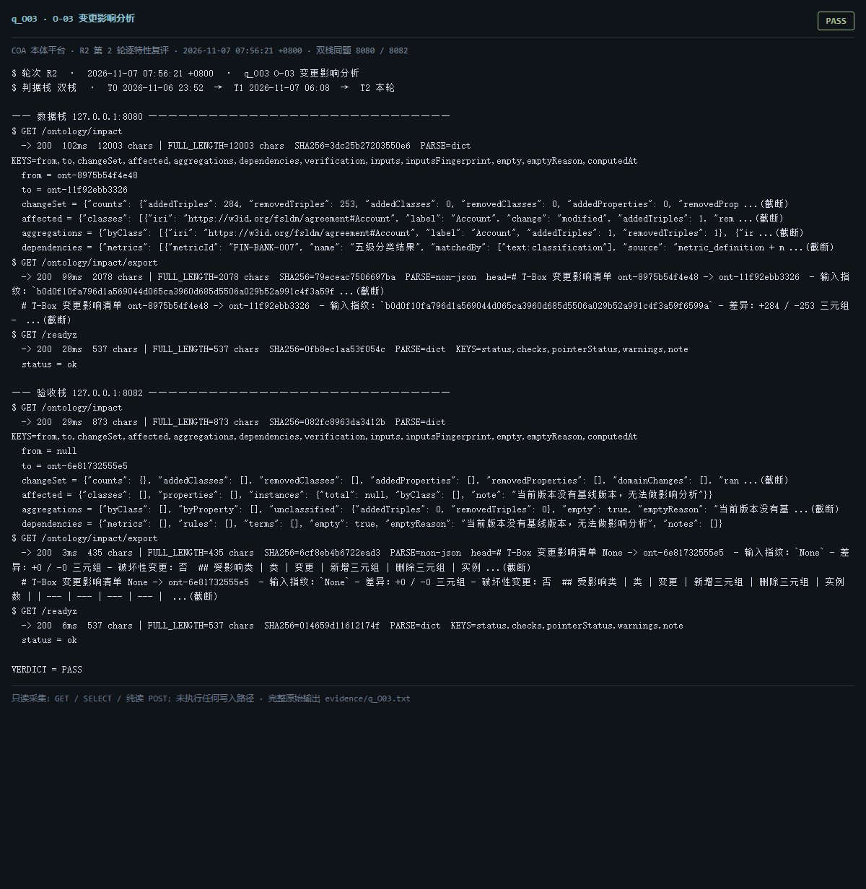

# q_O03 · O-03 变更影响分析

| 项 | 内容 |
| --- | --- |
| 用例编号 | `q_O03` |
| 特性名称 | O-03 变更影响分析 |
| 分组 | B 本轮特性 O 本体治理 |
| 文档依据 | 52 §4.1 O-03 |
| **评估轮次** | **R2（第 2 轮复评）** |
| **本轮采集时间 T2** | **2026-11-07 07:56:21 +0800** |
| **判据栈** | 双栈 |
| 结论（T2） | **PASS** |
| 证据截图 |  |
| 完整原始输出 | `evidence/q_O03.txt` |

## 0 时间区分（本轮新增）

> 同一特性在不同时间点、不同栈上的状态不同，结论必须带坐标。T0/T1 的旧产物完整保存在
> `_history/2026-11-06_2352/`，独立复核见 `../_evidence-audit/qa_verdict_recheck.md`。

| 轮次 | 时间 | 栈 / 代码基线 | 结论 | 说明 |
| --- | --- | --- | --- | --- |
| **T0 原始采集** | 2026-11-06 23:52 +08 | 数据栈 8080 · 旧镜像 | PASS | R1 采集器，存在 200KB 静默截断与写死结论 |
| **T1 独立复核 / 修复基线** | 2026-11-07 05:45–06:08 +08 | 验收栈 8082 · `8b3f36f` | PASS | 复核定性：一致 |
| **T2 本轮复评** | 2026-11-07 07:56:21 +0800 | 数据栈 8080 + 验收栈 8082 双栈同题 | **PASS** | 采集器已修截断、verdict 由证据动态推导 |

栈说明：
- **数据栈 8080**：镜像 `715d59e8`（11-07 00:53 +08 构建），全量数据，用于验证「数据内容 / 规模」类判据。注意 T0(11-06 23:52) 时 8080 跑的是更早的镜像，容器在 00:53 被重建过，**同一端口跨时间也不是同一个基线**。
- **验收栈 8082**：镜像 `80cb274f` / `agent-platform:0.1-s5`（11-07 05:45 +08 构建），代码等价 `8b3f36f`，验收残留小库，用于验证「代码行为 / 契约」类判据。
- 验收栈 A-Box 为空导致的 `404 / 0` 不判为功能缺陷；两栈版本不同属独立数据库，不计为漂移。

## 1 测试目标

验证影响分析能给出受影响类/属性/依赖，并带输入指纹与可导出结果。

## 2 输入

- `GET /ontology/impact`
- `GET /ontology/impact/export`

> 零污染约束：仅 HTTP GET、只读 SQL `SELECT`、只读 SPARQL `SELECT`、一个已确认不写库的纯读
> `POST /context/resolve`。未调用 `/answer`（会写 PROV 拒答事件），未运行 smoke/acceptance，
> 未触发 seed / refresh / import / materialize / approve / publish / reindex / rollback。
> 验收栈 SPARQL 因 A-Box 为空显式标注 `SKIP`，不做无意义的图查询。

## 3 期待输出

返回 changeSet/affected/aggregations/dependencies/verification/inputsFingerprint；export 为可下载文本且 200。

## 4 真实输出（T2 · 双栈同题）

### 4.1 数据栈 127.0.0.1:8080（全量数据 / 旧代码）

```
$ GET /ontology/impact
  -> 200  102ms  12003 chars | FULL_LENGTH=12003 chars  SHA256=3dc25b27203550e6  PARSE=dict  KEYS=from,to,changeSet,affected,aggregations,dependencies,verification,inputs,inputsFingerprint,empty,emptyReason,computedAt
  from = ont-8975b54f4e48
  to = ont-11f92ebb3326
  changeSet = {"counts": {"addedTriples": 284, "removedTriples": 253, "addedClasses": 0, "removedClasses": 0, "addedProperties": 0, "removedProp ...(截断)
  affected = {"classes": [{"iri": "https://w3id.org/fsldm/agreement#Account", "label": "Account", "change": "modified", "addedTriples": 1, "rem ...(截断)
  aggregations = {"byClass": [{"iri": "https://w3id.org/fsldm/agreement#Account", "label": "Account", "addedTriples": 1, "removedTriples": 1}, {"ir ...(截断)
  dependencies = {"metrics": [{"metricId": "FIN-BANK-007", "name": "五级分类结果", "matchedBy": ["text:classification"], "source": "metric_definition + m ...(截断)
$ GET /ontology/impact/export
  -> 200  99ms  2078 chars | FULL_LENGTH=2078 chars  SHA256=79eceac7506697ba  PARSE=non-json  head=# T-Box 变更影响清单 ont-8975b54f4e48 -> ont-11f92ebb3326  - 输入指纹：`b0d0f10fa796d1a569044d065ca3960d685d5506a029b52a991c4f3a59f ...(截断)
  # T-Box 变更影响清单 ont-8975b54f4e48 -> ont-11f92ebb3326  - 输入指纹：`b0d0f10fa796d1a569044d065ca3960d685d5506a029b52a991c4f3a59f6599a` - 差异：+284 / -253 三元组 -  ...(截断)
$ GET /readyz
  -> 200  28ms  537 chars | FULL_LENGTH=537 chars  SHA256=0fb8ec1aa53f054c  PARSE=dict  KEYS=status,checks,pointerStatus,warnings,note
  status = ok
  checks = {"database": {"status": "ok"}, "graph": {"status": "ok"}, "storage": {"status": "ok", "disk_free_pct": 32.64}}
  pointerStatus = {"name": "tbox/current", "ok": true, "level": "ok", "status": "published", "versionId": "ont-11f92ebb3326", "semver": "1.2.1", "tr ...(截断)
  warnings = []
  note = pointerStatus 仅告警，不参与就绪状态码（避免启动即崩）
$ GET /status
  -> 200  642ms  11200 chars | FULL_LENGTH=11200 chars  SHA256=e7dc32324bc2d0e8  PARSE=dict  KEYS=status,version,slice,mode,runtime_mode,config_version,config_file,providers,not_implemented,degraded,storage,graph
  status = ok
  version = 0.1.0
  slice = S13
  mode = single
  runtime_mode = learn
  config_version = 1
```

### 4.2 验收栈 127.0.0.1:8082（新代码 8b3f36f / 小库）

```
$ GET /ontology/impact
  -> 200  29ms  873 chars | FULL_LENGTH=873 chars  SHA256=082fc8963da3412b  PARSE=dict  KEYS=from,to,changeSet,affected,aggregations,dependencies,verification,inputs,inputsFingerprint,empty,emptyReason,computedAt
  from = null
  to = ont-6e81732555e5
  changeSet = {"counts": {}, "addedClasses": [], "removedClasses": [], "addedProperties": [], "removedProperties": [], "domainChanges": [], "ran ...(截断)
  affected = {"classes": [], "properties": [], "instances": {"total": null, "byClass": [], "note": "当前版本没有基线版本，无法做影响分析"}}
  aggregations = {"byClass": [], "byProperty": [], "unclassified": {"addedTriples": 0, "removedTriples": 0}, "empty": true, "emptyReason": "当前版本没有基 ...(截断)
  dependencies = {"metrics": [], "rules": [], "terms": [], "empty": true, "emptyReason": "当前版本没有基线版本，无法做影响分析", "notes": []}
$ GET /ontology/impact/export
  -> 200  3ms  435 chars | FULL_LENGTH=435 chars  SHA256=6cf8eb4b6722ead3  PARSE=non-json  head=# T-Box 变更影响清单 None -> ont-6e81732555e5  - 输入指纹：`None` - 差异：+0 / -0 三元组 - 破坏性变更：否  ## 受影响类 | 类 | 变更 | 新增三元组 | 删除三元组 | 实例 ...(截断)
  # T-Box 变更影响清单 None -> ont-6e81732555e5  - 输入指纹：`None` - 差异：+0 / -0 三元组 - 破坏性变更：否  ## 受影响类 | 类 | 变更 | 新增三元组 | 删除三元组 | 实例数 | | --- | --- | --- | --- |  ...(截断)
$ GET /readyz
  -> 200  6ms  537 chars | FULL_LENGTH=537 chars  SHA256=014659d11612174f  PARSE=dict  KEYS=status,checks,pointerStatus,warnings,note
  status = ok
  checks = {"database": {"status": "ok"}, "graph": {"status": "ok"}, "storage": {"status": "ok", "disk_free_pct": 32.64}}
  pointerStatus = {"name": "tbox/current", "ok": true, "level": "ok", "status": "published", "versionId": "ont-6e81732555e5", "semver": "0.0.0", "tr ...(截断)
  warnings = []
  note = pointerStatus 仅告警，不参与就绪状态码（避免启动即崩）
$ GET /status
  -> 200  58ms  11356 chars | FULL_LENGTH=11356 chars  SHA256=406a3270929bc0c9  PARSE=dict  KEYS=status,version,slice,mode,runtime_mode,config_version,config_file,providers,not_implemented,degraded,storage,graph
  status = ok
  version = 0.1.0
  slice = S13
  mode = single
  runtime_mode = learn
  config_version = 1
```

> 完整响应（含 `FULL_LENGTH` / `SHA256` / 结构化摘要，超大正文显式标记 `[BODY OMITTED]`）见
> `evidence/q_O03.txt`；终端渲染截图见 `screenshots/q_O03.png`。

## 5 结论

**PASS** — 影响分析字段完整并带 inputsFingerprint，导出端点返回文本。


---
[返回总报告](README.md) · [T0 归档](<_history/2026-11-06_2352/q_O03_O-03 变更影响分析.md>)
