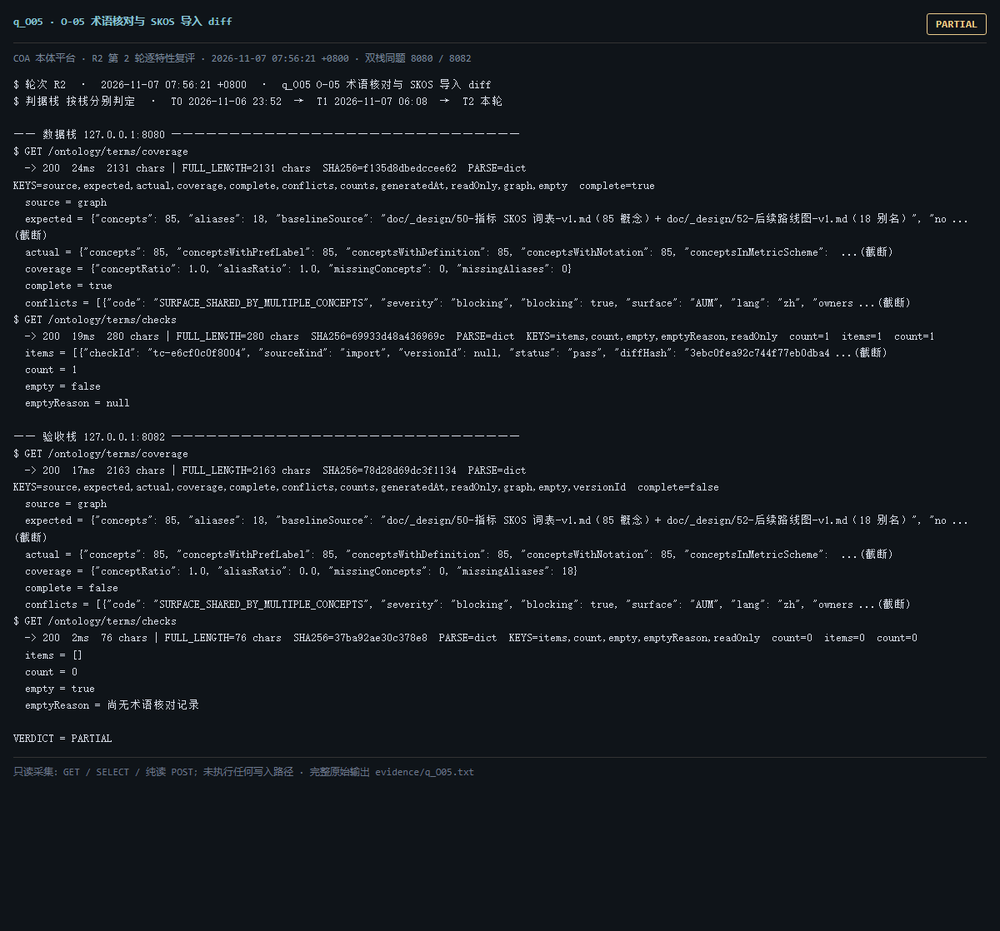

# q_O05 · O-05 术语核对与 SKOS 导入 diff

| 项 | 内容 |
| --- | --- |
| 用例编号 | `q_O05` |
| 特性名称 | O-05 术语核对与 SKOS 导入 diff |
| 分组 | B 本轮特性 O 本体治理 |
| 文档依据 | 50-B05-指标词表入SKOS.md；52 §4.1 O-05 |
| **评估轮次** | **R2（第 2 轮复评）** |
| **本轮采集时间 T2** | **2026-11-07 07:56:21 +0800** |
| **判据栈** | 按栈分别判定 |
| 结论（T2） | **PARTIAL** |
| 证据截图 |  |
| 完整原始输出 | `evidence/q_O05.txt` |

## 0 时间区分（本轮新增）

> 同一特性在不同时间点、不同栈上的状态不同，结论必须带坐标。T0/T1 的旧产物完整保存在
> `_history/2026-11-06_2352/`，独立复核见 `../_evidence-audit/qa_verdict_recheck.md`。

| 轮次 | 时间 | 栈 / 代码基线 | 结论 | 说明 |
| --- | --- | --- | --- | --- |
| **T0 原始采集** | 2026-11-06 23:52 +08 | 数据栈 8080 · 旧镜像 | FAIL | R1 采集器，存在 200KB 静默截断与写死结论 |
| **T1 独立复核 / 修复基线** | 2026-11-07 05:45–06:08 +08 | 验收栈 8082 · `8b3f36f` | PARTIAL | 复核定性：判定逻辑错 |
| **T2 本轮复评** | 2026-11-07 07:56:21 +0800 | 数据栈 8080 + 验收栈 8082 双栈同题 | **PARTIAL** | 采集器已修截断、verdict 由证据动态推导 |

栈说明：
- **数据栈 8080**：镜像 `715d59e8`（11-07 00:53 +08 构建），全量数据，用于验证「数据内容 / 规模」类判据。注意 T0(11-06 23:52) 时 8080 跑的是更早的镜像，容器在 00:53 被重建过，**同一端口跨时间也不是同一个基线**。
- **验收栈 8082**：镜像 `80cb274f` / `agent-platform:0.1-s5`（11-07 05:45 +08 构建），代码等价 `8b3f36f`，验收残留小库，用于验证「代码行为 / 契约」类判据。
- 验收栈 A-Box 为空导致的 `404 / 0` 不判为功能缺陷；两栈版本不同属独立数据库，不计为漂移。

## 1 测试目标

验证 85 概念 / 18 别名已进当前 T-Box，并有覆盖率/冲突报告与核对记录。

## 2 输入

- `GET /ontology/terms/coverage`
- `GET /ontology/terms/checks`
- `GET /browse/terms`
- `SPARQL: 按命名图统计 skos:Concept 数`

> 零污染约束：仅 HTTP GET、只读 SQL `SELECT`、只读 SPARQL `SELECT`、一个已确认不写库的纯读
> `POST /context/resolve`。未调用 `/answer`（会写 PROV 拒答事件），未运行 smoke/acceptance，
> 未触发 seed / refresh / import / materialize / approve / publish / reindex / rollback。
> 验收栈 SPARQL 因 A-Box 为空显式标注 `SKIP`，不做无意义的图查询。

## 3 期待输出

按判据：expected 85 概念/18 别名，actual 应接近且 complete=true；checks 有核对记录；词表在当前 T-Box 指针指向的图里。

## 4 真实输出（T2 · 双栈同题）

### 4.1 数据栈 127.0.0.1:8080（全量数据 / 旧代码）

```
$ GET /ontology/terms/coverage
  -> 200  24ms  2131 chars | FULL_LENGTH=2131 chars  SHA256=f135d8dbedccee62  PARSE=dict  KEYS=source,expected,actual,coverage,complete,conflicts,counts,generatedAt,readOnly,graph,empty  complete=true
  source = graph
  expected = {"concepts": 85, "aliases": 18, "baselineSource": "doc/_design/50-指标 SKOS 词表-v1.md（85 概念）+ doc/_design/52-后续路线图-v1.md（18 别名）", "no ...(截断)
  actual = {"concepts": 85, "conceptsWithPrefLabel": 85, "conceptsWithDefinition": 85, "conceptsWithNotation": 85, "conceptsInMetricScheme":  ...(截断)
  coverage = {"conceptRatio": 1.0, "aliasRatio": 1.0, "missingConcepts": 0, "missingAliases": 0}
  complete = true
  conflicts = [{"code": "SURFACE_SHARED_BY_MULTIPLE_CONCEPTS", "severity": "blocking", "blocking": true, "surface": "AUM", "lang": "zh", "owners ...(截断)
$ GET /ontology/terms/checks
  -> 200  19ms  280 chars | FULL_LENGTH=280 chars  SHA256=69933d48a436969c  PARSE=dict  KEYS=items,count,empty,emptyReason,readOnly  count=1  items=1  count=1
  items = [{"checkId": "tc-e6cf0c0f8004", "sourceKind": "import", "versionId": null, "status": "pass", "diffHash": "3ebc0fea92c744f77eb0dba4 ...(截断)
  count = 1
  empty = false
  emptyReason = null
  readOnly = true
$ GET /browse/terms
  -> 200  19ms  6443 chars | FULL_LENGTH=6443 chars  SHA256=8c3257d5056a0a17  PARSE=dict  KEYS=pointer,entries,classes,counts
  pointer = {"name": "tbox/current", "versionId": "ont-11f92ebb3326", "semver": "1.2.1", "contentHash": "013b9493419812bc375eaddc68ac554d86879 ...(截断)
  entries = [{"entry": "https://w3id.org/fsldm/terms#entry-A01", "classIri": "https://w3id.org/fsldm/agreement#Account", "classLabel": "Accoun ...(截断)
  classes = [{"iri": "https://w3id.org/fsldm/agreement#Account", "label": "Account", "aliases": ["帐户"]}, {"iri": "https://w3id.org/fsldm/asset ...(截断)
  counts = {"anchorClasses": 15, "altLabels": 18, "evidenced": 6, "inferred": 12}
$ SPARQL SELECT ?g (COUNT(DISTINCT ?c) AS ?n) WHERE { GRAPH ?g { ?c a <http://w ...(截断)
  -> OK  362ms  1394 chars | FULL_LENGTH=1394 chars  SHA256=e3832f5077f689de  PARSE=non-json  head=[{"g": {"type": "uri", "value": "urn:platform:graph:tbox:ont-11f92ebb3326"}, "n": {"type": "literal", "value": "180", "d ...(截断)
  [{"g": {"type": "uri", "value": "urn:platform:graph:tbox:ont-11f92ebb3326"}, "n": {"type": "literal", "value": "180", "datatype": "http://www.w3.org/2 ...(截断)
$ GET /readyz
  -> 200  28ms  537 chars | FULL_LENGTH=537 chars  SHA256=0fb8ec1aa53f054c  PARSE=dict  KEYS=status,checks,pointerStatus,warnings,note
```

### 4.2 验收栈 127.0.0.1:8082（新代码 8b3f36f / 小库）

```
$ GET /ontology/terms/coverage
  -> 200  17ms  2163 chars | FULL_LENGTH=2163 chars  SHA256=78d28d69dc3f1134  PARSE=dict  KEYS=source,expected,actual,coverage,complete,conflicts,counts,generatedAt,readOnly,graph,empty,versionId  complete=false
  source = graph
  expected = {"concepts": 85, "aliases": 18, "baselineSource": "doc/_design/50-指标 SKOS 词表-v1.md（85 概念）+ doc/_design/52-后续路线图-v1.md（18 别名）", "no ...(截断)
  actual = {"concepts": 85, "conceptsWithPrefLabel": 85, "conceptsWithDefinition": 85, "conceptsWithNotation": 85, "conceptsInMetricScheme":  ...(截断)
  coverage = {"conceptRatio": 1.0, "aliasRatio": 0.0, "missingConcepts": 0, "missingAliases": 18}
  complete = false
  conflicts = [{"code": "SURFACE_SHARED_BY_MULTIPLE_CONCEPTS", "severity": "blocking", "blocking": true, "surface": "AUM", "lang": "zh", "owners ...(截断)
$ GET /ontology/terms/checks
  -> 200  2ms  76 chars | FULL_LENGTH=76 chars  SHA256=37ba92ae30c378e8  PARSE=dict  KEYS=items,count,empty,emptyReason,readOnly  count=0  items=0  count=0
  items = []
  count = 0
  empty = true
  emptyReason = 尚无术语核对记录
  readOnly = true
$ GET /browse/terms
  -> 200  3ms  358 chars | FULL_LENGTH=358 chars  SHA256=873315bf9ed6093a  PARSE=dict  KEYS=pointer,entries,classes,counts
  pointer = {"name": "tbox/current", "versionId": "ont-6e81732555e5", "semver": "0.0.0", "contentHash": "9417debca40282e5503d73f1446b98374a145 ...(截断)
  entries = []
  classes = []
  counts = {"anchorClasses": 0, "altLabels": 0, "evidenced": 0, "inferred": 0}
$ SPARQL SELECT ?g (COUNT(DISTINCT ?c) AS ?n) WHERE { GRAPH ?g { ?c a <http://w ...(截断)
  -> SKIP  0ms  41 chars | FULL_LENGTH=41 chars  SHA256=68bc3d107364f634  PARSE=non-json  head=验收栈 A-Box 为空且图库未纳管，本栈不执行 SPARQL（数据栈结果见同页）
  验收栈 A-Box 为空且图库未纳管，本栈不执行 SPARQL（数据栈结果见同页）
$ GET /readyz
  -> 200  6ms  537 chars | FULL_LENGTH=537 chars  SHA256=014659d11612174f  PARSE=dict  KEYS=status,checks,pointerStatus,warnings,note
```

> 完整响应（含 `FULL_LENGTH` / `SHA256` / 结构化摘要，超大正文显式标记 `[BODY OMITTED]`）见
> `evidence/q_O05.txt`；终端渲染截图见 `screenshots/q_O05.png`。

## 5 结论

**PARTIAL** — 栈分歧必须分开陈述。数据栈 8080：coverage complete=True、actual.concepts=85、actual.aliases=18、checks.count=1、/ontology/terms/gate HTTP 404（旧镜像无此端点）。验收栈 8082：coverage complete=False、actual.aliases=0、blocking=5、checks.count=0、gate HTTP 200、configuredGate=warn、last.verdict=blocked、last.enforced=True。零术语硬阻断在新代码上确实生效。

T0 判 FAIL 的理由（当前图 0 概念 / 0-of-85 / complete=false）在 T0 证据里即被反证，复核 §3.2 已 FLIP 为 PARTIAL；本轮进一步区分两套栈：数据栈术语齐备、验收栈因 term_import=0 而别名缺失并被门禁阻断，两者都不可笼统写成「术语层未生效」。

---
[返回总报告](README.md) · [T0 归档](<_history/2026-11-06_2352/q_O05_O-05 术语核对与 SKOS 导入 diff.md>)
