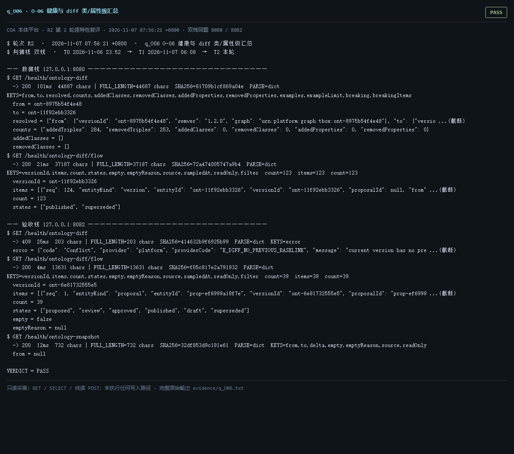

# q_O06 · O-06 健康与 diff 类/属性级汇总

| 项 | 内容 |
| --- | --- |
| 用例编号 | `q_O06` |
| 特性名称 | O-06 健康与 diff 类/属性级汇总 |
| 分组 | B 本轮特性 O 本体治理 |
| 文档依据 | 52 §4.1 O-06；49 §3 |
| **评估轮次** | **R2（第 2 轮复评）** |
| **本轮采集时间 T2** | **2026-11-07 07:56:21 +0800** |
| **判据栈** | 双栈 |
| 结论（T2） | **PASS** |
| 证据截图 |  |
| 完整原始输出 | `evidence/q_O06.txt` |

## 0 时间区分（本轮新增）

> 同一特性在不同时间点、不同栈上的状态不同，结论必须带坐标。T0/T1 的旧产物完整保存在
> `_history/2026-11-06_2352/`，独立复核见 `../_evidence-audit/qa_verdict_recheck.md`。

| 轮次 | 时间 | 栈 / 代码基线 | 结论 | 说明 |
| --- | --- | --- | --- | --- |
| **T0 原始采集** | 2026-11-06 23:52 +08 | 数据栈 8080 · 旧镜像 | PASS | R1 采集器，存在 200KB 静默截断与写死结论 |
| **T1 独立复核 / 修复基线** | 2026-11-07 05:45–06:08 +08 | 验收栈 8082 · `8b3f36f` | PASS | 复核定性：一致 |
| **T2 本轮复评** | 2026-11-07 07:56:21 +0800 | 数据栈 8080 + 验收栈 8082 双栈同题 | **PASS** | 采集器已修截断、verdict 由证据动态推导 |

栈说明：
- **数据栈 8080**：镜像 `715d59e8`（11-07 00:53 +08 构建），全量数据，用于验证「数据内容 / 规模」类判据。注意 T0(11-06 23:52) 时 8080 跑的是更早的镜像，容器在 00:53 被重建过，**同一端口跨时间也不是同一个基线**。
- **验收栈 8082**：镜像 `80cb274f` / `agent-platform:0.1-s5`（11-07 05:45 +08 构建），代码等价 `8b3f36f`，验收残留小库，用于验证「代码行为 / 契约」类判据。
- 验收栈 A-Box 为空导致的 `404 / 0` 不判为功能缺陷；两栈版本不同属独立数据库，不计为漂移。

## 1 测试目标

验证 diff 能按类/属性聚合、支持两版本对比、空态明确。

## 2 输入

- `GET /health/ontology-diff`
- `GET /health/ontology-diff/flow`
- `GET /health/ontology-snapshot`

> 零污染约束：仅 HTTP GET、只读 SQL `SELECT`、只读 SPARQL `SELECT`、一个已确认不写库的纯读
> `POST /context/resolve`。未调用 `/answer`（会写 PROV 拒答事件），未运行 smoke/acceptance，
> 未触发 seed / refresh / import / materialize / approve / publish / reindex / rollback。
> 验收栈 SPARQL 因 A-Box 为空显式标注 `SKIP`，不做无意义的图查询。

## 3 期待输出

diff 返回 addedClasses/removedClasses/addedProperties/removedProperties/counts；snapshot 支持 from/to；空态有 emptyReason。

## 4 真实输出（T2 · 双栈同题）

### 4.1 数据栈 127.0.0.1:8080（全量数据 / 旧代码）

```
$ GET /health/ontology-diff
  -> 200  101ms  44687 chars | FULL_LENGTH=44687 chars  SHA256=81709b1cf869a04e  PARSE=dict  KEYS=from,to,resolved,counts,addedClasses,removedClasses,addedProperties,removedProperties,examples,exampleLimit,breaking,breakingItems
  from = ont-8975b54f4e48
  to = ont-11f92ebb3326
  resolved = {"from": {"versionId": "ont-8975b54f4e48", "semver": "1.2.0", "graph": "urn:platform:graph:tbox:ont-8975b54f4e48"}, "to": {"versio ...(截断)
  counts = {"addedTriples": 284, "removedTriples": 253, "addedClasses": 0, "removedClasses": 0, "addedProperties": 0, "removedProperties": 0}
  addedClasses = []
  removedClasses = []
$ GET /health/ontology-diff/flow
  -> 200  21ms  37187 chars | FULL_LENGTH=37187 chars  SHA256=72a474005747a9b4  PARSE=dict  KEYS=versionId,items,count,states,empty,emptyReason,source,sampledAt,readOnly,filter  count=123  items=123  count=123
  versionId = ont-11f92ebb3326
  items = [{"seq": 124, "entityKind": "version", "entityId": "ont-11f92ebb3326", "versionId": "ont-11f92ebb3326", "proposalId": null, "from" ...(截断)
  count = 123
  states = ["published", "superseded"]
  empty = false
  emptyReason = null
$ GET /health/ontology-snapshot
  -> 200  67ms  1370 chars | FULL_LENGTH=1370 chars  SHA256=0d27eb0a60f3823e  PARSE=dict  KEYS=from,to,delta,empty,emptyReason,source,readOnly
  from = {"versionId": "ont-8975b54f4e48", "semver": "1.2.0", "status": "superseded", "graph": "urn:platform:graph:tbox:ont-8975b54f4e48",  ...(截断)
  to = {"versionId": "ont-11f92ebb3326", "semver": "1.2.1", "status": "published", "graph": "urn:platform:graph:tbox:ont-11f92ebb3326", " ...(截断)
  delta = {"triples": 31, "classes": 0, "properties": 0, "instances": 0}
  empty = false
  emptyReason = null
  source = 各版本类/属性/实例计数 + 内容指纹三元组数
$ GET /readyz
  -> 200  28ms  537 chars | FULL_LENGTH=537 chars  SHA256=0fb8ec1aa53f054c  PARSE=dict  KEYS=status,checks,pointerStatus,warnings,note
```

### 4.2 验收栈 127.0.0.1:8082（新代码 8b3f36f / 小库）

```
$ GET /health/ontology-diff
  -> 409  25ms  203 chars | FULL_LENGTH=203 chars  SHA256=414632b9f6925b99  PARSE=dict  KEYS=error
  error = {"code": "Conflict", "provider": "platform", "providerCode": "E_DIFF_NO_PREVIOUS_BASELINE", "message": "current version has no pre ...(截断)
$ GET /health/ontology-diff/flow
  -> 200  4ms  13631 chars | FULL_LENGTH=13631 chars  SHA256=f05c817e2a791932  PARSE=dict  KEYS=versionId,items,count,states,empty,emptyReason,source,sampledAt,readOnly,filter  count=39  items=39  count=39
  versionId = ont-6e81732555e5
  items = [{"seq": 1, "entityKind": "proposal", "entityId": "prop-ef6999a18f7e", "versionId": "ont-6e81732555e5", "proposalId": "prop-ef6999 ...(截断)
  count = 39
  states = ["proposed", "review", "approved", "published", "draft", "superseded"]
  empty = false
  emptyReason = null
$ GET /health/ontology-snapshot
  -> 200  12ms  732 chars | FULL_LENGTH=732 chars  SHA256=32df853d9c181e61  PARSE=dict  KEYS=from,to,delta,empty,emptyReason,source,readOnly
  from = null
  to = {"versionId": "ont-6e81732555e5", "semver": "0.0.0", "status": "published", "graph": "urn:platform:graph:tbox:ont-6e81732555e5", " ...(截断)
  delta = {}
  empty = true
  emptyReason = 当前版本没有基线版本，无法做快照对比
  source = 各版本类/属性/实例计数 + 内容指纹三元组数
$ GET /readyz
  -> 200  6ms  537 chars | FULL_LENGTH=537 chars  SHA256=014659d11612174f  PARSE=dict  KEYS=status,checks,pointerStatus,warnings,note
  status = ok
  checks = {"database": {"status": "ok"}, "graph": {"status": "ok"}, "storage": {"status": "ok", "disk_free_pct": 32.64}}
  pointerStatus = {"name": "tbox/current", "ok": true, "level": "ok", "status": "published", "versionId": "ont-6e81732555e5", "semver": "0.0.0", "tr ...(截断)
  warnings = []
  note = pointerStatus 仅告警，不参与就绪状态码（避免启动即崩）
```

> 完整响应（含 `FULL_LENGTH` / `SHA256` / 结构化摘要，超大正文显式标记 `[BODY OMITTED]`）见
> `evidence/q_O06.txt`；终端渲染截图见 `screenshots/q_O06.png`。

## 5 结论

**PASS** — 类/属性级聚合、状态流、两版本快照与空态说明均按判据返回。


---
[返回总报告](README.md) · [T0 归档](<_history/2026-11-06_2352/q_O06_O-06 健康与 diff 类-属性级汇总.md>)
