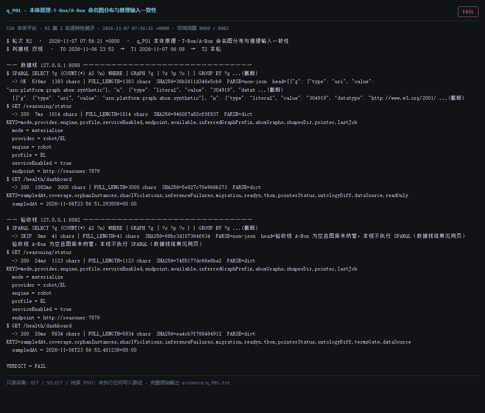

# q_P01 · 本体原理·T-Box/A-Box 命名图分布与推理输入一致性

| 项 | 内容 |
| --- | --- |
| 用例编号 | `q_P01` |
| 特性名称 | 本体原理·T-Box/A-Box 命名图分布与推理输入一致性 |
| 分组 | F 本体原理专项 |
| 文档依据 | 45-产品架构介绍.md；48-技术说明书.md；本体工程通用原理 |
| **评估轮次** | **R2（第 2 轮复评）** |
| **本轮采集时间 T2** | **2026-11-07 07:56:21 +0800** |
| **判据栈** | 双栈 |
| 结论（T2） | **FAIL** |
| 证据截图 |  |
| 完整原始输出 | `evidence/q_P01.txt` |

## 0 时间区分（本轮新增）

> 同一特性在不同时间点、不同栈上的状态不同，结论必须带坐标。T0/T1 的旧产物完整保存在
> `_history/2026-11-06_2352/`，独立复核见 `../_evidence-audit/qa_verdict_recheck.md`。

| 轮次 | 时间 | 栈 / 代码基线 | 结论 | 说明 |
| --- | --- | --- | --- | --- |
| **T0 原始采集** | 2026-11-06 23:52 +08 | 数据栈 8080 · 旧镜像 | FAIL | R1 采集器，存在 200KB 静默截断与写死结论 |
| **T1 独立复核 / 修复基线** | 2026-11-07 05:45–06:08 +08 | 验收栈 8082 · `8b3f36f` | FAIL | 复核定性：一致 |
| **T2 本轮复评** | 2026-11-07 07:56:21 +0800 | 数据栈 8080 + 验收栈 8082 双栈同题 | **FAIL** | 采集器已修截断、verdict 由证据动态推导 |

栈说明：
- **数据栈 8080**：镜像 `715d59e8`（11-07 00:53 +08 构建），全量数据，用于验证「数据内容 / 规模」类判据。注意 T0(11-06 23:52) 时 8080 跑的是更早的镜像，容器在 00:53 被重建过，**同一端口跨时间也不是同一个基线**。
- **验收栈 8082**：镜像 `80cb274f` / `agent-platform:0.1-s5`（11-07 05:45 +08 构建），代码等价 `8b3f36f`，验收残留小库，用于验证「代码行为 / 契约」类判据。
- 验收栈 A-Box 为空导致的 `404 / 0` 不判为功能缺陷；两栈版本不同属独立数据库，不计为漂移。

## 1 测试目标

从本体原理检查：T-Box 与 A-Box 是否分区、实例图命名是否有单一权威、推理器读入的图是否等于真实数据所在图。

## 2 输入

- `SPARQL: 按命名图统计三元组 TOP`
- `GET /reasoning/status（aboxGraphs）`
- `GET /health/dashboard（coverage.instances.graphs）`

> 零污染约束：仅 HTTP GET、只读 SQL `SELECT`、只读 SPARQL `SELECT`、一个已确认不写库的纯读
> `POST /context/resolve`。未调用 `/answer`（会写 PROV 拒答事件），未运行 smoke/acceptance，
> 未触发 seed / refresh / import / materialize / approve / publish / reindex / rollback。
> 验收栈 SPARQL 因 A-Box 为空显式标注 `SKIP`，不做无意义的图查询。

## 3 期待输出

推理器的 aboxGraphs 应与看板统计的 A-Box 图集合一致；命名图 IRI 应由注册表驱动而非散落硬编码。

## 4 真实输出（T2 · 双栈同题）

### 4.1 数据栈 127.0.0.1:8080（全量数据 / 旧代码）

```
$ SPARQL SELECT ?g (COUNT(*) AS ?n) WHERE { GRAPH ?g { ?s ?p ?o } } GROUP BY ?g ...(截断)
  -> OK  516ms  1383 chars | FULL_LENGTH=1383 chars  SHA256=36b2611d346e5cb9  PARSE=non-json  head=[{"g": {"type": "uri", "value": "urn:platform:graph:abox:synthetic"}, "n": {"type": "literal", "value": "304919", "datat ...(截断)
  [{"g": {"type": "uri", "value": "urn:platform:graph:abox:synthetic"}, "n": {"type": "literal", "value": "304919", "datatype": "http://www.w3.org/2001/ ...(截断)
$ GET /reasoning/status
  -> 200  7ms  1014 chars | FULL_LENGTH=1014 chars  SHA256=9460f7a82cf0f837  PARSE=dict  KEYS=mode,provider,engine,profile,serviceEnabled,endpoint,available,inferredGraphPrefix,aboxGraphs,shapesDir,pointer,lastJob
  mode = materialize
  provider = robot/EL
  engine = robot
  profile = EL
  serviceEnabled = true
  endpoint = http://reasoner:7879
$ GET /health/dashboard
  -> 200  1082ms  3000 chars | FULL_LENGTH=3000 chars  SHA256=5e827c70e966b273  PARSE=dict  KEYS=sampledAt,coverage,orphanInstances,shaclViolations,inferenceFailures,migration,readyz,tbox,pointerStatus,ontologyDiff,dataSource,readOnly
  sampledAt = 2026-11-06T23:56:51.293508+00:00
  coverage = {"classes": {"total": 159, "withInstances": 156, "ratio": 0.9811, "unlabeled": 0, "error": null, "source": "SPARQL GRAPH <urn:plat ...(截断)
  orphanInstances = {"count": 0, "error": null, "source": "A-Box：无出边（除 rdf:type/rdfs:label）且无入边的实例"}
  shaclViolations = {"count": 0, "conforms": true, "importId": "imp-e34387c39d06", "versionId": "ont-draft-b814289626a0", "sampledAt": "2026-11-07T00: ...(截断)
  inferenceFailures = {"count": 336, "lastJob": {"jobId": "rsn-b0dbf674542d", "kind": "materialize", "state": "succeeded", "ontologyVersion": "ont-11f92 ...(截断)
  migration = {"codeVersion": 34, "dbVersion": 34, "consistent": true, "source": "platform.schema_version MAX(version) vs SUPPORTED_SCHEMA_VERSI ...(截断)
$ GET /readyz
  -> 200  28ms  537 chars | FULL_LENGTH=537 chars  SHA256=0fb8ec1aa53f054c  PARSE=dict  KEYS=status,checks,pointerStatus,warnings,note
  status = ok
  checks = {"database": {"status": "ok"}, "graph": {"status": "ok"}, "storage": {"status": "ok", "disk_free_pct": 32.64}}
  pointerStatus = {"name": "tbox/current", "ok": true, "level": "ok", "status": "published", "versionId": "ont-11f92ebb3326", "semver": "1.2.1", "tr ...(截断)
  warnings = []
  note = pointerStatus 仅告警，不参与就绪状态码（避免启动即崩）
```

### 4.2 验收栈 127.0.0.1:8082（新代码 8b3f36f / 小库）

```
$ SPARQL SELECT ?g (COUNT(*) AS ?n) WHERE { GRAPH ?g { ?s ?p ?o } } GROUP BY ?g ...(截断)
  -> SKIP  0ms  41 chars | FULL_LENGTH=41 chars  SHA256=68bc3d107364f634  PARSE=non-json  head=验收栈 A-Box 为空且图库未纳管，本栈不执行 SPARQL（数据栈结果见同页）
  验收栈 A-Box 为空且图库未纳管，本栈不执行 SPARQL（数据栈结果见同页）
$ GET /reasoning/status
  -> 200  24ms  1123 chars | FULL_LENGTH=1123 chars  SHA256=7455177dc66e6ba2  PARSE=dict  KEYS=mode,provider,engine,profile,serviceEnabled,endpoint,available,inferredGraphPrefix,aboxGraphs,shapesDir,pointer,lastJob
  mode = materialize
  provider = robot/EL
  engine = robot
  profile = EL
  serviceEnabled = true
  endpoint = http://reasoner:7879
$ GET /health/dashboard
  -> 200  20ms  5834 chars | FULL_LENGTH=5834 chars  SHA256=ea4cb7f788484912  PARSE=dict  KEYS=sampledAt,coverage,orphanInstances,shaclViolations,inferenceFailures,migration,readyz,tbox,pointerStatus,ontologyDiff,termsGate,dataSource
  sampledAt = 2026-11-06T23:56:52.401238+00:00
  coverage = {"classes": {"total": 156, "withInstances": 0, "ratio": 0.0, "unlabeled": 0, "error": null, "source": "SPARQL GRAPH <urn:platform: ...(截断)
  orphanInstances = {"count": 0, "error": null, "source": "A-Box：无出边（除 rdf:type/rdfs:label）且无入边的实例"}
  shaclViolations = {"count": null, "conforms": null, "sampledAt": null, "source": "platform.ontology_import（最新导入记录）", "note": "无导入记录，未以 0 代替"}
  inferenceFailures = {"count": 3, "lastJob": {"jobId": "rsn-cc97af80d34f", "kind": "materialize", "state": "failed", "ontologyVersion": "ont-6e81732555 ...(截断)
  migration = {"codeVersion": 40, "dbVersion": 40, "consistent": true, "source": "platform.schema_version MAX(version) vs SUPPORTED_SCHEMA_VERSI ...(截断)
$ GET /readyz
  -> 200  6ms  537 chars | FULL_LENGTH=537 chars  SHA256=014659d11612174f  PARSE=dict  KEYS=status,checks,pointerStatus,warnings,note
  status = ok
  checks = {"database": {"status": "ok"}, "graph": {"status": "ok"}, "storage": {"status": "ok", "disk_free_pct": 32.64}}
  pointerStatus = {"name": "tbox/current", "ok": true, "level": "ok", "status": "published", "versionId": "ont-6e81732555e5", "semver": "0.0.0", "tr ...(截断)
  warnings = []
  note = pointerStatus 仅告警，不参与就绪状态码（避免启动即崩）
```

> 完整响应（含 `FULL_LENGTH` / `SHA256` / 结构化摘要，超大正文显式标记 `[BODY OMITTED]`）见
> `evidence/q_P01.txt`；终端渲染截图见 `screenshots/q_P01.png`。

## 5 结论

**FAIL** — 推理器 aboxGraphs=['urn:platform:graph:abox:main'] 只读 abox:main；看板 graphs=None 同时读 main 与 synthetic；真实实例绝大多数在 abox:synthetic。两套栈均如此（验收栈 aboxGraphs=['urn:platform:graph:abox:main']）。「哪个图是 A-Box」仍无唯一权威，命名图缺注册表。

这是架构层面的核心问题，两轮、两栈一致，未随时间改善。

---
[返回总报告](README.md) · [T0 归档](<_history/2026-11-06_2352/q_P01_本体原理·T-Box-A-Box 命名图分布与推理输入一致性.md>)
