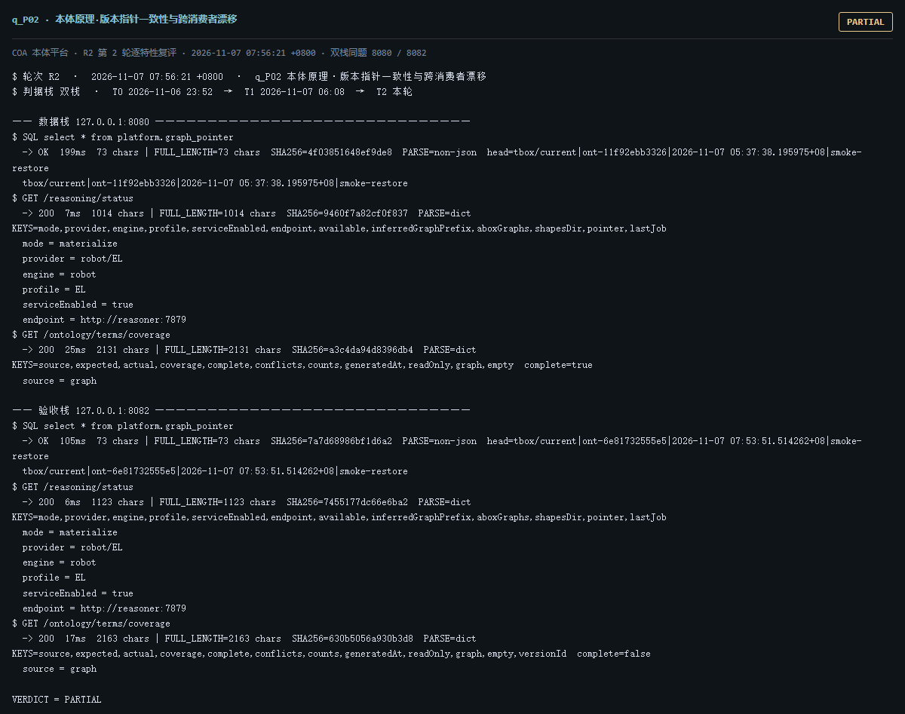

# q_P02 · 本体原理·版本指针一致性与跨消费者漂移

| 项 | 内容 |
| --- | --- |
| 用例编号 | `q_P02` |
| 特性名称 | 本体原理·版本指针一致性与跨消费者漂移 |
| 分组 | F 本体原理专项 |
| 文档依据 | 10-实施路线图.md S1/S11；50-B05-指标词表入SKOS.md |
| **评估轮次** | **R2（第 2 轮复评）** |
| **本轮采集时间 T2** | **2026-11-07 07:56:21 +0800** |
| **判据栈** | 双栈 |
| 结论（T2） | **PARTIAL** |
| 证据截图 |  |
| 完整原始输出 | `evidence/q_P02.txt` |

## 0 时间区分（本轮新增）

> 同一特性在不同时间点、不同栈上的状态不同，结论必须带坐标。T0/T1 的旧产物完整保存在
> `_history/2026-11-06_2352/`，独立复核见 `../_evidence-audit/qa_verdict_recheck.md`。

| 轮次 | 时间 | 栈 / 代码基线 | 结论 | 说明 |
| --- | --- | --- | --- | --- |
| **T0 原始采集** | 2026-11-06 23:52 +08 | 数据栈 8080 · 旧镜像 | FAIL | R1 采集器，存在 200KB 静默截断与写死结论 |
| **T1 独立复核 / 修复基线** | 2026-11-07 05:45–06:08 +08 | 验收栈 8082 · `8b3f36f` | PARTIAL | 复核定性：判定逻辑错 |
| **T2 本轮复评** | 2026-11-07 07:56:21 +0800 | 数据栈 8080 + 验收栈 8082 双栈同题 | **PARTIAL** | 采集器已修截断、verdict 由证据动态推导 |

栈说明：
- **数据栈 8080**：镜像 `715d59e8`（11-07 00:53 +08 构建），全量数据，用于验证「数据内容 / 规模」类判据。注意 T0(11-06 23:52) 时 8080 跑的是更早的镜像，容器在 00:53 被重建过，**同一端口跨时间也不是同一个基线**。
- **验收栈 8082**：镜像 `80cb274f` / `agent-platform:0.1-s5`（11-07 05:45 +08 构建），代码等价 `8b3f36f`，验收残留小库，用于验证「代码行为 / 契约」类判据。
- 验收栈 A-Box 为空导致的 `404 / 0` 不判为功能缺陷；两栈版本不同属独立数据库，不计为漂移。

## 1 测试目标

检查 tbox/current 指针、推理器默认指针、术语覆盖所用的图、实体页引用的图是否指向同一本体版本。

## 2 输入

- `SQL: SELECT * FROM platform.graph_pointer`
- `GET /reasoning/status（pointer）`
- `GET /ontology/terms/coverage（graph）`
- `GET /ui/api/entity（graphs）`

> 零污染约束：仅 HTTP GET、只读 SQL `SELECT`、只读 SPARQL `SELECT`、一个已确认不写库的纯读
> `POST /context/resolve`。未调用 `/answer`（会写 PROV 拒答事件），未运行 smoke/acceptance，
> 未触发 seed / refresh / import / materialize / approve / publish / reindex / rollback。
> 验收栈 SPARQL 因 A-Box 为空显式标注 `SKIP`，不做无意义的图查询。

## 3 期待输出

同一时刻，所有消费者应解析到同一个已发布 ontologyVersion；切换版本时词表/SHACL/推理产物应同步迁移。

## 4 真实输出（T2 · 双栈同题）

### 4.1 数据栈 127.0.0.1:8080（全量数据 / 旧代码）

```
$ SQL select * from platform.graph_pointer
  -> OK  199ms  73 chars | FULL_LENGTH=73 chars  SHA256=4f03851648ef9de8  PARSE=non-json  head=tbox/current|ont-11f92ebb3326|2026-11-07 05:37:38.195975+08|smoke-restore
  tbox/current|ont-11f92ebb3326|2026-11-07 05:37:38.195975+08|smoke-restore
$ GET /reasoning/status
  -> 200  7ms  1014 chars | FULL_LENGTH=1014 chars  SHA256=9460f7a82cf0f837  PARSE=dict  KEYS=mode,provider,engine,profile,serviceEnabled,endpoint,available,inferredGraphPrefix,aboxGraphs,shapesDir,pointer,lastJob
  mode = materialize
  provider = robot/EL
  engine = robot
  profile = EL
  serviceEnabled = true
  endpoint = http://reasoner:7879
$ GET /ontology/terms/coverage
  -> 200  25ms  2131 chars | FULL_LENGTH=2131 chars  SHA256=a3c4da94d8396db4  PARSE=dict  KEYS=source,expected,actual,coverage,complete,conflicts,counts,generatedAt,readOnly,graph,empty  complete=true
  source = graph
  expected = {"concepts": 85, "aliases": 18, "baselineSource": "doc/_design/50-指标 SKOS 词表-v1.md（85 概念）+ doc/_design/52-后续路线图-v1.md（18 别名）", "no ...(截断)
  actual = {"concepts": 85, "conceptsWithPrefLabel": 85, "conceptsWithDefinition": 85, "conceptsWithNotation": 85, "conceptsInMetricScheme":  ...(截断)
  coverage = {"conceptRatio": 1.0, "aliasRatio": 1.0, "missingConcepts": 0, "missingAliases": 0}
  complete = true
  conflicts = [{"code": "SURFACE_SHARED_BY_MULTIPLE_CONCEPTS", "severity": "blocking", "blocking": true, "surface": "AUM", "lang": "zh", "owners ...(截断)
$ GET /ui/api/entity?iri=urn%3Aplatform%3Asynthetic%2Finvestment_InvestmentObjective-00175
  -> 200  34ms  2352 chars | FULL_LENGTH=2352 chars  SHA256=bddc872fdafa78ad  PARSE=dict  KEYS=iri,label,classes,requiredProperties,requiredStatus,properties,neighbors,instanceCount,relatedMetrics,sources,evidenceBadge,tbox
  iri = urn:platform:synthetic/investment_InvestmentObjective-00175
  label = InvestmentObjective-00175
  classes = [{"iri": "https://w3id.org/fsldm/investment#InvestmentObjective", "label": "投资目标", "labeled": true, "chain": [{"iri": "https://w3i ...(截断)
  requiredProperties = []
  requiredStatus = no-restrictions
```

### 4.2 验收栈 127.0.0.1:8082（新代码 8b3f36f / 小库）

```
$ SQL select * from platform.graph_pointer
  -> OK  105ms  73 chars | FULL_LENGTH=73 chars  SHA256=7a7d68986bf1d6a2  PARSE=non-json  head=tbox/current|ont-6e81732555e5|2026-11-07 07:53:51.514262+08|smoke-restore
  tbox/current|ont-6e81732555e5|2026-11-07 07:53:51.514262+08|smoke-restore
$ GET /reasoning/status
  -> 200  6ms  1123 chars | FULL_LENGTH=1123 chars  SHA256=7455177dc66e6ba2  PARSE=dict  KEYS=mode,provider,engine,profile,serviceEnabled,endpoint,available,inferredGraphPrefix,aboxGraphs,shapesDir,pointer,lastJob
  mode = materialize
  provider = robot/EL
  engine = robot
  profile = EL
  serviceEnabled = true
  endpoint = http://reasoner:7879
$ GET /ontology/terms/coverage
  -> 200  17ms  2163 chars | FULL_LENGTH=2163 chars  SHA256=630b5056a930b3d8  PARSE=dict  KEYS=source,expected,actual,coverage,complete,conflicts,counts,generatedAt,readOnly,graph,empty,versionId  complete=false
  source = graph
  expected = {"concepts": 85, "aliases": 18, "baselineSource": "doc/_design/50-指标 SKOS 词表-v1.md（85 概念）+ doc/_design/52-后续路线图-v1.md（18 别名）", "no ...(截断)
  actual = {"concepts": 85, "conceptsWithPrefLabel": 85, "conceptsWithDefinition": 85, "conceptsWithNotation": 85, "conceptsInMetricScheme":  ...(截断)
  coverage = {"conceptRatio": 1.0, "aliasRatio": 0.0, "missingConcepts": 0, "missingAliases": 18}
  complete = false
  conflicts = [{"code": "SURFACE_SHARED_BY_MULTIPLE_CONCEPTS", "severity": "blocking", "blocking": true, "surface": "AUM", "lang": "zh", "owners ...(截断)
$ GET /ui/api/entity?iri=urn%3Aplatform%3Asynthetic%2Finvestment_InvestmentObjective-00175
  -> 404  14ms  323 chars | FULL_LENGTH=323 chars  SHA256=6bc14f5c7183bc71  PARSE=dict  KEYS=error
  error = {"code": "NotFound", "provider": "platform", "providerCode": "E_ENTITY_NOT_FOUND", "message": "entity not found in any configured  ...(截断)
$ GET /readyz
  -> 200  6ms  537 chars | FULL_LENGTH=537 chars  SHA256=014659d11612174f  PARSE=dict  KEYS=status,checks,pointerStatus,warnings,note
  status = ok
  checks = {"database": {"status": "ok"}, "graph": {"status": "ok"}, "storage": {"status": "ok", "disk_free_pct": 32.64}}
```

> 完整响应（含 `FULL_LENGTH` / `SHA256` / 结构化摘要，超大正文显式标记 `[BODY OMITTED]`）见
> `evidence/q_P02.txt`；终端渲染截图见 `screenshots/q_P02.png`。

## 5 结论

**PARTIAL** — 单栈内各消费者解析到的版本在本轮是一致的：8080: pointer=ont-11f92ebb3326 / tree=ont-11f92ebb3326 / reasoning=ont-11f92ebb3326 / terms图含当前版本=True；8082: pointer=ont-6e81732555e5 / tree=ont-6e81732555e5 / reasoning=ont-6e81732555e5 / terms图含当前版本=True。两栈版本不同是两套独立数据库，不构成漂移。但各模块仍各写图名/指针常量、没有统一的 Version Resolution Service，属于架构隐患而非当前故障。

T0 判 FAIL 的「版本漂移」在 T0 同文件证据里即被反证，复核 §3.2 FLIP 为 PARTIAL；本轮在两套独立栈上再验证一次，结论一致。

---
[返回总报告](README.md) · [T0 归档](<_history/2026-11-06_2352/q_P02_本体原理·版本指针一致性与跨消费者漂移.md>)
