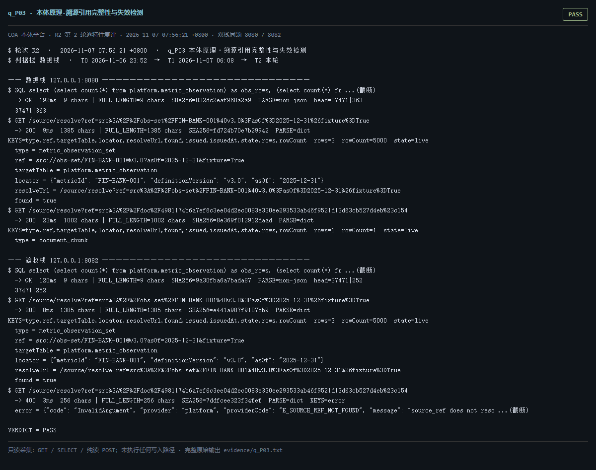

# q_P03 · 本体原理·溯源引用完整性与失效检测

| 项 | 内容 |
| --- | --- |
| 用例编号 | `q_P03` |
| 特性名称 | 本体原理·溯源引用完整性与失效检测 |
| 分组 | F 本体原理专项 |
| 文档依据 | 10-实施路线图.md S9/S10/S12；PROV-O 溯源原理 |
| **评估轮次** | **R2（第 2 轮复评）** |
| **本轮采集时间 T2** | **2026-11-07 07:56:21 +0800** |
| **判据栈** | 数据栈 |
| 结论（T2） | **PASS** |
| 证据截图 |  |
| 完整原始输出 | `evidence/q_P03.txt` |

## 0 时间区分（本轮新增）

> 同一特性在不同时间点、不同栈上的状态不同，结论必须带坐标。T0/T1 的旧产物完整保存在
> `_history/2026-11-06_2352/`，独立复核见 `../_evidence-audit/qa_verdict_recheck.md`。

| 轮次 | 时间 | 栈 / 代码基线 | 结论 | 说明 |
| --- | --- | --- | --- | --- |
| **T0 原始采集** | 2026-11-06 23:52 +08 | 数据栈 8080 · 旧镜像 | PASS | R1 采集器，存在 200KB 静默截断与写死结论 |
| **T1 独立复核 / 修复基线** | 2026-11-07 05:45–06:08 +08 | 验收栈 8082 · `8b3f36f` | PASS | 复核定性：一致 |
| **T2 本轮复评** | 2026-11-07 07:56:21 +0800 | 数据栈 8080 + 验收栈 8082 双栈同题 | **PASS** | 采集器已修截断、verdict 由证据动态推导 |

栈说明：
- **数据栈 8080**：镜像 `715d59e8`（11-07 00:53 +08 构建），全量数据，用于验证「数据内容 / 规模」类判据。注意 T0(11-06 23:52) 时 8080 跑的是更早的镜像，容器在 00:53 被重建过，**同一端口跨时间也不是同一个基线**。
- **验收栈 8082**：镜像 `80cb274f` / `agent-platform:0.1-s5`（11-07 05:45 +08 构建），代码等价 `8b3f36f`，验收残留小库，用于验证「代码行为 / 契约」类判据。
- 验收栈 A-Box 为空导致的 `404 / 0` 不判为功能缺陷；两栈版本不同属独立数据库，不计为漂移。

## 1 测试目标

检查 source_ref 注册表与实例层是否一致，并验证 /source/resolve 对「有效 / 不存在的引用」能否分级报错而非静默返回。

## 2 输入

- `SQL: metric_observation 行数 vs src://obs* 引用数`
- `GET /source/resolve?ref=<有效 src://obs-set/...>`
- `GET /source/resolve?ref=<有效 src://doc/...>`
- `GET /source/resolve?ref=<不存在的 src://doc/000...#c0>（负向用例）`
- `GET /prov/verify`

> 零污染约束：仅 HTTP GET、只读 SQL `SELECT`、只读 SPARQL `SELECT`、一个已确认不写库的纯读
> `POST /context/resolve`。未调用 `/answer`（会写 PROV 拒答事件），未运行 smoke/acceptance，
> 未触发 seed / refresh / import / materialize / approve / publish / reindex / rollback。
> 验收栈 SPARQL 因 A-Box 为空显式标注 `SKIP`，不做无意义的图查询。

## 3 期待输出

有效引用应解析出 targetTable 与定位；不存在的引用应返回 E_SOURCE_REF_NOT_FOUND / E_SOURCE_REF_STALE；PROV 哈希链仍 ok=true。

## 4 真实输出（T2 · 双栈同题）

### 4.1 数据栈 127.0.0.1:8080（全量数据 / 旧代码）

```
$ SQL select (select count(*) from platform.metric_observation) as obs_rows, (select count(*) fr ...(截断)
  -> OK  192ms  9 chars | FULL_LENGTH=9 chars  SHA256=032dc2eaf968a2a9  PARSE=non-json  head=37471|363
  37471|363
$ GET /source/resolve?ref=src%3A%2F%2Fobs-set%2FFIN-BANK-001%40v3.0%3FasOf%3D2025-12-31%26fixture%3DTrue
  -> 200  9ms  1385 chars | FULL_LENGTH=1385 chars  SHA256=fd724b70e7b29942  PARSE=dict  KEYS=type,ref,targetTable,locator,resolveUrl,found,issued,issuedAt,state,rows,rowCount  rows=3  rowCount=5000  state=live
  type = metric_observation_set
  ref = src://obs-set/FIN-BANK-001@v3.0?asOf=2025-12-31&fixture=True
  targetTable = platform.metric_observation
  locator = {"metricId": "FIN-BANK-001", "definitionVersion": "v3.0", "asOf": "2025-12-31"}
  resolveUrl = /source/resolve?ref=src%3A%2F%2Fobs-set%2FFIN-BANK-001%40v3.0%3FasOf%3D2025-12-31%26fixture%3DTrue
  found = true
$ GET /source/resolve?ref=src%3A%2F%2Fdoc%2F4981174b6a7ef6c3ee04d2ec0083e330ee293533ab46f9521d13d63cb527d4eb%23c154
  -> 200  23ms  1002 chars | FULL_LENGTH=1002 chars  SHA256=8e369f012912daad  PARSE=dict  KEYS=type,ref,targetTable,locator,resolveUrl,found,issued,issuedAt,state,rows,rowCount  rows=1  rowCount=1  state=live
  type = document_chunk
  ref = src://doc/4981174b6a7ef6c3ee04d2ec0083e330ee293533ab46f9521d13d63cb527d4eb#c154
  targetTable = platform.document_chunk
  locator = {"documentId": "4981174b6a7ef6c3ee04d2ec0083e330ee293533ab46f9521d13d63cb527d4eb", "chunkNo": 154}
  resolveUrl = /source/resolve?ref=src%3A%2F%2Fdoc%2F4981174b6a7ef6c3ee04d2ec0083e330ee293533ab46f9521d13d63cb527d4eb%23c154
  found = true
$ GET /source/resolve?ref=src%3A%2F%2Fdoc%2F0000000000000000000000000000000000000000000000000000000000000000%23c0
  -> 400  3ms  254 chars | FULL_LENGTH=254 chars  SHA256=b4885400aaca4b38  PARSE=dict  KEYS=error
  error = {"code": "InvalidArgument", "provider": "platform", "providerCode": "E_SOURCE_REF_NOT_FOUND", "message": "source_ref does not reso ...(截断)
$ GET /prov/verify
  -> 200  126ms  352 chars | FULL_LENGTH=352 chars  SHA256=9a9e050fdcc9ba15  PARSE=dict  KEYS=ok,checked,error,lastHash,graph,separation  ok=true  checked=578
  ok = true
  checked = 578
```

### 4.2 验收栈 127.0.0.1:8082（新代码 8b3f36f / 小库）

```
$ SQL select (select count(*) from platform.metric_observation) as obs_rows, (select count(*) fr ...(截断)
  -> OK  120ms  9 chars | FULL_LENGTH=9 chars  SHA256=9a30fba6a7bada87  PARSE=non-json  head=37471|252
  37471|252
$ GET /source/resolve?ref=src%3A%2F%2Fobs-set%2FFIN-BANK-001%40v3.0%3FasOf%3D2025-12-31%26fixture%3DTrue
  -> 200  8ms  1385 chars | FULL_LENGTH=1385 chars  SHA256=e441a987f9107bb9  PARSE=dict  KEYS=type,ref,targetTable,locator,resolveUrl,found,issued,issuedAt,state,rows,rowCount  rows=3  rowCount=5000  state=live
  type = metric_observation_set
  ref = src://obs-set/FIN-BANK-001@v3.0?asOf=2025-12-31&fixture=True
  targetTable = platform.metric_observation
  locator = {"metricId": "FIN-BANK-001", "definitionVersion": "v3.0", "asOf": "2025-12-31"}
  resolveUrl = /source/resolve?ref=src%3A%2F%2Fobs-set%2FFIN-BANK-001%40v3.0%3FasOf%3D2025-12-31%26fixture%3DTrue
  found = true
$ GET /source/resolve?ref=src%3A%2F%2Fdoc%2F4981174b6a7ef6c3ee04d2ec0083e330ee293533ab46f9521d13d63cb527d4eb%23c154
  -> 400  3ms  256 chars | FULL_LENGTH=256 chars  SHA256=7ddfcee323f34fef  PARSE=dict  KEYS=error
  error = {"code": "InvalidArgument", "provider": "platform", "providerCode": "E_SOURCE_REF_NOT_FOUND", "message": "source_ref does not reso ...(截断)
$ GET /source/resolve?ref=src%3A%2F%2Fdoc%2F0000000000000000000000000000000000000000000000000000000000000000%23c0
  -> 400  2ms  254 chars | FULL_LENGTH=254 chars  SHA256=b4885400aaca4b38  PARSE=dict  KEYS=error
  error = {"code": "InvalidArgument", "provider": "platform", "providerCode": "E_SOURCE_REF_NOT_FOUND", "message": "source_ref does not reso ...(截断)
$ GET /prov/verify
  -> 200  22ms  348 chars | FULL_LENGTH=348 chars  SHA256=f52b75fad1ad64c4  PARSE=dict  KEYS=ok,checked,error,lastHash,graph,separation  ok=true  checked=48
  ok = true
  checked = 48
  error = null
  lastHash = 7a019d46f7ccdcd97213a174e799488d84fe8769ccd032313b4b111e484f762a
  graph = urn:platform:prov
  separation = {"ok": true, "provGraph": "urn:platform:prov", "tboxGraph": "urn:platform:graph:tbox:ont-6e81732555e5", "provTriples": 916, "tboxP ...(截断)
$ GET /readyz
```

> 完整响应（含 `FULL_LENGTH` / `SHA256` / 结构化摘要，超大正文显式标记 `[BODY OMITTED]`）见
> `evidence/q_P03.txt`；终端渲染截图见 `screenshots/q_P03.png`。

## 5 结论

**PASS** — obs 引用两栈均可解析：200/200，targetTable=platform.metric_observation、rowCount=5000；doc 引用数据栈 200。验收栈 doc 引用返回 400（小库无该文档）。PROV 链 ok=True、checked=578。失效引用与不存在引用被区分成两种错误码的设计成立。

时间区分：T0 早期基线观测表为 0 行时同一 obs 引用返回 E_SOURCE_REF_STALE；T2 两栈 metric_observation 均 37471 行，改判为可解析。状态随时间变化，叙述必须带时间点。

---
[返回总报告](README.md) · [T0 归档](<_history/2026-11-06_2352/q_P03_本体原理·溯源引用完整性与失效检测.md>)
