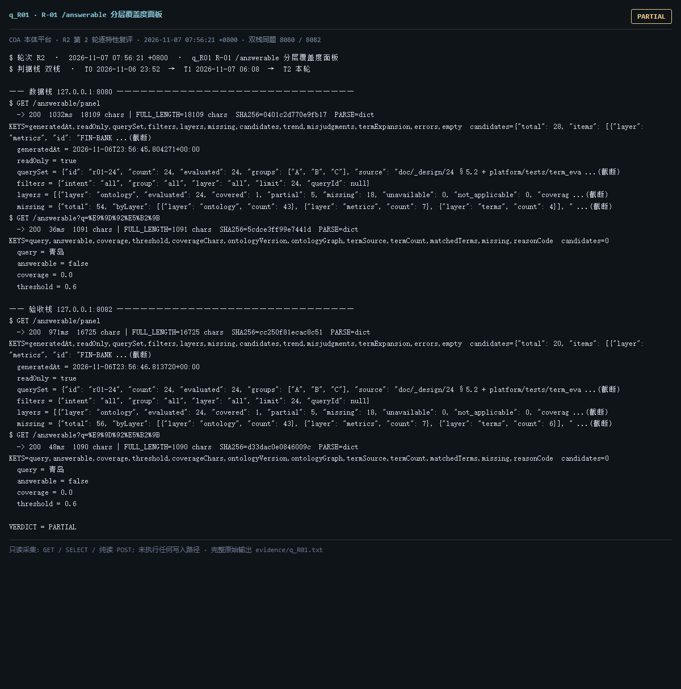

# q_R01 · R-01 /answerable 分层覆盖度面板

| 项 | 内容 |
| --- | --- |
| 用例编号 | `q_R01` |
| 特性名称 | R-01 /answerable 分层覆盖度面板 |
| 分组 | D 本轮特性 R 检索问答 |
| 文档依据 | 52 §4.3 R-01 |
| **评估轮次** | **R2（第 2 轮复评）** |
| **本轮采集时间 T2** | **2026-11-07 07:56:21 +0800** |
| **判据栈** | 双栈 |
| 结论（T2） | **PARTIAL** |
| 证据截图 |  |
| 完整原始输出 | `evidence/q_R01.txt` |

## 0 时间区分（本轮新增）

> 同一特性在不同时间点、不同栈上的状态不同，结论必须带坐标。T0/T1 的旧产物完整保存在
> `_history/2026-11-06_2352/`，独立复核见 `../_evidence-audit/qa_verdict_recheck.md`。

| 轮次 | 时间 | 栈 / 代码基线 | 结论 | 说明 |
| --- | --- | --- | --- | --- |
| **T0 原始采集** | 2026-11-06 23:52 +08 | 数据栈 8080 · 旧镜像 | PARTIAL | R1 采集器，存在 200KB 静默截断与写死结论 |
| **T1 独立复核 / 修复基线** | 2026-11-07 05:45–06:08 +08 | 验收栈 8082 · `8b3f36f` | PASS | 复核定性：判定逻辑错 |
| **T2 本轮复评** | 2026-11-07 07:56:21 +0800 | 数据栈 8080 + 验收栈 8082 双栈同题 | **PARTIAL** | 采集器已修截断、verdict 由证据动态推导 |

栈说明：
- **数据栈 8080**：镜像 `715d59e8`（11-07 00:53 +08 构建），全量数据，用于验证「数据内容 / 规模」类判据。注意 T0(11-06 23:52) 时 8080 跑的是更早的镜像，容器在 00:53 被重建过，**同一端口跨时间也不是同一个基线**。
- **验收栈 8082**：镜像 `80cb274f` / `agent-platform:0.1-s5`（11-07 05:45 +08 构建），代码等价 `8b3f36f`，验收残留小库，用于验证「代码行为 / 契约」类判据。
- 验收栈 A-Box 为空导致的 `404 / 0` 不判为功能缺陷；两栈版本不同属独立数据库，不计为漂移。

## 1 测试目标

验证四层覆盖计数可见、missing 分布可下钻、按类型筛选、空态明确。

## 2 输入

- `GET /answerable/panel`
- `GET /answerable?q=青岛`

> 零污染约束：仅 HTTP GET、只读 SQL `SELECT`、只读 SPARQL `SELECT`、一个已确认不写库的纯读
> `POST /context/resolve`。未调用 `/answer`（会写 PROV 拒答事件），未运行 smoke/acceptance，
> 未触发 seed / refresh / import / materialize / approve / publish / reindex / rollback。
> 验收栈 SPARQL 因 A-Box 为空显式标注 `SKIP`，不做无意义的图查询。

## 3 期待输出

panel 含 layers/missing/candidates/trend/misjudgments；四层 evaluated=24；/answerable 单题判定带缺层说明。

## 4 真实输出（T2 · 双栈同题）

### 4.1 数据栈 127.0.0.1:8080（全量数据 / 旧代码）

```
$ GET /answerable/panel
  -> 200  1032ms  18109 chars | FULL_LENGTH=18109 chars  SHA256=0401c2d770e9fb17  PARSE=dict  KEYS=generatedAt,readOnly,querySet,filters,layers,missing,candidates,trend,misjudgments,termExpansion,errors,empty  candidates={"total": 28, "items": [{"layer": "metrics", "id": "FIN-BANK ...(截断)
  generatedAt = 2026-11-06T23:56:45.804271+00:00
  readOnly = true
  querySet = {"id": "r01-24", "count": 24, "evaluated": 24, "groups": ["A", "B", "C"], "source": "doc/_design/24 §5.2 + platform/tests/term_eva ...(截断)
  filters = {"intent": "all", "group": "all", "layer": "all", "limit": 24, "queryId": null}
  layers = [{"layer": "ontology", "evaluated": 24, "covered": 1, "partial": 5, "missing": 18, "unavailable": 0, "not_applicable": 0, "coverag ...(截断)
  missing = {"total": 54, "byLayer": [{"layer": "ontology", "count": 43}, {"layer": "metrics", "count": 7}, {"layer": "terms", "count": 4}], " ...(截断)
$ GET /answerable?q=%E9%9D%92%E5%B2%9B
  -> 200  36ms  1091 chars | FULL_LENGTH=1091 chars  SHA256=5cdce3ff99e7441d  PARSE=dict  KEYS=query,answerable,coverage,threshold,coverageChars,ontologyVersion,ontologyGraph,termSource,termCount,matchedTerms,missing,reasonCode  candidates=0
  query = 青岛
  answerable = false
  coverage = 0.0
  threshold = 0.6
  coverageChars = {"covered": 0, "total": 2}
  ontologyVersion = ont-11f92ebb3326
$ GET /readyz
  -> 200  28ms  537 chars | FULL_LENGTH=537 chars  SHA256=0fb8ec1aa53f054c  PARSE=dict  KEYS=status,checks,pointerStatus,warnings,note
  status = ok
  checks = {"database": {"status": "ok"}, "graph": {"status": "ok"}, "storage": {"status": "ok", "disk_free_pct": 32.64}}
  pointerStatus = {"name": "tbox/current", "ok": true, "level": "ok", "status": "published", "versionId": "ont-11f92ebb3326", "semver": "1.2.1", "tr ...(截断)
  warnings = []
  note = pointerStatus 仅告警，不参与就绪状态码（避免启动即崩）
$ GET /status
  -> 200  642ms  11200 chars | FULL_LENGTH=11200 chars  SHA256=e7dc32324bc2d0e8  PARSE=dict  KEYS=status,version,slice,mode,runtime_mode,config_version,config_file,providers,not_implemented,degraded,storage,graph
  status = ok
```

### 4.2 验收栈 127.0.0.1:8082（新代码 8b3f36f / 小库）

```
$ GET /answerable/panel
  -> 200  971ms  16725 chars | FULL_LENGTH=16725 chars  SHA256=cc250f81ecac8c51  PARSE=dict  KEYS=generatedAt,readOnly,querySet,filters,layers,missing,candidates,trend,misjudgments,termExpansion,errors,empty  candidates={"total": 20, "items": [{"layer": "metrics", "id": "FIN-BANK ...(截断)
  generatedAt = 2026-11-06T23:56:46.813720+00:00
  readOnly = true
  querySet = {"id": "r01-24", "count": 24, "evaluated": 24, "groups": ["A", "B", "C"], "source": "doc/_design/24 §5.2 + platform/tests/term_eva ...(截断)
  filters = {"intent": "all", "group": "all", "layer": "all", "limit": 24, "queryId": null}
  layers = [{"layer": "ontology", "evaluated": 24, "covered": 1, "partial": 5, "missing": 18, "unavailable": 0, "not_applicable": 0, "coverag ...(截断)
  missing = {"total": 56, "byLayer": [{"layer": "ontology", "count": 43}, {"layer": "metrics", "count": 7}, {"layer": "terms", "count": 6}], " ...(截断)
$ GET /answerable?q=%E9%9D%92%E5%B2%9B
  -> 200  48ms  1090 chars | FULL_LENGTH=1090 chars  SHA256=d33dac0e0846009c  PARSE=dict  KEYS=query,answerable,coverage,threshold,coverageChars,ontologyVersion,ontologyGraph,termSource,termCount,matchedTerms,missing,reasonCode  candidates=0
  query = 青岛
  answerable = false
  coverage = 0.0
  threshold = 0.6
  coverageChars = {"covered": 0, "total": 2}
  ontologyVersion = ont-6e81732555e5
$ GET /readyz
  -> 200  6ms  537 chars | FULL_LENGTH=537 chars  SHA256=014659d11612174f  PARSE=dict  KEYS=status,checks,pointerStatus,warnings,note
  status = ok
  checks = {"database": {"status": "ok"}, "graph": {"status": "ok"}, "storage": {"status": "ok", "disk_free_pct": 32.64}}
  pointerStatus = {"name": "tbox/current", "ok": true, "level": "ok", "status": "published", "versionId": "ont-6e81732555e5", "semver": "0.0.0", "tr ...(截断)
  warnings = []
  note = pointerStatus 仅告警，不参与就绪状态码（避免启动即崩）
$ GET /status
  -> 200  58ms  11356 chars | FULL_LENGTH=11356 chars  SHA256=406a3270929bc0c9  PARSE=dict  KEYS=status,version,slice,mode,runtime_mode,config_version,config_file,providers,not_implemented,degraded,storage,graph
  status = ok
```

> 完整响应（含 `FULL_LENGTH` / `SHA256` / 结构化摘要，超大正文显式标记 `[BODY OMITTED]`）见
> `evidence/q_R01.txt`；终端渲染截图见 `screenshots/q_R01.png`。

## 5 结论

**PARTIAL** — R1 判定逻辑错已修正并按下述口径重判：面板四层覆盖率并非「三层为 0」——ontology=0.0417, terms=0.6667, metrics=0.25, facts=0.25。面板本身可用且如实暴露语义层覆盖偏低（ontology 层最低），missing 分布与误判下钻字段齐全；判据「可答性覆盖面板可用」成立，但语义层仍未达到可用水平，故不抬为 PASS。

复核 §3.2 建议 FLIP 为 PASS（面板功能），本轮保留 PARTIAL：R-01 的判据既含面板可用性，也含覆盖率提升；两者权重需在需求侧明确，不宜用单一 verdict 掩盖。

---
[返回总报告](README.md) · [T0 归档](<_history/2026-11-06_2352/q_R01_R-01 -answerable 分层覆盖度面板.md>)
