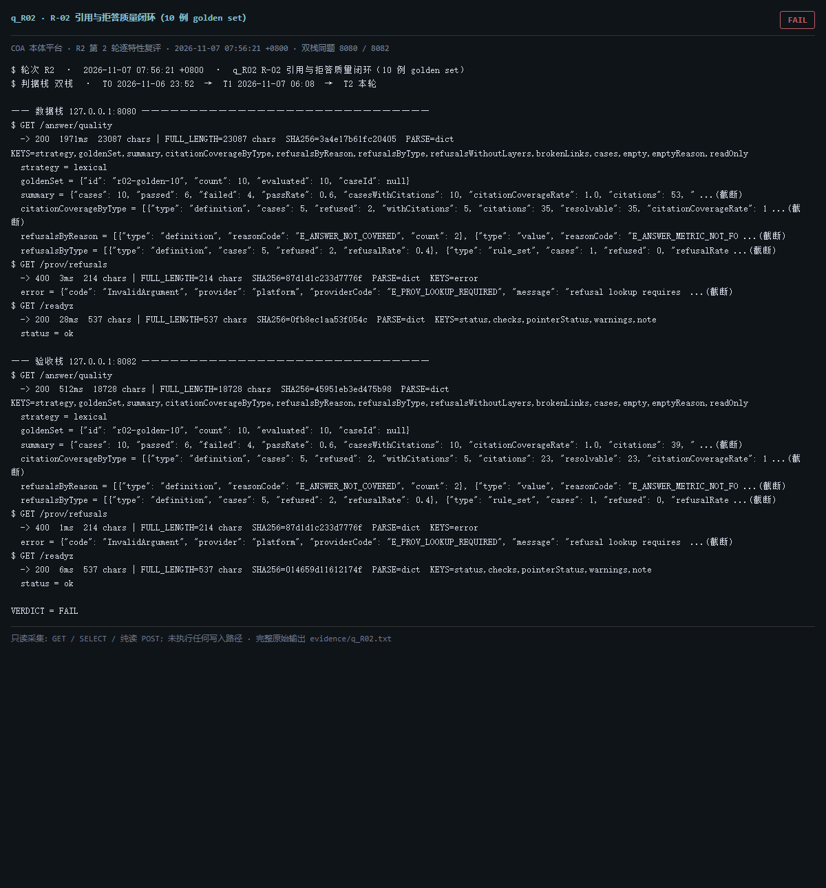

# q_R02 · R-02 引用与拒答质量闭环（10 例 golden set）

| 项 | 内容 |
| --- | --- |
| 用例编号 | `q_R02` |
| 特性名称 | R-02 引用与拒答质量闭环（10 例 golden set） |
| 分组 | D 本轮特性 R 检索问答 |
| 文档依据 | 52 §4.3 R-02 |
| **评估轮次** | **R2（第 2 轮复评）** |
| **本轮采集时间 T2** | **2026-11-07 07:56:21 +0800** |
| **判据栈** | 双栈 |
| 结论（T2） | **FAIL** |
| 证据截图 |  |
| 完整原始输出 | `evidence/q_R02.txt` |

## 0 时间区分（本轮新增）

> 同一特性在不同时间点、不同栈上的状态不同，结论必须带坐标。T0/T1 的旧产物完整保存在
> `_history/2026-11-06_2352/`，独立复核见 `../_evidence-audit/qa_verdict_recheck.md`。

| 轮次 | 时间 | 栈 / 代码基线 | 结论 | 说明 |
| --- | --- | --- | --- | --- |
| **T0 原始采集** | 2026-11-06 23:52 +08 | 数据栈 8080 · 旧镜像 | FAIL | R1 采集器，存在 200KB 静默截断与写死结论 |
| **T1 独立复核 / 修复基线** | 2026-11-07 05:45–06:08 +08 | 验收栈 8082 · `8b3f36f` | FAIL | 复核定性：文案错 |
| **T2 本轮复评** | 2026-11-07 07:56:21 +0800 | 数据栈 8080 + 验收栈 8082 双栈同题 | **FAIL** | 采集器已修截断、verdict 由证据动态推导 |

栈说明：
- **数据栈 8080**：镜像 `715d59e8`（11-07 00:53 +08 构建），全量数据，用于验证「数据内容 / 规模」类判据。注意 T0(11-06 23:52) 时 8080 跑的是更早的镜像，容器在 00:53 被重建过，**同一端口跨时间也不是同一个基线**。
- **验收栈 8082**：镜像 `80cb274f` / `agent-platform:0.1-s5`（11-07 05:45 +08 构建），代码等价 `8b3f36f`，验收残留小库，用于验证「代码行为 / 契约」类判据。
- 验收栈 A-Box 为空导致的 `404 / 0` 不判为功能缺陷；两栈版本不同属独立数据库，不计为漂移。

## 1 测试目标

验证 golden set 10 例通过率、citation 覆盖率、断链率、拒答原因是否达标。

## 2 输入

- `GET /answer/quality`
- `GET /prov/refusals（非法参数，验证错误码）`

> 零污染约束：仅 HTTP GET、只读 SQL `SELECT`、只读 SPARQL `SELECT`、一个已确认不写库的纯读
> `POST /context/resolve`。未调用 `/answer`（会写 PROV 拒答事件），未运行 smoke/acceptance，
> 未触发 seed / refresh / import / materialize / approve / publish / reindex / rollback。
> 验收栈 SPARQL 因 A-Box 为空显式标注 `SKIP`，不做无意义的图查询。

## 3 期待输出

按判据「10 例通过；拒答必带缺层；citation 覆盖按类型统计；断链率不退化」。

## 4 真实输出（T2 · 双栈同题）

### 4.1 数据栈 127.0.0.1:8080（全量数据 / 旧代码）

```
$ GET /answer/quality
  -> 200  1971ms  23087 chars | FULL_LENGTH=23087 chars  SHA256=3a4e17b61fc20405  PARSE=dict  KEYS=strategy,goldenSet,summary,citationCoverageByType,refusalsByReason,refusalsByType,refusalsWithoutLayers,brokenLinks,cases,empty,emptyReason,readOnly
  strategy = lexical
  goldenSet = {"id": "r02-golden-10", "count": 10, "evaluated": 10, "caseId": null}
  summary = {"cases": 10, "passed": 6, "failed": 4, "passRate": 0.6, "casesWithCitations": 10, "citationCoverageRate": 1.0, "citations": 53, " ...(截断)
  citationCoverageByType = [{"type": "definition", "cases": 5, "refused": 2, "withCitations": 5, "citations": 35, "resolvable": 35, "citationCoverageRate": 1 ...(截断)
  refusalsByReason = [{"type": "definition", "reasonCode": "E_ANSWER_NOT_COVERED", "count": 2}, {"type": "value", "reasonCode": "E_ANSWER_METRIC_NOT_FO ...(截断)
  refusalsByType = [{"type": "definition", "cases": 5, "refused": 2, "refusalRate": 0.4}, {"type": "rule_set", "cases": 1, "refused": 0, "refusalRate ...(截断)
$ GET /prov/refusals
  -> 400  3ms  214 chars | FULL_LENGTH=214 chars  SHA256=87d1d1c233d7776f  PARSE=dict  KEYS=error
  error = {"code": "InvalidArgument", "provider": "platform", "providerCode": "E_PROV_LOOKUP_REQUIRED", "message": "refusal lookup requires  ...(截断)
$ GET /readyz
  -> 200  28ms  537 chars | FULL_LENGTH=537 chars  SHA256=0fb8ec1aa53f054c  PARSE=dict  KEYS=status,checks,pointerStatus,warnings,note
  status = ok
  checks = {"database": {"status": "ok"}, "graph": {"status": "ok"}, "storage": {"status": "ok", "disk_free_pct": 32.64}}
  pointerStatus = {"name": "tbox/current", "ok": true, "level": "ok", "status": "published", "versionId": "ont-11f92ebb3326", "semver": "1.2.1", "tr ...(截断)
  warnings = []
  note = pointerStatus 仅告警，不参与就绪状态码（避免启动即崩）
$ GET /status
  -> 200  642ms  11200 chars | FULL_LENGTH=11200 chars  SHA256=e7dc32324bc2d0e8  PARSE=dict  KEYS=status,version,slice,mode,runtime_mode,config_version,config_file,providers,not_implemented,degraded,storage,graph
  status = ok
  version = 0.1.0
  slice = S13
  mode = single
  runtime_mode = learn
  config_version = 1
```

### 4.2 验收栈 127.0.0.1:8082（新代码 8b3f36f / 小库）

```
$ GET /answer/quality
  -> 200  512ms  18728 chars | FULL_LENGTH=18728 chars  SHA256=45951eb3ed475b98  PARSE=dict  KEYS=strategy,goldenSet,summary,citationCoverageByType,refusalsByReason,refusalsByType,refusalsWithoutLayers,brokenLinks,cases,empty,emptyReason,readOnly
  strategy = lexical
  goldenSet = {"id": "r02-golden-10", "count": 10, "evaluated": 10, "caseId": null}
  summary = {"cases": 10, "passed": 6, "failed": 4, "passRate": 0.6, "casesWithCitations": 10, "citationCoverageRate": 1.0, "citations": 39, " ...(截断)
  citationCoverageByType = [{"type": "definition", "cases": 5, "refused": 2, "withCitations": 5, "citations": 23, "resolvable": 23, "citationCoverageRate": 1 ...(截断)
  refusalsByReason = [{"type": "definition", "reasonCode": "E_ANSWER_NOT_COVERED", "count": 2}, {"type": "value", "reasonCode": "E_ANSWER_METRIC_NOT_FO ...(截断)
  refusalsByType = [{"type": "definition", "cases": 5, "refused": 2, "refusalRate": 0.4}, {"type": "rule_set", "cases": 1, "refused": 0, "refusalRate ...(截断)
$ GET /prov/refusals
  -> 400  1ms  214 chars | FULL_LENGTH=214 chars  SHA256=87d1d1c233d7776f  PARSE=dict  KEYS=error
  error = {"code": "InvalidArgument", "provider": "platform", "providerCode": "E_PROV_LOOKUP_REQUIRED", "message": "refusal lookup requires  ...(截断)
$ GET /readyz
  -> 200  6ms  537 chars | FULL_LENGTH=537 chars  SHA256=014659d11612174f  PARSE=dict  KEYS=status,checks,pointerStatus,warnings,note
  status = ok
  checks = {"database": {"status": "ok"}, "graph": {"status": "ok"}, "storage": {"status": "ok", "disk_free_pct": 32.64}}
  pointerStatus = {"name": "tbox/current", "ok": true, "level": "ok", "status": "published", "versionId": "ont-6e81732555e5", "semver": "0.0.0", "tr ...(截断)
  warnings = []
  note = pointerStatus 仅告警，不参与就绪状态码（避免启动即崩）
$ GET /status
  -> 200  58ms  11356 chars | FULL_LENGTH=11356 chars  SHA256=406a3270929bc0c9  PARSE=dict  KEYS=status,version,slice,mode,runtime_mode,config_version,config_file,providers,not_implemented,degraded,storage,graph
  status = ok
  version = 0.1.0
  slice = S13
  mode = single
  runtime_mode = learn
  config_version = 1
```

> 完整响应（含 `FULL_LENGTH` / `SHA256` / 结构化摘要，超大正文显式标记 `[BODY OMITTED]`）见
> `evidence/q_R02.txt`；终端渲染截图见 `screenshots/q_R02.png`。

## 5 结论

**FAIL** — 平台自报 golden set：数据栈 cases=10、passed=6、failed=4、passRate=0.6、citationResolvableRate=1.0、brokenLinkRate=0.0、regression=False；验收栈 passed=6、brokenLinkRate=0.0、regression=False。断链与回归在新代码上已修复，但 10 例仍未全过，判据「10 例通过」不成立。

时间区分：T0 断链率 0.3774 / regression=true；T1(51d3d76、0046bc5) 后降到 0.0 / false；passRate 始终 0.6。R1 文案把修复后的值提前写进 T0 证据页，本轮已按实测重写。

---
[返回总报告](README.md) · [T0 归档](<_history/2026-11-06_2352/q_R02_R-02 引用与拒答质量闭环（10 例 golden set）.md>)
