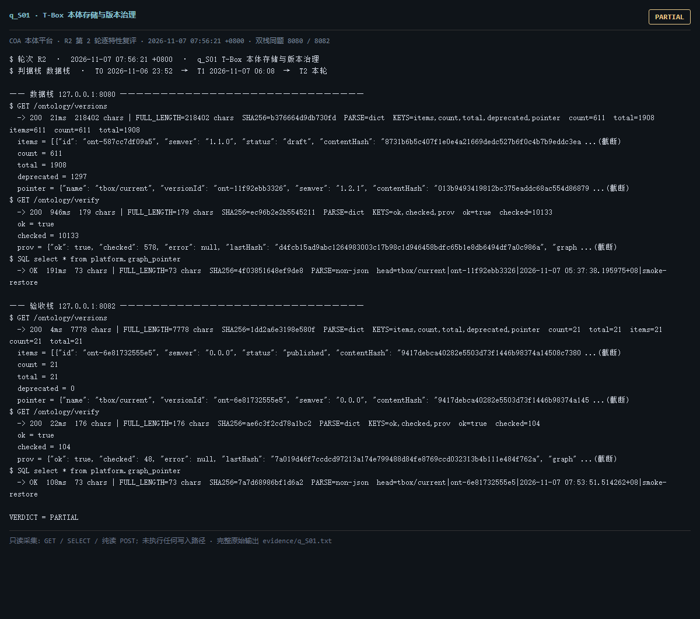

# q_S01 · T-Box 本体存储与版本治理

| 项 | 内容 |
| --- | --- |
| 用例编号 | `q_S01` |
| 特性名称 | T-Box 本体存储与版本治理 |
| 分组 | A 核心工作流 S0-S14 |
| 文档依据 | 10-实施路线图.md S1；S11；52 §4.1 O-02 |
| **评估轮次** | **R2（第 2 轮复评）** |
| **本轮采集时间 T2** | **2026-11-07 07:56:21 +0800** |
| **判据栈** | 数据栈 |
| 结论（T2） | **PARTIAL** |
| 证据截图 |  |
| 完整原始输出 | `evidence/q_S01.txt` |

## 0 时间区分（本轮新增）

> 同一特性在不同时间点、不同栈上的状态不同，结论必须带坐标。T0/T1 的旧产物完整保存在
> `_history/2026-11-06_2352/`，独立复核见 `../_evidence-audit/qa_verdict_recheck.md`。

| 轮次 | 时间 | 栈 / 代码基线 | 结论 | 说明 |
| --- | --- | --- | --- | --- |
| **T0 原始采集** | 2026-11-06 23:52 +08 | 数据栈 8080 · 旧镜像 | PARTIAL | R1 采集器，存在 200KB 静默截断与写死结论 |
| **T1 独立复核 / 修复基线** | 2026-11-07 05:45–06:08 +08 | 验收栈 8082 · `8b3f36f` | 不可采信 | 复核定性：不可采信 |
| **T2 本轮复评** | 2026-11-07 07:56:21 +0800 | 数据栈 8080 + 验收栈 8082 双栈同题 | **PARTIAL** | 采集器已修截断、verdict 由证据动态推导 |

栈说明：
- **数据栈 8080**：镜像 `715d59e8`（11-07 00:53 +08 构建），全量数据，用于验证「数据内容 / 规模」类判据。注意 T0(11-06 23:52) 时 8080 跑的是更早的镜像，容器在 00:53 被重建过，**同一端口跨时间也不是同一个基线**。
- **验收栈 8082**：镜像 `80cb274f` / `agent-platform:0.1-s5`（11-07 05:45 +08 构建），代码等价 `8b3f36f`，验收残留小库，用于验证「代码行为 / 契约」类判据。
- 验收栈 A-Box 为空导致的 `404 / 0` 不判为功能缺陷；两栈版本不同属独立数据库，不计为漂移。

## 1 测试目标

验证 T-Box 以命名图形式存入图库、版本可枚举、当前指针可读、审计链可校验。

## 2 输入

- `GET /ontology/versions`
- `GET /ontology/verify`
- `SQL: SELECT * FROM platform.graph_pointer`
- `SQL: SELECT max(version) FROM platform.schema_version`

> 零污染约束：仅 HTTP GET、只读 SQL `SELECT`、只读 SPARQL `SELECT`、一个已确认不写库的纯读
> `POST /context/resolve`。未调用 `/answer`（会写 PROV 拒答事件），未运行 smoke/acceptance，
> 未触发 seed / refresh / import / materialize / approve / publish / reindex / rollback。
> 验收栈 SPARQL 因 A-Box 为空显式标注 `SKIP`，不做无意义的图查询。

## 3 期待输出

存在大量 ontology_version 记录；/ontology/verify ok=true；graph_pointer 只有唯一 tbox/current 且 version_id 指向已发布版本；关系 schema 版本与代码迁移头一致。

## 4 真实输出（T2 · 双栈同题）

### 4.1 数据栈 127.0.0.1:8080（全量数据 / 旧代码）

```
$ GET /ontology/versions
  -> 200  21ms  218402 chars | FULL_LENGTH=218402 chars  SHA256=b376664d9db730fd  PARSE=dict  KEYS=items,count,total,deprecated,pointer  count=611  total=1908  items=611  count=611  total=1908
  items = [{"id": "ont-587cc7df09a5", "semver": "1.1.0", "status": "draft", "contentHash": "8731b6b5c407f1e0e4a21669dedc527b6f0c4b7b9eddc3ea ...(截断)
  count = 611
  total = 1908
  deprecated = 1297
  pointer = {"name": "tbox/current", "versionId": "ont-11f92ebb3326", "semver": "1.2.1", "contentHash": "013b9493419812bc375eaddc68ac554d86879 ...(截断)
$ GET /ontology/verify
  -> 200  946ms  179 chars | FULL_LENGTH=179 chars  SHA256=ec96b2e2b5545211  PARSE=dict  KEYS=ok,checked,prov  ok=true  checked=10133
  ok = true
  checked = 10133
  prov = {"ok": true, "checked": 578, "error": null, "lastHash": "d4fcb15ad9abc1264983003c17b98c1d946458bdfc65b1e8db6494df7a0c986a", "graph ...(截断)
$ SQL select * from platform.graph_pointer
  -> OK  191ms  73 chars | FULL_LENGTH=73 chars  SHA256=4f03851648ef9de8  PARSE=non-json  head=tbox/current|ont-11f92ebb3326|2026-11-07 05:37:38.195975+08|smoke-restore
  tbox/current|ont-11f92ebb3326|2026-11-07 05:37:38.195975+08|smoke-restore
$ SQL select max(version) from platform.schema_version
  -> OK  193ms  2 chars | FULL_LENGTH=2 chars  SHA256=86e5014965866131  PARSE=non-json  head=34
  34
$ GET /readyz
  -> 200  28ms  537 chars | FULL_LENGTH=537 chars  SHA256=0fb8ec1aa53f054c  PARSE=dict  KEYS=status,checks,pointerStatus,warnings,note
  status = ok
  checks = {"database": {"status": "ok"}, "graph": {"status": "ok"}, "storage": {"status": "ok", "disk_free_pct": 32.64}}
  pointerStatus = {"name": "tbox/current", "ok": true, "level": "ok", "status": "published", "versionId": "ont-11f92ebb3326", "semver": "1.2.1", "tr ...(截断)
  warnings = []
  note = pointerStatus 仅告警，不参与就绪状态码（避免启动即崩）
$ GET /status
```

### 4.2 验收栈 127.0.0.1:8082（新代码 8b3f36f / 小库）

```
$ GET /ontology/versions
  -> 200  4ms  7778 chars | FULL_LENGTH=7778 chars  SHA256=1dd2a6e3198e580f  PARSE=dict  KEYS=items,count,total,deprecated,pointer  count=21  total=21  items=21  count=21  total=21
  items = [{"id": "ont-6e81732555e5", "semver": "0.0.0", "status": "published", "contentHash": "9417debca40282e5503d73f1446b98374a14508c7380 ...(截断)
  count = 21
  total = 21
  deprecated = 0
  pointer = {"name": "tbox/current", "versionId": "ont-6e81732555e5", "semver": "0.0.0", "contentHash": "9417debca40282e5503d73f1446b98374a145 ...(截断)
$ GET /ontology/verify
  -> 200  22ms  176 chars | FULL_LENGTH=176 chars  SHA256=ae6c3f2cd78a1bc2  PARSE=dict  KEYS=ok,checked,prov  ok=true  checked=104
  ok = true
  checked = 104
  prov = {"ok": true, "checked": 48, "error": null, "lastHash": "7a019d46f7ccdcd97213a174e799488d84fe8769ccd032313b4b111e484f762a", "graph" ...(截断)
$ SQL select * from platform.graph_pointer
  -> OK  108ms  73 chars | FULL_LENGTH=73 chars  SHA256=7a7d68986bf1d6a2  PARSE=non-json  head=tbox/current|ont-6e81732555e5|2026-11-07 07:53:51.514262+08|smoke-restore
  tbox/current|ont-6e81732555e5|2026-11-07 07:53:51.514262+08|smoke-restore
$ SQL select max(version) from platform.schema_version
  -> OK  103ms  2 chars | FULL_LENGTH=2 chars  SHA256=d59eced1ded07f84  PARSE=non-json  head=40
  40
$ GET /readyz
  -> 200  6ms  537 chars | FULL_LENGTH=537 chars  SHA256=014659d11612174f  PARSE=dict  KEYS=status,checks,pointerStatus,warnings,note
  status = ok
  checks = {"database": {"status": "ok"}, "graph": {"status": "ok"}, "storage": {"status": "ok", "disk_free_pct": 32.64}}
  pointerStatus = {"name": "tbox/current", "ok": true, "level": "ok", "status": "published", "versionId": "ont-6e81732555e5", "semver": "0.0.0", "tr ...(截断)
  warnings = []
  note = pointerStatus 仅告警，不参与就绪状态码（避免启动即崩）
$ GET /status
```

> 完整响应（含 `FULL_LENGTH` / `SHA256` / 结构化摘要，超大正文显式标记 `[BODY OMITTED]`）见
> `evidence/q_S01.txt`；终端渲染截图见 `screenshots/q_S01.png`。

## 5 结论

**PARTIAL** — R1 的 200KB 静默截断已修复：/ontology/versions 完整长度 218402 chars，解析出 total=1908、本页返回 count=611、pointer.versionId=ont-11f92ebb3326；与 /browse/ontology/tree=ont-11f92ebb3326、/reasoning/status=ont-11f92ebb3326、terms.coverage.graph 内含 ont-11f92ebb3326 一致。/prov/verify 与 /ontology/verify 均 ok=true。验收栈同端点 total=21。

不可判定的根因（R1）是采集器缺陷，本轮已消除；仍判 PARTIAL 是因为 tbox/current 由外部 smoke-restore 反复改写（T0 23:51、T2 05:37），版本切换并非原子事务。

---
[返回总报告](README.md) · [T0 归档](<_history/2026-11-06_2352/q_S01_T-Box 本体存储与版本治理.md>)
