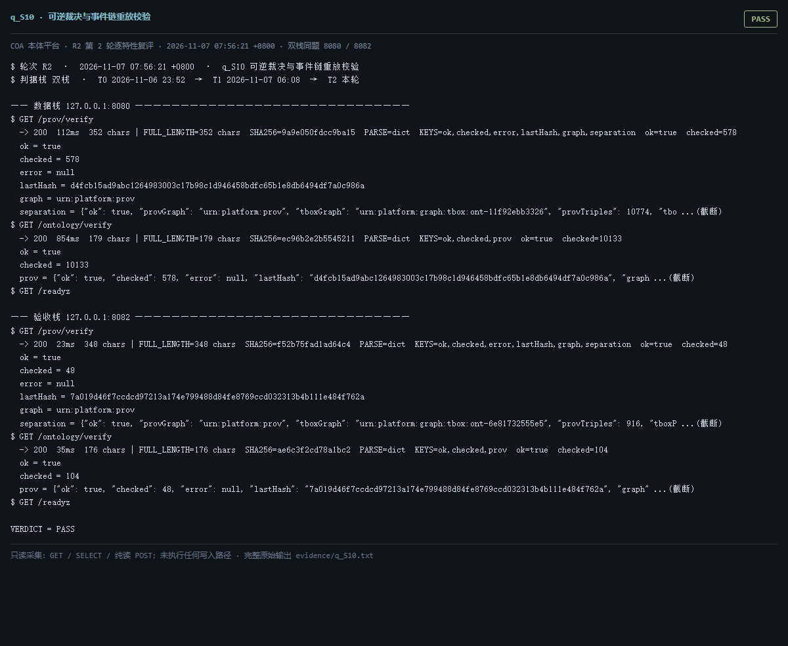

# q_S10 · 可逆裁决与事件链重放校验

| 项 | 内容 |
| --- | --- |
| 用例编号 | `q_S10` |
| 特性名称 | 可逆裁决与事件链重放校验 |
| 分组 | A 核心工作流 S0-S14 |
| 文档依据 | 10-实施路线图.md S10；29-S0-S14-收尾验收清单.md |
| **评估轮次** | **R2（第 2 轮复评）** |
| **本轮采集时间 T2** | **2026-11-07 07:56:21 +0800** |
| **判据栈** | 双栈 |
| 结论（T2） | **PASS** |
| 证据截图 |  |
| 完整原始输出 | `evidence/q_S10.txt` |

## 0 时间区分（本轮新增）

> 同一特性在不同时间点、不同栈上的状态不同，结论必须带坐标。T0/T1 的旧产物完整保存在
> `_history/2026-11-06_2352/`，独立复核见 `../_evidence-audit/qa_verdict_recheck.md`。

| 轮次 | 时间 | 栈 / 代码基线 | 结论 | 说明 |
| --- | --- | --- | --- | --- |
| **T0 原始采集** | 2026-11-06 23:52 +08 | 数据栈 8080 · 旧镜像 | PASS | R1 采集器，存在 200KB 静默截断与写死结论 |
| **T1 独立复核 / 修复基线** | 2026-11-07 05:45–06:08 +08 | 验收栈 8082 · `8b3f36f` | PARTIAL(采集时失败，T1 已恢复) | 复核定性：已修复 |
| **T2 本轮复评** | 2026-11-07 07:56:21 +0800 | 数据栈 8080 + 验收栈 8082 双栈同题 | **PASS** | 采集器已修截断、verdict 由证据动态推导 |

栈说明：
- **数据栈 8080**：镜像 `715d59e8`（11-07 00:53 +08 构建），全量数据，用于验证「数据内容 / 规模」类判据。注意 T0(11-06 23:52) 时 8080 跑的是更早的镜像，容器在 00:53 被重建过，**同一端口跨时间也不是同一个基线**。
- **验收栈 8082**：镜像 `80cb274f` / `agent-platform:0.1-s5`（11-07 05:45 +08 构建），代码等价 `8b3f36f`，验收残留小库，用于验证「代码行为 / 契约」类判据。
- 验收栈 A-Box 为空导致的 `404 / 0` 不判为功能缺陷；两栈版本不同属独立数据库，不计为漂移。

## 1 测试目标

验证 PROV 哈希链与本体事件链都能离线校验通过，且 PROV 图与 T-Box 图严格分离。

## 2 输入

- `GET /prov/verify`
- `GET /ontology/verify`

> 零污染约束：仅 HTTP GET、只读 SQL `SELECT`、只读 SPARQL `SELECT`、一个已确认不写库的纯读
> `POST /context/resolve`。未调用 `/answer`（会写 PROV 拒答事件），未运行 smoke/acceptance，
> 未触发 seed / refresh / import / materialize / approve / publish / reindex / rollback。
> 验收栈 SPARQL 因 A-Box 为空显式标注 `SKIP`，不做无意义的图查询。

## 3 期待输出

两者 ok=true；prov separation.ok=true 且 tboxGraph 内 PROV 谓词计数为 0。

## 4 真实输出（T2 · 双栈同题）

### 4.1 数据栈 127.0.0.1:8080（全量数据 / 旧代码）

```
$ GET /prov/verify
  -> 200  112ms  352 chars | FULL_LENGTH=352 chars  SHA256=9a9e050fdcc9ba15  PARSE=dict  KEYS=ok,checked,error,lastHash,graph,separation  ok=true  checked=578
  ok = true
  checked = 578
  error = null
  lastHash = d4fcb15ad9abc1264983003c17b98c1d946458bdfc65b1e8db6494df7a0c986a
  graph = urn:platform:prov
  separation = {"ok": true, "provGraph": "urn:platform:prov", "tboxGraph": "urn:platform:graph:tbox:ont-11f92ebb3326", "provTriples": 10774, "tbo ...(截断)
$ GET /ontology/verify
  -> 200  854ms  179 chars | FULL_LENGTH=179 chars  SHA256=ec96b2e2b5545211  PARSE=dict  KEYS=ok,checked,prov  ok=true  checked=10133
  ok = true
  checked = 10133
  prov = {"ok": true, "checked": 578, "error": null, "lastHash": "d4fcb15ad9abc1264983003c17b98c1d946458bdfc65b1e8db6494df7a0c986a", "graph ...(截断)
$ GET /readyz
  -> 200  28ms  537 chars | FULL_LENGTH=537 chars  SHA256=0fb8ec1aa53f054c  PARSE=dict  KEYS=status,checks,pointerStatus,warnings,note
  status = ok
  checks = {"database": {"status": "ok"}, "graph": {"status": "ok"}, "storage": {"status": "ok", "disk_free_pct": 32.64}}
  pointerStatus = {"name": "tbox/current", "ok": true, "level": "ok", "status": "published", "versionId": "ont-11f92ebb3326", "semver": "1.2.1", "tr ...(截断)
  warnings = []
  note = pointerStatus 仅告警，不参与就绪状态码（避免启动即崩）
$ GET /status
  -> 200  642ms  11200 chars | FULL_LENGTH=11200 chars  SHA256=e7dc32324bc2d0e8  PARSE=dict  KEYS=status,version,slice,mode,runtime_mode,config_version,config_file,providers,not_implemented,degraded,storage,graph
  status = ok
  version = 0.1.0
  slice = S13
  mode = single
```

### 4.2 验收栈 127.0.0.1:8082（新代码 8b3f36f / 小库）

```
$ GET /prov/verify
  -> 200  23ms  348 chars | FULL_LENGTH=348 chars  SHA256=f52b75fad1ad64c4  PARSE=dict  KEYS=ok,checked,error,lastHash,graph,separation  ok=true  checked=48
  ok = true
  checked = 48
  error = null
  lastHash = 7a019d46f7ccdcd97213a174e799488d84fe8769ccd032313b4b111e484f762a
  graph = urn:platform:prov
  separation = {"ok": true, "provGraph": "urn:platform:prov", "tboxGraph": "urn:platform:graph:tbox:ont-6e81732555e5", "provTriples": 916, "tboxP ...(截断)
$ GET /ontology/verify
  -> 200  35ms  176 chars | FULL_LENGTH=176 chars  SHA256=ae6c3f2cd78a1bc2  PARSE=dict  KEYS=ok,checked,prov  ok=true  checked=104
  ok = true
  checked = 104
  prov = {"ok": true, "checked": 48, "error": null, "lastHash": "7a019d46f7ccdcd97213a174e799488d84fe8769ccd032313b4b111e484f762a", "graph" ...(截断)
$ GET /readyz
  -> 200  6ms  537 chars | FULL_LENGTH=537 chars  SHA256=014659d11612174f  PARSE=dict  KEYS=status,checks,pointerStatus,warnings,note
  status = ok
  checks = {"database": {"status": "ok"}, "graph": {"status": "ok"}, "storage": {"status": "ok", "disk_free_pct": 32.64}}
  pointerStatus = {"name": "tbox/current", "ok": true, "level": "ok", "status": "published", "versionId": "ont-6e81732555e5", "semver": "0.0.0", "tr ...(截断)
  warnings = []
  note = pointerStatus 仅告警，不参与就绪状态码（避免启动即崩）
$ GET /status
  -> 200  58ms  11356 chars | FULL_LENGTH=11356 chars  SHA256=406a3270929bc0c9  PARSE=dict  KEYS=status,version,slice,mode,runtime_mode,config_version,config_file,providers,not_implemented,degraded,storage,graph
  status = ok
  version = 0.1.0
  slice = S13
  mode = single
```

> 完整响应（含 `FULL_LENGTH` / `SHA256` / 结构化摘要，超大正文显式标记 `[BODY OMITTED]`）见
> `evidence/q_S10.txt`；终端渲染截图见 `screenshots/q_S10.png`。

## 5 结论

**PASS** — T0 采集时 /prov/verify 曾 503 E_GRAPH_UNAVAILABLE（图库 DNS 暂时不可解析）；本轮两栈均 HTTP 200/200、ok=true、checked=578/48，T-Box/PROV 图分离字段存在、legacy 谓词为 0。

时间区分：这是 T0→T1 的图库可达性恢复（oxigraph 23:57:32 稳定），不是代码修复；checked 差异仅因两库 PROV 事件数不同。

---
[返回总报告](README.md) · [T0 归档](<_history/2026-11-06_2352/q_S10_可逆裁决与事件链重放校验.md>)
