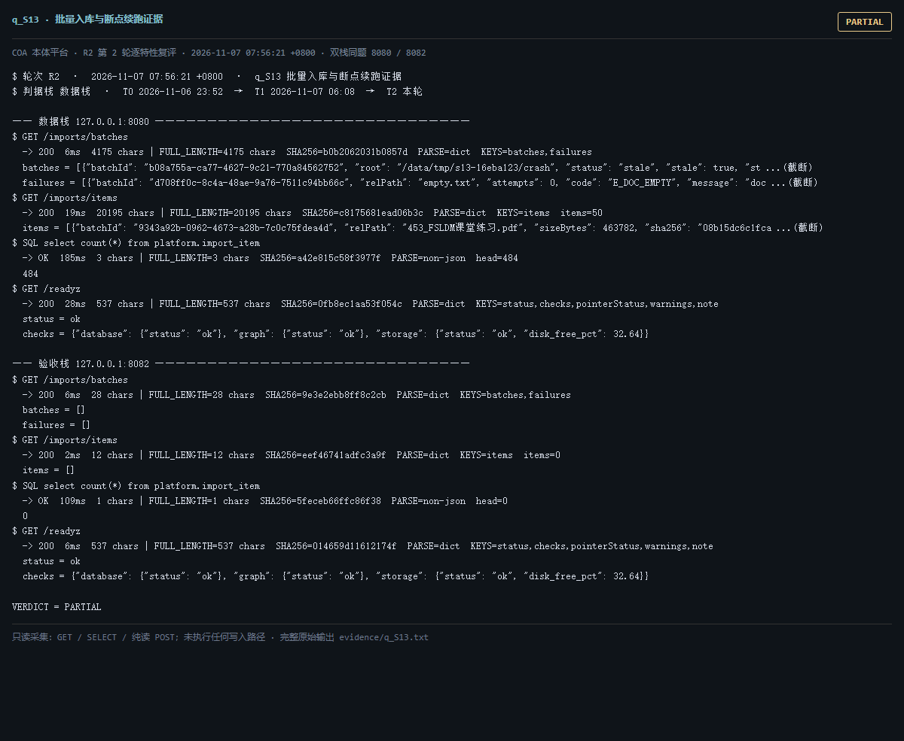

# q_S13 · 批量入库与断点续跑证据

| 项 | 内容 |
| --- | --- |
| 用例编号 | `q_S13` |
| 特性名称 | 批量入库与断点续跑证据 |
| 分组 | A 核心工作流 S0-S14 |
| 文档依据 | 10-实施路线图.md S13；_impl/WORKLOG |
| **评估轮次** | **R2（第 2 轮复评）** |
| **本轮采集时间 T2** | **2026-11-07 07:56:21 +0800** |
| **判据栈** | 数据栈 |
| 结论（T2） | **PARTIAL** |
| 证据截图 |  |
| 完整原始输出 | `evidence/q_S13.txt` |

## 0 时间区分（本轮新增）

> 同一特性在不同时间点、不同栈上的状态不同，结论必须带坐标。T0/T1 的旧产物完整保存在
> `_history/2026-11-06_2352/`，独立复核见 `../_evidence-audit/qa_verdict_recheck.md`。

| 轮次 | 时间 | 栈 / 代码基线 | 结论 | 说明 |
| --- | --- | --- | --- | --- |
| **T0 原始采集** | 2026-11-06 23:52 +08 | 数据栈 8080 · 旧镜像 | PASS | R1 采集器，存在 200KB 静默截断与写死结论 |
| **T1 独立复核 / 修复基线** | 2026-11-07 05:45–06:08 +08 | 验收栈 8082 · `8b3f36f` | PARTIAL | 复核定性：判定逻辑错 |
| **T2 本轮复评** | 2026-11-07 07:56:21 +0800 | 数据栈 8080 + 验收栈 8082 双栈同题 | **PARTIAL** | 采集器已修截断、verdict 由证据动态推导 |

栈说明：
- **数据栈 8080**：镜像 `715d59e8`（11-07 00:53 +08 构建），全量数据，用于验证「数据内容 / 规模」类判据。注意 T0(11-06 23:52) 时 8080 跑的是更早的镜像，容器在 00:53 被重建过，**同一端口跨时间也不是同一个基线**。
- **验收栈 8082**：镜像 `80cb274f` / `agent-platform:0.1-s5`（11-07 05:45 +08 构建），代码等价 `8b3f36f`，验收残留小库，用于验证「代码行为 / 契约」类判据。
- 验收栈 A-Box 为空导致的 `404 / 0` 不判为功能缺陷；两栈版本不同属独立数据库，不计为漂移。

## 1 测试目标

验证批量导入的批次、条目、失败隔离与进度信息可在只读端点查到。

## 2 输入

- `GET /imports/batches`
- `GET /imports/items`
- `SQL: SELECT count(*) FROM platform.import_item`

> 零污染约束：仅 HTTP GET、只读 SQL `SELECT`、只读 SPARQL `SELECT`、一个已确认不写库的纯读
> `POST /context/resolve`。未调用 `/answer`（会写 PROV 拒答事件），未运行 smoke/acceptance，
> 未触发 seed / refresh / import / materialize / approve / publish / reindex / rollback。
> 验收栈 SPARQL 因 A-Box 为空显式标注 `SKIP`，不做无意义的图查询。

## 3 期待输出

batches 含批次与 failures；items 非空；与 import_item 表计数一致。

## 4 真实输出（T2 · 双栈同题）

### 4.1 数据栈 127.0.0.1:8080（全量数据 / 旧代码）

```
$ GET /imports/batches
  -> 200  6ms  4175 chars | FULL_LENGTH=4175 chars  SHA256=b0b2062031b0857d  PARSE=dict  KEYS=batches,failures
  batches = [{"batchId": "b08a755a-ca77-4627-9c21-770a84562752", "root": "/data/tmp/s13-16eba123/crash", "status": "stale", "stale": true, "st ...(截断)
  failures = [{"batchId": "d708ff0c-8c4a-48ae-9a76-7511c94bb66c", "relPath": "empty.txt", "attempts": 0, "code": "E_DOC_EMPTY", "message": "doc ...(截断)
$ GET /imports/items
  -> 200  19ms  20195 chars | FULL_LENGTH=20195 chars  SHA256=c8175681ead06b3c  PARSE=dict  KEYS=items  items=50
  items = [{"batchId": "9343a92b-0962-4673-a28b-7c0c75fdea4d", "relPath": "453_FSLDM课堂练习.pdf", "sizeBytes": 463782, "sha256": "08b15dc6c1fca ...(截断)
$ SQL select count(*) from platform.import_item
  -> OK  185ms  3 chars | FULL_LENGTH=3 chars  SHA256=a42e815c58f3977f  PARSE=non-json  head=484
  484
$ GET /readyz
  -> 200  28ms  537 chars | FULL_LENGTH=537 chars  SHA256=0fb8ec1aa53f054c  PARSE=dict  KEYS=status,checks,pointerStatus,warnings,note
  status = ok
  checks = {"database": {"status": "ok"}, "graph": {"status": "ok"}, "storage": {"status": "ok", "disk_free_pct": 32.64}}
  pointerStatus = {"name": "tbox/current", "ok": true, "level": "ok", "status": "published", "versionId": "ont-11f92ebb3326", "semver": "1.2.1", "tr ...(截断)
  warnings = []
  note = pointerStatus 仅告警，不参与就绪状态码（避免启动即崩）
$ GET /status
  -> 200  642ms  11200 chars | FULL_LENGTH=11200 chars  SHA256=e7dc32324bc2d0e8  PARSE=dict  KEYS=status,version,slice,mode,runtime_mode,config_version,config_file,providers,not_implemented,degraded,storage,graph
  status = ok
  version = 0.1.0
  slice = S13
  mode = single
  runtime_mode = learn
  config_version = 1
$ GET /ontology/versions
```

### 4.2 验收栈 127.0.0.1:8082（新代码 8b3f36f / 小库）

```
$ GET /imports/batches
  -> 200  6ms  28 chars | FULL_LENGTH=28 chars  SHA256=9e3e2ebb8ff8c2cb  PARSE=dict  KEYS=batches,failures
  batches = []
  failures = []
$ GET /imports/items
  -> 200  2ms  12 chars | FULL_LENGTH=12 chars  SHA256=eef46741adfc3a9f  PARSE=dict  KEYS=items  items=0
  items = []
$ SQL select count(*) from platform.import_item
  -> OK  109ms  1 chars | FULL_LENGTH=1 chars  SHA256=5feceb66ffc86f38  PARSE=non-json  head=0
  0
$ GET /readyz
  -> 200  6ms  537 chars | FULL_LENGTH=537 chars  SHA256=014659d11612174f  PARSE=dict  KEYS=status,checks,pointerStatus,warnings,note
  status = ok
  checks = {"database": {"status": "ok"}, "graph": {"status": "ok"}, "storage": {"status": "ok", "disk_free_pct": 32.64}}
  pointerStatus = {"name": "tbox/current", "ok": true, "level": "ok", "status": "published", "versionId": "ont-6e81732555e5", "semver": "0.0.0", "tr ...(截断)
  warnings = []
  note = pointerStatus 仅告警，不参与就绪状态码（避免启动即崩）
$ GET /status
  -> 200  58ms  11356 chars | FULL_LENGTH=11356 chars  SHA256=406a3270929bc0c9  PARSE=dict  KEYS=status,version,slice,mode,runtime_mode,config_version,config_file,providers,not_implemented,degraded,storage,graph
  status = ok
  version = 0.1.0
  slice = S13
  mode = single
  runtime_mode = learn
  config_version = 1
$ GET /ontology/versions
```

> 完整响应（含 `FULL_LENGTH` / `SHA256` / 结构化摘要，超大正文显式标记 `[BODY OMITTED]`）见
> `evidence/q_S13.txt`；终端渲染截图见 `screenshots/q_S13.png`。

## 5 结论

**PARTIAL** — R1 判定逻辑错已修正：/imports/items 返回 50 条且无 total 字段，数据栈库内 import_item=None 条，验收栈 items=0 / 库 None。「条目数与库一致」不成立，仅能确认批次与条目结构可读。

复核 §3.2：分页子集被当成全量，PASS→PARTIAL。

---
[返回总报告](README.md) · [T0 归档](<_history/2026-11-06_2352/q_S13_批量入库与断点续跑证据.md>)
