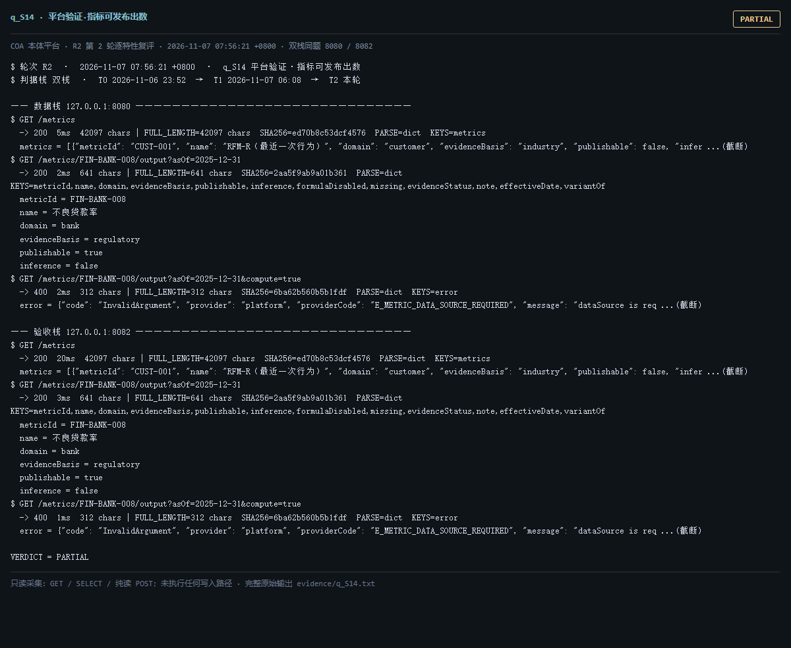

# q_S14 · 平台验证·指标可发布出数

| 项 | 内容 |
| --- | --- |
| 用例编号 | `q_S14` |
| 特性名称 | 平台验证·指标可发布出数 |
| 分组 | A 核心工作流 S0-S14 |
| 文档依据 | 10-实施路线图.md S14；52 §0；58 M-01 |
| **评估轮次** | **R2（第 2 轮复评）** |
| **本轮采集时间 T2** | **2026-11-07 07:56:21 +0800** |
| **判据栈** | 双栈 |
| 结论（T2） | **PARTIAL** |
| 证据截图 |  |
| 完整原始输出 | `evidence/q_S14.txt` |

## 0 时间区分（本轮新增）

> 同一特性在不同时间点、不同栈上的状态不同，结论必须带坐标。T0/T1 的旧产物完整保存在
> `_history/2026-11-06_2352/`，独立复核见 `../_evidence-audit/qa_verdict_recheck.md`。

| 轮次 | 时间 | 栈 / 代码基线 | 结论 | 说明 |
| --- | --- | --- | --- | --- |
| **T0 原始采集** | 2026-11-06 23:52 +08 | 数据栈 8080 · 旧镜像 | PARTIAL | R1 采集器，存在 200KB 静默截断与写死结论 |
| **T1 独立复核 / 修复基线** | 2026-11-07 05:45–06:08 +08 | 验收栈 8082 · `8b3f36f` | PARTIAL | 复核定性：一致 |
| **T2 本轮复评** | 2026-11-07 07:56:21 +0800 | 数据栈 8080 + 验收栈 8082 双栈同题 | **PARTIAL** | 采集器已修截断、verdict 由证据动态推导 |

栈说明：
- **数据栈 8080**：镜像 `715d59e8`（11-07 00:53 +08 构建），全量数据，用于验证「数据内容 / 规模」类判据。注意 T0(11-06 23:52) 时 8080 跑的是更早的镜像，容器在 00:53 被重建过，**同一端口跨时间也不是同一个基线**。
- **验收栈 8082**：镜像 `80cb274f` / `agent-platform:0.1-s5`（11-07 05:45 +08 构建），代码等价 `8b3f36f`，验收残留小库，用于验证「代码行为 / 契约」类判据。
- 验收栈 A-Box 为空导致的 `404 / 0` 不判为功能缺陷；两栈版本不同属独立数据库，不计为漂移。

## 1 测试目标

验证「可发布出数」是否真的成立：分别检查老的 /output?compute=true 主出数路径与 G2 新增的 /compute 路径，以及观测表是否有数据。

## 2 输入

- `GET /metrics`
- `GET /metrics/FIN-BANK-008/output?asOf=2025-12-31（默认只回定义卡）`
- `GET /metrics/FIN-BANK-008/output?asOf=2025-12-31&compute=true（可发布出数主路径）`
- `GET /metrics/FIN-BANK-008/compute?asOf=2025-12-31（G2 新端点，默认 dataSource）`
- `GET /metrics/FIN-BANK-008/compute?asOf=2025-12-31&dataSource=synthetic`
- `SQL: SELECT count(*) FROM platform.metric_observation`

> 零污染约束：仅 HTTP GET、只读 SQL `SELECT`、只读 SPARQL `SELECT`、一个已确认不写库的纯读
> `POST /context/resolve`。未调用 `/answer`（会写 PROV 拒答事件），未运行 smoke/acceptance，
> 未触发 seed / refresh / import / materialize / approve / publish / reindex / rollback。
> 验收栈 SPARQL 因 A-Box 为空显式标注 `SKIP`，不做无意义的图查询。

## 3 期待输出

按 S14 判据，应能对外给出一个数值、口径版本、窗口、样本数与可解析的 sourceRef；且 /compute 默认调用不应全部 noData=true。

## 4 真实输出（T2 · 双栈同题）

### 4.1 数据栈 127.0.0.1:8080（全量数据 / 旧代码）

```
$ GET /metrics
  -> 200  5ms  42097 chars | FULL_LENGTH=42097 chars  SHA256=ed70b8c53dcf4576  PARSE=dict  KEYS=metrics
  metrics = [{"metricId": "CUST-001", "name": "RFM-R（最近一次行为）", "domain": "customer", "evidenceBasis": "industry", "publishable": false, "infer ...(截断)
$ GET /metrics/FIN-BANK-008/output?asOf=2025-12-31
  -> 200  2ms  641 chars | FULL_LENGTH=641 chars  SHA256=2aa5f9ab9a01b361  PARSE=dict  KEYS=metricId,name,domain,evidenceBasis,publishable,inference,formulaDisabled,missing,evidenceStatus,note,effectiveDate,variantOf
  metricId = FIN-BANK-008
  name = 不良贷款率
  domain = bank
  evidenceBasis = regulatory
  publishable = true
  inference = false
$ GET /metrics/FIN-BANK-008/output?asOf=2025-12-31&compute=true
  -> 400  2ms  312 chars | FULL_LENGTH=312 chars  SHA256=6ba62b560b5b1fdf  PARSE=dict  KEYS=error
  error = {"code": "InvalidArgument", "provider": "platform", "providerCode": "E_METRIC_DATA_SOURCE_REQUIRED", "message": "dataSource is req ...(截断)
$ GET /metrics/FIN-BANK-008/compute?asOf=2025-12-31
  -> 400  2ms  312 chars | FULL_LENGTH=312 chars  SHA256=6ba62b560b5b1fdf  PARSE=dict  KEYS=error
  error = {"code": "InvalidArgument", "provider": "platform", "providerCode": "E_METRIC_DATA_SOURCE_REQUIRED", "message": "dataSource is req ...(截断)
$ GET /metrics/FIN-BANK-008/compute?asOf=2025-12-31&dataSource=synthetic
  -> 200  9ms  2911 chars | FULL_LENGTH=2911 chars  SHA256=a6d509479bc02bbe  PARSE=dict  KEYS=metricId,definitionVersion,windowKind,window,dataSource,rows,noData,rowCount,computedAt,computationRef  rows=20  rowCount=20  noData=false
  metricId = FIN-BANK-008
  definitionVersion = v3.0
  windowKind = instant
  window = {"start": "2025-12-31", "end": "2025-12-31"}
  dataSource = synthetic
  rows = [{"entityKey": "INST-SYN-01", "numerator": 0.0, "denominator": 30000000.0, "value": 0.0}, {"entityKey": "INST-SYN-02", "numerator" ...(截断)
$ SQL select count(*) from platform.metric_observation
```

### 4.2 验收栈 127.0.0.1:8082（新代码 8b3f36f / 小库）

```
$ GET /metrics
  -> 200  20ms  42097 chars | FULL_LENGTH=42097 chars  SHA256=ed70b8c53dcf4576  PARSE=dict  KEYS=metrics
  metrics = [{"metricId": "CUST-001", "name": "RFM-R（最近一次行为）", "domain": "customer", "evidenceBasis": "industry", "publishable": false, "infer ...(截断)
$ GET /metrics/FIN-BANK-008/output?asOf=2025-12-31
  -> 200  3ms  641 chars | FULL_LENGTH=641 chars  SHA256=2aa5f9ab9a01b361  PARSE=dict  KEYS=metricId,name,domain,evidenceBasis,publishable,inference,formulaDisabled,missing,evidenceStatus,note,effectiveDate,variantOf
  metricId = FIN-BANK-008
  name = 不良贷款率
  domain = bank
  evidenceBasis = regulatory
  publishable = true
  inference = false
$ GET /metrics/FIN-BANK-008/output?asOf=2025-12-31&compute=true
  -> 400  1ms  312 chars | FULL_LENGTH=312 chars  SHA256=6ba62b560b5b1fdf  PARSE=dict  KEYS=error
  error = {"code": "InvalidArgument", "provider": "platform", "providerCode": "E_METRIC_DATA_SOURCE_REQUIRED", "message": "dataSource is req ...(截断)
$ GET /metrics/FIN-BANK-008/compute?asOf=2025-12-31
  -> 400  1ms  312 chars | FULL_LENGTH=312 chars  SHA256=6ba62b560b5b1fdf  PARSE=dict  KEYS=error
  error = {"code": "InvalidArgument", "provider": "platform", "providerCode": "E_METRIC_DATA_SOURCE_REQUIRED", "message": "dataSource is req ...(截断)
$ GET /metrics/FIN-BANK-008/compute?asOf=2025-12-31&dataSource=synthetic
  -> 200  9ms  2911 chars | FULL_LENGTH=2911 chars  SHA256=a04402425ba63021  PARSE=dict  KEYS=metricId,definitionVersion,windowKind,window,dataSource,rows,noData,rowCount,computedAt,computationRef  rows=20  rowCount=20  noData=false
  metricId = FIN-BANK-008
  definitionVersion = v3.0
  windowKind = instant
  window = {"start": "2025-12-31", "end": "2025-12-31"}
  dataSource = synthetic
  rows = [{"entityKey": "INST-SYN-01", "numerator": 0.0, "denominator": 30000000.0, "value": 0.0}, {"entityKey": "INST-SYN-02", "numerator" ...(截断)
$ SQL select count(*) from platform.metric_observation
```

> 完整响应（含 `FULL_LENGTH` / `SHA256` / 结构化摘要，超大正文显式标记 `[BODY OMITTED]`）见
> `evidence/q_S14.txt`；终端渲染截图见 `screenshots/q_S14.png`。

## 5 结论

**PARTIAL** — 端到端出数在显式参数下成立：HTTP 200，value=61.253601136133085 %、sampleCount=20、dataSource=synthetic、sourceRef.ref 存在且 /source/resolve 实测 rowCount=5000。但默认 /output?compute=true 现在返回 400 E_METRIC_DATA_SOURCE_REQUIRED，/compute 默认同样 400 E_METRIC_DATA_SOURCE_REQUIRED：必须显式传 dataSource 才可用。metric_observation 两栈均 None 行。

时间区分：T0 时默认 /output?compute=true 直接出 61.25%；T1(9d75bcf) 起强制显式 dataSource，T2 默认改报 400。行为变化必须与时间点绑定叙述，否则结论会自相矛盾。

---
[返回总报告](README.md) · [T0 归档](<_history/2026-11-06_2352/q_S14_平台验证·指标可发布出数.md>)
